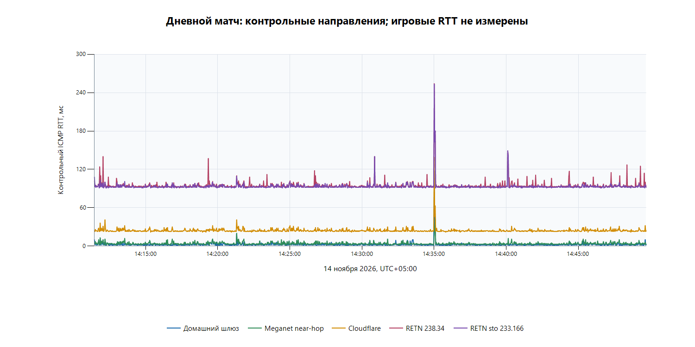
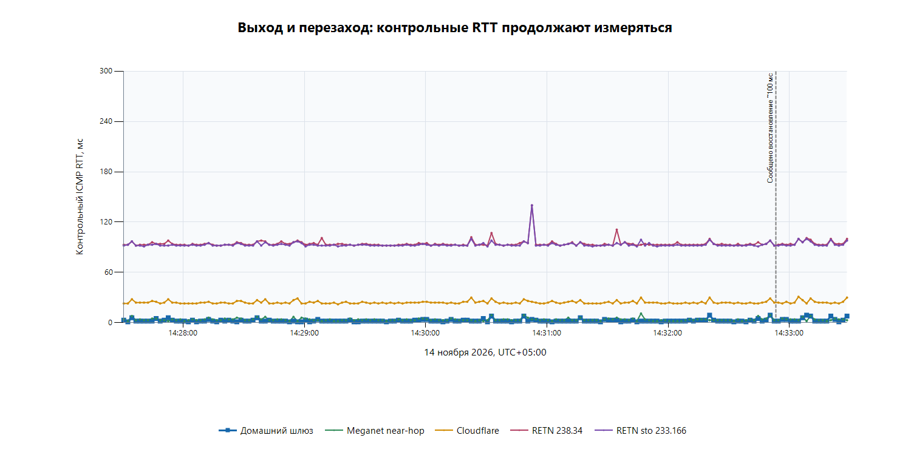
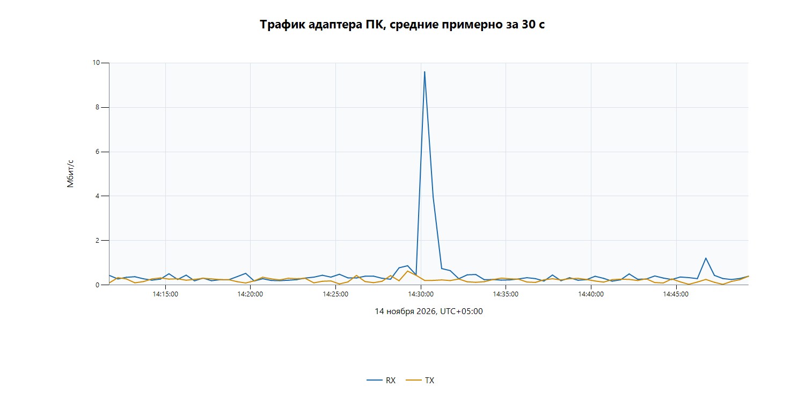
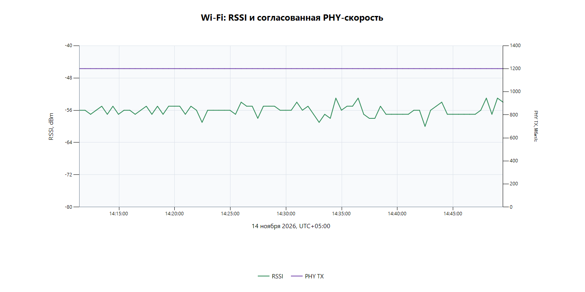

# Итог дневного матча Stockholm — 14 ноября 2026

**Дополнение RRT от 15 ноября:** [новый подробный анализ](RIOT-RRT-LOG-ANALYSIS.md) подтверждает восемь игровых Average Ping **328,12–383,31 мс** в 14:27:45.760–14:29:58.816 (+05) и 26 остановок репликации ввода/overflow. В этот интервал по 67/67 успешных ICMP на пять целей; конкретная причина остаётся неустановленной. Ниже сохранён прежний этап и его ограничения.

**Публичная обезличенная копия.** Числовые измерения, времена и целевые/транзитные IP сохранены. Личные сетевые идентификаторы и локальные пользовательские пути заменены стабильными обозначениями. Упоминаемые исходные размеры и хеши относятся к приватному источнику; актуальные публичные хеши — в SHA256SUMS.txt. Полные native ping/tracert сохранены побайтно. Подробнее — корневой PUBLICATION-NOTES.md.

**Проблема проявлялась как повторная нестабильность игрового RTT с частичными восстановлениями: по уточнению игрока 95 → 120 → 180 → 120 мс, позднее 300–400 мс. Длительные игровые 300–400 мс не сопровождались аналогичным ростом контрольных RTT. После самостоятельного перезапуска игрок сообщил ~100, затем стабильные 100–110 мс; одновременно изменился адрес подключения в игровом логе. Это существенная зацепка для проверки конкретного игрового пути/соединения, но она не отделяет маршрут от состояния клиента/сервера. Точная причина и источник UDP-потерь пока не установлены.**

Монитор остановлен после окончания игры в **2026-11-14T14:49:44.196+05:00**. Run `ee9e460bbe9743cda5e45f28ca24c633`; PID 32732 завершён, DONE durable=true. Начало 2026-11-14T14:11:26.498+05:00, длительность 2297.698 с. **1149 полных циклов, 5745 успешных ICMP-проб, 5988 записей.**

## 1. Происхождение и целостность

Непрерывный обычный пользовательский процесс, ICMPv4 32 байта каждые 2 с к пяти целям, timeout 1500 мс. Три сегмента ротировались без перезапуска. Sequence 1–5988 непрерывен, дубликатов и удалений нет. Все размеры, границы manifest и завершающие newline совпадают. Очередь записи и dropped=0; io_error=null; незавершённых проб нет. Исправленная после ночного этапа ошибка first_seq в этом запуске не повторилась.

UTC/local +05 согласованы; обратных ходов времени нет; максимальный интервал проб 2.147420 с, разброс запуска целей 9.0 мс, относительное wall/monotonic расхождение 0.902 мс. Это не независимая проверка абсолютных часов и не гарантия регистрации субсекундных событий.

Пользователь подтвердил рейтинговый Stockholm; агент не входил в матч и не управлял игрой. Metadata context=Unknown отражает ограниченный перечень launcher, а ручной контекст явно указывает ranked. Network RTT/loss автоматически из игры не читались. Все игровые числа ниже — сообщения игрока с известным временем внесения, но не точные секундные отсчёты.

## 2. Пять контрольных направлений

| Адрес | n | min | median | avg | p95 | max, мс | ICMP неответы |
|---|---|---|---|---|---|---|---|
| 192.168.123.1 | 1149 | 1 | 2 | 2.747 | 6 | 118 | 0 |
| 89.38.164.205 | 1149 | 2 | 3 | 3.976 | 8 | 43 | 0 |
| 1.1.1.1 | 1149 | 22 | 24 | 24.425 | 28 | 139 | 0 |
| 87.245.238.34 | 1149 | 91 | 93 | 94.822 | 100 | 254 | 0 |
| 87.245.233.166 | 1149 | 91 | 92 | 93.386 | 97 | 253 | 0 |



Пороги из прежних измерений: 15 / 16 / 38 / 109 / 106 мс, в порядке таблицы. Классы относятся к отдельным контрольным циклам, а не длительности плохой игры или проценту потерь.

| Класс | Циклов |
|---|---|
| transit_only_threshold | 22 |
| below_all_thresholds | 1122 |
| public_without_local_threshold | 1 |
| local_threshold | 4 |

## 3. Игровая хронология и ручные метки

Сохранено **107 F8 и 20 F9**, плюс ручные записи по сообщениям. Последовательные F8 до следующего F9/recovery сгруппированы: всего 21; закрыто 20, открыто к концу 1. Один F9 без открытого F8 сохранён отдельно. Нажатия не выдаются за независимые инциденты, числовой RTT или доказанное непрерывное состояние игры.

* Начало: 89–95 мс по сообщению игрока.
* В плотных F8 около 14:19–14:22: ретроспективно колебания 120–180 мс, повторные нажатия сопровождали колебания.
* Новая серия F8 с 14:27:50; в 14:29:10 внесено сообщение о стабильных 300–400 мс. Позже игрок оценил продолжительность примерно в пять минут. Точные границы неизвестны.
* В снимке 14:29:58 ещё PID 12840; в 14:30:28 и 14:30:58 игры нет; в 14:31:28 появился PID 23980. Это дискретные снимки, а не точные секунды выхода/входа.
* В 14:32:53 внесено сообщение ~100 мс после перезахода; в 14:42:38 — стабильные 100–110 мс.
* Последние F8 в 14:46:53/54, 14:48:17 и 14:48:40 игрок после матча связал с 120–130 мс. Потери в этом матче численно не сообщены.

### Уточнённый порядок колебаний до тяжёлого эпизода

**95 → 120 → 180 → 120 мс, затем позднее 300–400 мс** — ретроспективная последовательность со слов игрока, уточнённая после матча. Это неоднократные изменения задержки с периодическим частичным восстановлением, а не один изолированный скачок и не только постоянный высокий RTT. Возврат 180→120 является частичным: 120 всё ещё выше исходных ~95 мс. Точные секунды этих числовых переходов не записаны.

| Сохранённое время, +05:00 | Что действительно зафиксировано | Предел сопоставления |
|---|---|---|
| 14:14:08.511→14:14:15.215; 14:15:38.130→14:15:41.905; 14:15:47.842→14:15:53.398 | Отдельные группы F8→F9 до тяжёлого эпизода | Метки повторных ухудшений/восстановлений; чисел RTT внутри нажатий нет |
| 14:19:15.263–14:22:15.150 | Плотные серии F8 с промежуточными F9; ранее игрок связал их с колебаниями 120–180 | Согласуется с повторными изменениями и частичными восстановлениями; нельзя назначить конкретной F8/F9 значение 95, 120 или 180 |
| С 14:27:50.587; F8 также в 14:28:12.731 | Новая серия отметок ухудшения | Время нажатий известно; точный переход к 300–400 по ним не установлен |
| 14:29:10.353 | Внесено сообщение о продолжающихся 300–400 мс | Время внесения сообщения, не точная секунда начала 300–400 |

Контроли в плотном окне 14:19:15–14:22:15: по 90 проб на цель, медианы 2 / 4 / 24 / 94 / 93 мс, максимумы 19 / 20 / 41 / 137 / 109 мс. Максимумы могли прийтись на разные циклы. Синхронно 14:19:20.547: 2 / 3 / 24 / 137 / 92; 14:21:18.527: 19 / 20 / 41 / 110 / 109 мс. Эти измерения не дают числовой привязки к каждому игровому переходу 95→120→180→120. Наличие коротких контрольных всплесков не превращает весь период колебаний игры в один сетевой инцидент.

## 4. Сопоставление окон

Ниже контрольные min/median/max по каждому адресу. Выбранные окна — границы сообщений/меток; они не подменяют отсутствующий игровой временной ряд.

### Плотные F8, ретроспективно 120–180

2026-11-14T14:19:15.263+05:00 — 2026-11-14T14:22:15.150+05:00

| Цель | n | min / median / max, мс |
|---|---|---|
| 192.168.123.1 | 90 | 1 / 2.0 / 19 |
| 89.38.164.205 | 90 | 2 / 4.0 / 20 |
| 1.1.1.1 | 90 | 22 / 24.0 / 41 |
| 87.245.238.34 | 90 | 92 / 94.0 / 137 |
| 87.245.233.166 | 90 | 91 / 93.0 / 109 |

### После сообщения 300–400, до последнего снимка прежнего PID

2026-11-14T14:29:10.353+05:00 — 2026-11-14T14:29:58.079+05:00

| Цель | n | min / median / max, мс |
|---|---|---|
| 192.168.123.1 | 24 | 1 / 2.0 / 3 |
| 89.38.164.205 | 24 | 2 / 3.0 / 5 |
| 1.1.1.1 | 24 | 22 / 24.0 / 25 |
| 87.245.238.34 | 24 | 92 / 93.0 / 95 |
| 87.245.233.166 | 24 | 91 / 92.0 / 93 |

### После сообщения о восстановлении ~100

2026-11-14T14:32:53.416+05:00 — 2026-11-14T14:49:44.196+05:00

| Цель | n | min / median / max, мс |
|---|---|---|
| 192.168.123.1 | 505 | 1 / 2 / 118 |
| 89.38.164.205 | 505 | 2 / 3 / 43 |
| 1.1.1.1 | 505 | 22 / 24 / 139 |
| 87.245.238.34 | 505 | 92 / 93 / 254 |
| 87.245.233.166 | 505 | 91 / 92 / 253 |

### Последняя закрытая группа F8→F9, ретроспективно 120–130

2026-11-14T14:46:53.433+05:00 — 2026-11-14T14:48:19.919+05:00

| Цель | n | min / median / max, мс |
|---|---|---|
| 192.168.123.1 | 43 | 1 / 2 / 5 |
| 89.38.164.205 | 43 | 2 / 4 / 10 |
| 1.1.1.1 | 43 | 23 / 24 / 31 |
| 87.245.238.34 | 43 | 92 / 94 / 115 |
| 87.245.233.166 | 43 | 92 / 93 / 99 |

### Последняя незакрытая группа F8, ретроспективно 120–130

2026-11-14T14:48:40.169+05:00 — 2026-11-14T14:49:44.196+05:00

| Цель | n | min / median / max, мс |
|---|---|---|
| 192.168.123.1 | 32 | 1 / 2.0 / 10 |
| 89.38.164.205 | 32 | 2 / 4.0 / 9 |
| 1.1.1.1 | 32 | 23 / 24.0 / 32 |
| 87.245.238.34 | 32 | 92 / 94.0 / 125 |
| 87.245.233.166 | 32 | 91 / 93.0 / 98 |



Во время наиболее полезного короткого окна после сообщения 300–400 и до последнего снимка прежнего игрового процесса все пять контролей остаются близки к обычному уровню. Это не поддерживает гипотезу длительной общей задержки на ПК–шлюз–все измеренные направления. Но узлы RETN не являются подтверждённым игровым peer; специфический игровой/обратный путь и UDP могут отличаться.

Отдельный сильный локальный эпизод после восстановления: **14:35:00.503 — 118 / 16 / 139 / 254 / 253 мс**; затем 14:35:02 — 25 / 26 / 46 / 163 / 163, 14:35:04 — 41 / 43 / 63 / 180 / 180. Есть задержка уже до шлюза, но величины целей не идентичны. Это краткое локальное/общее явление, а не доказательство причины прежних игровых пяти минут 300–400. Ручной F8 около него нет. Wi-Fi, AP/роутер, планирование и сетевой стек ещё не разделены.

## 5. Что изменилось после перезахода

В сохранённой allowlist-выборке штатного игрового лога до выхода: **185.40.64.1:7004**, после: **162.249.72.1:7004**. Категории LogTravelManager/LogMapLoadModel, после также LogNet. Raw log times около 09:08:49–09:09:04 и 09:31:45–09:31:50; интерпретация UTC согласуется с системой, но независимо формат часов не проверен.

Финальная выборка после матча также содержит 162.249.72.1:7004 (LogMapLoadModel, raw log time 09:49:20.962). Нового отличающегося адреса в ограниченной выборке не найдено; это не заменяет непрерывную проверку реального UDP peer.

Это наблюдаемая смена адреса в логах подключения. Она не доказывает смену физического сервера, датацентра, транзита или независимо проверенный активный UDP peer. Перезапуск одновременно меняет клиентское состояние; восстановление после него не доказывает причинность адреса. Старый baseline уже упоминал 162.249.72.1 как не отвечающий на ICMP: это не означает неработоспособность игрового UDP.

## 6. Wi-Fi, нагрузка, маршруты

Снимков системы 77; вариантов выбранных маршрутов 1, IPv4-таблицы 1. Выбор маршрута диагностических целей через домашний Wi-Fi не изменялся в редких снимках. Это не исключает изменений международного/обратного пути или кратких изменений между снимками.

Wi-Fi RSSI -60…-53 dBm; каналы [36]; уникальных BSSID 1. Максимальные средние RX/TX адаптера примерно за 30 с: 9.599/0.634 Мбит/с. Эти средние не измеряют airtime/retries и не исключают микровсплески, другие домашние устройства или bufferbloat.





## 7. Выводы и следующий различающий тест

| Гипотеза | Статус |
|---|---|
| Пять минут общего роста RTT на всех измеренных направлениях | Не поддерживается сохранёнными синхронными пробами; специфические назначения/протоколы остаются открыты |
| Короткие локальные/общие всплески существуют | Поддерживается, в частности 14:35; точный механизм и соответствующий игровой RTT неизвестны |
| Игровой путь/соединение влияет на высокий RTT | Усилена расхождением контролей с игрой и сменой адреса при восстановлении; причинность не доказана |
| Виноваты только Meganet или RETN | Не доказано: не измерен реальный игровой forward/reverse UDP путь |
| Виноваты клиент или сервер Riot | Не доказано: нет точной игровой телеметрии и причинного A/B |
| Игровых потерь не было | Утверждать нельзя: нули ICMP и NIC не измеряют игровые UDP-потери |

Наиболее полезный следующий шаг — зафиксировать фактический игровой peer/подключение и точные RTT/loss одновременно с контролями в плохом и хорошем состоянии. Начать со штатных логов и пользовательских показаний; если этого недостаточно, отдельно согласовать строго ограниченное наблюдение метаданных только игрового потока. Никакого бесконтрольного UDP-захвата. Для коротких локальных всплесков остаётся отдельно согласованный Ethernet/Wi-Fi A/B. Для Meganet/Riot уже полезно приложить два кандидата подключения и хронологию, запросив проверку обоих направлений и обратного пути без обвинения оператора.

## 8. Материалы и воспроизведение

Исходные журналы и метаданные: [дневное evidence](evidence/day-2026-11-14/). Полный аудит и группы меток: [analysis.json](day-data/analysis.json), [парные циклы](day-data/paired-cycles.csv). Ночной этап сохранён в прежнем отчёте и не переписывается новыми выводами. Промежуточные отчёты имеют ограниченные watermark и не являются итогом всей серии.

```powershell
python scripts/analyze_day_match.py reports/evidence/day-2026-11-14 --output reports/day-data --report reports/DAY-MATCH-RESULTS-2026-11-14.md
powershell -NoProfile -File scripts/Render-InvestigationCharts.ps1 -SpecPath reports/day-data/chart-spec.json -OutputDirectory reports/figures/day-2026-11-14
```

Сетевые настройки не менялись; захват пакетов, вмешательство в память/Vanguard и управление окнами не выполнялись. Перезапуск игры выполнял пользователь. Монитор остановлен только после сообщения об окончании игры. Обращение Meganet обновляется как черновик и не отправляется.
