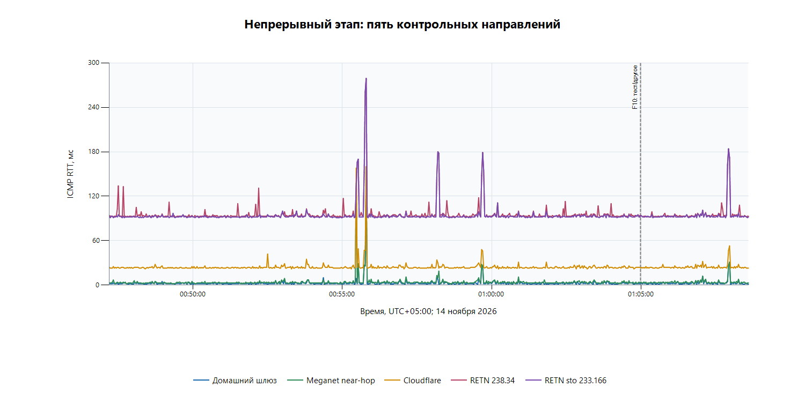
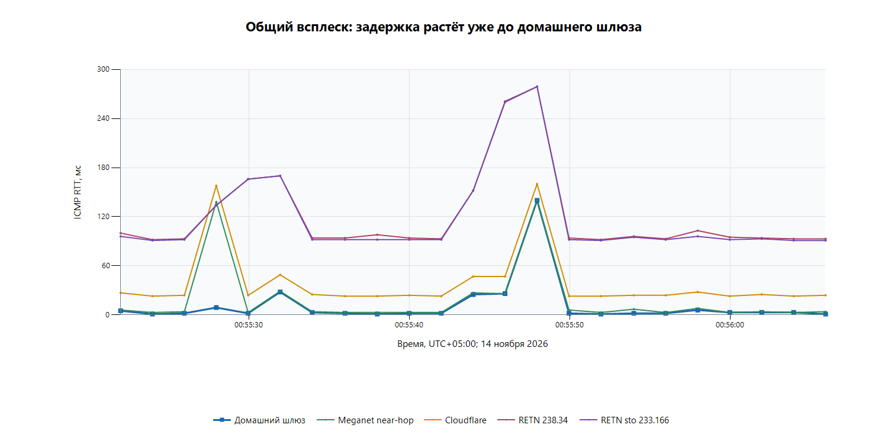
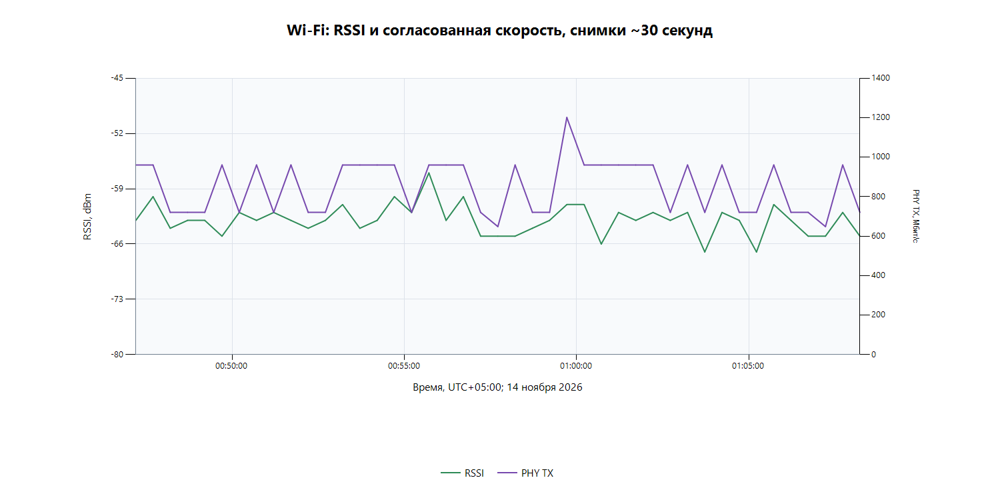
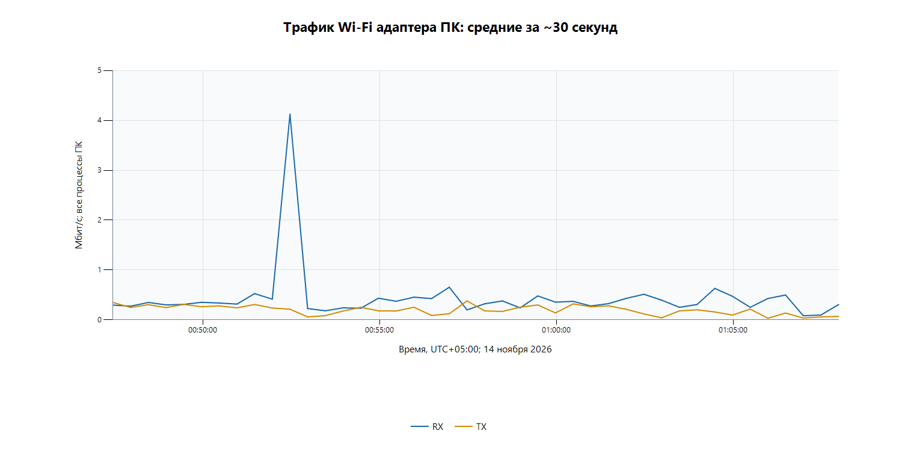

# Meganet × Valorant — итог текущего этапа, 14 ноября 2026

**Дополнение RRT от 15 ноября:** [новый подробный анализ](RIOT-RRT-LOG-ANALYSIS.md) подтверждает восемь игровых Average Ping **328,12–383,31 мс** в 14:27:45.760–14:29:58.816 (+05) и 26 остановок репликации ввода/overflow. В этот интервал по 67/67 успешных ICMP на пять целей; конкретная причина остаётся неустановленной. Ниже сохранён прежний этап и его ограничения.

**Публичная обезличенная копия.** Числовые измерения, времена и целевые/транзитные IP сохранены. Личные сетевые идентификаторы и локальные пользовательские пути заменены стабильными обозначениями. Упоминаемые исходные размеры и хеши относятся к приватному источнику; актуальные публичные хеши — в SHA256SUMS.txt. Полные native ping/tracert сохранены побайтно. Подробнее — корневой PUBLICATION-NOTES.md.

**Дополнительный пакет для Meganet:** [адреса, методика и полные ping/tracert](meganet-package-2026-11-14/README.md). Отдельные нативные проверки двух Riot-IP и двух опубликованных SDR relay выполнены после исторического дневного матча; они не воспроизводят его тяжёлый эпизод. Новый матч пользователя с :7158 наблюдается в отдельном продолжающемся run, без преждевременного итогового вывода.

**Более поздний дневной этап:** см. [итог матча 14 ноября, 14:11–14:49](DAY-MATCH-RESULTS-2026-11-14.md): игровые 300–400 мс при спокойных контролях, восстановление после перезахода и смена адреса в игровом логе. Ниже сохранён ночной этап без подмены его данных.

### Уточнение дневной хронологии, 14 ноября 2026

По ретроспективному уточнению игрока до тяжёлого эпизода наблюдалась последовательность **95 → 120 → 180 → 120 мс**, затем позднее RTT достиг **300–400 мс**. Это повторные колебания с периодическим частичным восстановлением, а не один изолированный скачок и не исключительно постоянная высокая задержка. Возврат к 120 мс после 180 — частичный, относительно исходных ~95 мс.

Сохранённые F8→F9 до тяжёлого эпизода включают 14:14:08.511→14:14:15.215, 14:15:38.130→14:15:41.905 и 14:15:47.842→14:15:53.398 (+05:00). В плотном окне 14:19:15.263–14:22:15.150 также есть промежуточные F9; ранее игрок связал эти серии с колебаниями 120–180. Метки фиксируют время обработки кнопок без числовых RTT, поэтому значения 95, 120 и 180 нельзя однозначно назначить отдельным нажатиям. Новые F8 начинаются в 14:27:50.587; сообщение о продолжающихся 300–400 внесено в 14:29:10.353, что не является точным временем начала этого уровня.

В окне плотных меток по 90 контрольных проб на цель: медианы шлюз / near-hop / Cloudflare / RETN-1 / RETN-2 — **2 / 4 / 24 / 94 / 93 мс**, максимумы **19 / 20 / 41 / 137 / 109 мс** (не обязательно один цикл). Это даёт контекст повторных игровых колебаний, но не точную корреляцию каждого числового перехода. Хронология расширяет описание симптомов; вывод о неустановленной конкретной причине сохраняется. [Полное сопоставление и ограничения](DAY-MATCH-RESULTS-2026-11-14.md). Ниже — результаты отдельного ночного этапа.

**Точная причина высокого игрового пинга и потерь пакетов не установлена. Обнаружены короткие всплески задержки уже до домашнего шлюза, а также отдельные повышения RTT контрольных узлов RETN при спокойных ближних целях. Объяснение всей проблемы только международным транзитом не подтверждается. Wi-Fi, роутер, локальный стек Windows и игровое направление ещё не разделены причинным тестом.**

Непрерывный монитор корректно остановлен по команде пользователя в **01:08:36,535 (+05:00)**. `DONE.durable=true`, очередь записи пуста, незавершённых проб нет, исходный PID 9936 завершён. Настройки сети не менялись. Запрос в Meganet **не отправлен**.

## 1. Охват и происхождение данных

Основная непрерывная серия: **00:47:11,940 — 01:08:35,970 (+05:00)**, 643 цикла по пяти целям, **3215/3215 успешных ICMP-ответов**, без timeout или ProbeError. Процесс работал 21 минуту 24,611 секунды от metadata start до end. Настройки: ICMPv4, 32 байта, интервал 2 секунды, timeout 1500 мс. Все цели в трёх снимках выбора маршрута использовали Realtek 8852BE / Wi-Fi, `CLIENT_LAN_IP_01`, шлюз `192.168.123.1`.

Дополнительно повторно проанализированы все шесть настоящих старых сетевых серий, включая переход в матч и непригодный запуск с 800 мс. Вместе пять пригодных старых серий и новая непрерывная серия дают **7125 контрольных проб с ответами из 7125**. Это разные окна и местами разные адреса; их RTT не объединяется в одну оценку пути. Тесты loopback, невалидные запуски и разовые проверки API не включены в этот итог. Предоставленный пользователем baseline сохранён отдельно и не выдаётся за повторно измеренный синхронный набор.

Источники: [новый исходный журнал и финализация](evidence/final-2026-11-14/), [полный машинный анализ](final-data/final-analysis.json), [парные циклы CSV](final-data/paired-cycles.csv), [старые таблицы](SESSION-METRICS.md), [инцидент 185/189 мс](INCIDENT-2026-11-14.md), [исходный baseline](../docs/BASELINE-2026-11-13.md). Схемы заданы сборщиком; полные строки Riot, токены и содержимое UDP не сохранялись.

## 2. Целостность и время

Проверены все **3299 JSONL-записей**: sequence 1–3299 непрерывен, повторов пары cycle/target нет, все 643 цикла содержат ровно пять целей. Оба файла закрыты, все строки завершены newline и разбираются как JSON. Размеры совпадают с manifest: суммарно **1 680 978 байт**. Удалённых retention-фрагментов нет; buffered/dropped/unfinished = 0; io_error=null. Проверены run_id и согласованность UTC/local; ошибок и обратных скачков времени записи нет.

Фактические интервалы между пробами находятся в `audit.intervals_seconds`: максимальный около **2,062 с**. Максимальное расхождение относительного wall clock с монотонным временем — **0,997 мс**. Максимальный разброс запуска пяти задач внутри одного цикла — **32 мс**. Это не независимая проверка абсолютного времени по NTP и не гарантия обнаружения каждого субсекундного события.

| Файл | Фактические sequence | first_seq manifest | Байт | Состояние |
|---|---|---|---|---|
| telemetry-00000001.jsonl | 1–2311 | 1 | 1175795 | OK |
| telemetry-00000002.jsonl | 2312–3299 | 2313 | 505183 | Ошибка границы manifest, строка на месте |

У второго файла `segments.json` содержит first_seq=2313 вместо физически присутствующего 2312. Это **ошибка метаданных ротации, не утрата строки**. Исходный manifest не переписывался. Аудит опирается на физические строки; SHA-256 исходных файлов сохранены. Формирование first_seq исправлено для будущих запусков и покрыто регрессионным тестом.

## 3. Сводные RTT непрерывного этапа

Все RTT ниже — миллисекунды по Windows IcmpSendEcho2, не игровые UDP RTT. p95/p99 вычислены методом ближайшего ранга по успешным ответам.

| Цель | n | min | медиана | avg | p95 | p99 | max | ICMP неответы |
|---|---|---|---|---|---|---|---|---|
| 192.168.123.1 | 643 | 1 | 2 | 2,942 | 6 | 25 | 140 | 0/643 |
| 89.38.164.205 | 643 | 2 | 3 | 4,308 | 7 | 26 | 140 | 0/643 |
| 1.1.1.1 | 643 | 22 | 24 | 24,656 | 27 | 47 | 160 | 0/643 |
| 87.245.238.34 | 643 | 91 | 93 | 96,275 | 105 | 172 | 279 | 0/643 |
| 87.245.233.166 | 643 | 91 | 92 | 94,58 | 96 | 172 | 279 | 0/643 |



Линии соединяют отдельные пробы с шагом около 2 с. Высокие краткие значения скрываются медианой: у шлюза медиана 2 мс, но max 140 мс. Вертикальная F10 — проверка/другое событие по уточнению пользователя, а не подтверждённый лаг.

## 4. Нормальные и повышенные контрольные значения

Пороговые значения зафиксированы до анализа этой серии из прежних CSV: шлюз 15, near-hop 16, Cloudflare 38, RETN-1 109, RETN-2 106 мс. Формула: `max(median + max(10, 6*MAD), p95 + 10)`. Превышением считается RTT ≥ порога. Категории взаимно исключаются с приоритетом шлюз → near-hop → Cloudflare → RETN.

| Класс контрольных проб | Циклов | Доля циклов | avg: шлюз / near / CF / R1 / R2, мс |
|---|---|---|---|
| Все цели ниже порогов | 613 | 95,334% | 2,427 / 3,573 / 23,91 / 93,811 / 92,548 |
| Порог превышен только на RETN | 19 | 2,955% | 3,474 / 4,579 / 25,105 / 128,842 / 112,158 |
| Cloudflare выше порога, ближние ниже | 1 | 0,156% | 1 / 3 / 42 / 95 / 95 |
| Near-hop выше порога, шлюз ниже | 2 | 0,311% | 5 / 78,5 / 90,5 / 156 / 156 |
| Порог превышен до шлюза | 8 | 1,244% | 40,875 / 41,625 / 62,125 / 193 / 193,125 |

**613/643 циклов (95,33%)** ниже всех порогов; **30/643 (4,67%)** имеют хотя бы одно превышение. Это доля дискретных циклов, **не длительность плохой связи и не процент игровых потерь**. 38 автоматических сообщений об аномалиях не означают 38 независимых игровых лагов: сообщения формируются по целям с cooldown.

Нет достоверной разметки непрерывной серии на «нормальная игра» и «высокий игровой RTT». Поэтому здесь сравниваются только контрольные ICMP-периоды. В спокойном классе медианы GW/near/CF/RETN-1/RETN-2 = **2 / 3 / 24 / 93 / 92 мс**. В 8 циклах локального класса средний RTT шлюза 40,875 мс, обоих RETN около 193 мс.

## 5. Ключевые синхронные события

| 14 ноября, +05:00 | Шлюз | Near-hop | Cloudflare | RETN .238.34 | RETN .233.166 |
|---|---|---|---|---|---|
| 00:55:27.945 | 9 | 138 | 158 | 134 | 134 |
| 00:55:29.931 | 2 | 3 | 24 | 166 | 166 |
| 00:55:31.926 | 28 | 29 | 49 | 170 | 170 |
| 00:55:43.961 | 25 | 27 | 47 | 152 | 152 |
| 00:55:45.945 | 26 | 26 | 47 | 260 | 261 |
| 00:55:47.941 | 140 | 140 | 160 | 279 | 279 |
| 00:55:49.930 | 2 | 6 | 23 | 94 | 92 |
| 00:58:11.956 | 8 | 10 | 30 | 180 | 180 |
| 00:59:39.963 | 26 | 28 | 48 | 148 | 148 |
| 00:59:41.965 | 25 | 26 | 46 | 179 | 179 |
| 01:07:55.926 | 26 | 26 | 47 | 184 | 184 |
| 01:07:57.981 | 31 | 31 | 53 | 172 | 172 |



**00:55:47,941:** 140 / 140 / 160 / 279 / 279 мс. Поскольку задержка выросла уже для адреса домашнего шлюза, этот цикл нельзя объяснить исключительно линией RETN→Riot. Наиболее поддерживаемая группа объяснений для такого паттерна — общий локальный участок/обработка на ПК или роутере: Wi-Fi доступ, очереди/повторы, AP либо обработка сетевого стека/драйвера. Сам ICMP-ответ роутера относится к его control plane; пересылаемый игровой UDP здесь напрямую не измерен. Поэтому «доказана неисправность Wi-Fi/роутера» было бы преждевременным выводом.

Есть и другой паттерн. **00:47:29,923:** GW 1, near 3, CF 24, RETN-1 134, RETN-2 95 мс — один транзитный адрес ответил медленнее без соответствующего ухудшения второго. Это не доказывает потерю пересылаемых данных на RETN-1. **00:58:11,956:** 8 / 10 / 30 / 180 / 180 мс — значительно выросли оба RETN, при этом ближние цели тоже несколько выше своих медиан, хотя ниже выбранных порогов. Рассматривать нужно различия направлений, обратного пути и обработки ICMP; локальный вклад не исключён.

Корреляция парных рядов: near-hop/Cloudflare **0,9844**, два RETN **0,9637**, шлюз/Cloudflare **0,7655**. Они описывают совместные колебания и чувствительны к нескольким выбросам; это не причинный тест и не измерение общего линка путём вычитания RTT.

## 6. Wi-Fi, нагрузка и маршруты

В 43 системных снимках Wi-Fi оставался connected, BSSID `NETWORK_HW_01`, канал **36**, диапазон **5 GHz**. RSSI **−67…−57 dBm**, RX PHY 1201 Мбит/с; TX PHY менялся **648,5 / 720,5 / 960,5 / 1201 Мбит/с**. Изменение PHY rate само по себе нормально для адаптации радиолинка и не устанавливает причину лагов. Между снимками могли происходить более короткие события.



Возле наибольшего локального всплеска ближайший снимок до него — 00:55:42,841: RSSI −57 dBm, TX 960,5, RX 1201, тот же BSSID/канал. Резкого падения RSSI в сохранённых снимках нет. Включённый WLAN-AutoConfig проверен за 00:47:00–01:08:40 — совпадающих событий нет. Это даёт отсутствие зарегистрированных разрывов/роуминга, но **не отсутствие помех или retries**. Прежние Native Wi-Fi PHY-счётчики драйвера возвращали нули при реальном трафике и признаны непригодными для такого вывода.



Из дельт счётчиков за интервалы около 30 с: максимальный средний RX **4,125 Мбит/с**, TX **0,381 Мбит/с**. В интервале, содержащем пик 00:55:47: RX **0,456**, TX **0,254 Мбит/с**. Высокая средняя загрузка именно этого ПК не подтверждается. Но 30-секундное усреднение не исключает короткий upload burst, другие домашние устройства или очередь провайдера. Bufferbloat не установлен и не опровергнут; нагрузочный тест не проводился.

Дополнительный фактор: commit подготовленного кода датирован **00:59:37**, рядом с локальными всплесками 00:59:39/41. В это время шла публикация проекта. Точного журнала момента передачи Git-пакетов и трафика по процессам нет, поэтому причинность не установлена; фон расследования не был полностью изолирован от работы Codex.

Дельты общих NIC errors/discards во всех доступных адаптерах — **0**. Эти счётчики не равны радиоповторам и потерям UDP. В трёх снимках (00:47:15, 00:56:45, 01:06:45) IPv4-таблица и выбранные пути к пяти целям одинаковы: Wi-Fi, default через 192.168.123.1, route metric 0 / interface metric 35. Radmin default metric 9256; его влияние как выбранного маршрута к этим целям не обнаружено. Прежний этап показывал Wi-Fi metric 30; причина различия не измерена, автоматическая настройка Windows возможна, но не доказана. Агент метрики не менял. Снимки раз в ~10 минут не исключают краткую смену маршрута между ними или асимметрию за пределами ПК.

## 7. Что известно об игре и ручных отметках

В непрерывном журнале **одна** ручная запись: F10 `note`, обработана Windows в **01:04:58,948**, записана в журнал **01:04:59,009**. Пользователь после завершения сообщил: **«Проверка кнопки или другое событие»**. Она не является подтверждённой отметкой скачка/восстановления и не содержит числовых RTT/loss. Окружающие контрольные пробы спокойны; это не доказывает спокойный игровой UDP.

Непосредственный поддерживаемый поток игровых RTT/loss не был доступен; память, хуки и пакето-захват не использовались. Наличие PID 13548 во всех снимках подтверждает процесс игры, но не режим/регион матча каждую секунду. Контекст непрерывного run в metadata — **Unknown**.

Безопасное извлечение из штатного журнала после игры нашло переходы `185.40.64.1:7039 → :7329 → :7415 → :7382 → :7354`. В основном окне наблюдаются, среди прочего, LogTravelManager `[2026.11.13-19.46.47:123]` к `:7382` и `[2026.11.13-19.53.41:234]` к `:7354`. При предположении UTC для игровых меток это около 00:46:47 и 00:53:41 (+05). Такая трактовка времени согласуется с системным окном, но независимо формат часов игры не проверен. Шесть вариантов локальных UDP-привязок также показывают, что сетевая конфигурация клиента менялась.

Нельзя считать весь вечер одним неизменным потоком `:7039`. IP остаётся кандидатом из игровых логов; текущий удалённый UDP peer и география Stockholm для каждой новой сессии независимо не подтверждены. Сохранены только IP:порт/категория/время из ограниченного фрагмента, не полный журнал или авторизация.

Ранее пользователь сообщил 100–110 на стрельбище, 90–100 с одним 110 в начале Stockholm, затем представил скриншот **185/189 мс**, после которого сообщал 100–180 и позже восстановление 91–96. Эти свидетельства остаются действительными. Но первый пик скриншота попал в пробел **00:03:21–00:06:13**, а непрерывная серия началась только в 00:47:11. Новыми данными нельзя задним числом локализовать причину именно скриншотного пика.

На скриншоте текущие потери 0%, накопленный счётчик 48. Baseline раньше показывал игровые потери 1% и входящие 3%. Ни 7125 контрольных ICMP без неответов, ни нули NIC counters не опровергают UDP-потери и не устанавливают их источник.

## 8. Пересмотр прежних серий

Окна ниже относятся к 13–14 ноября, местное UTC+05:00; детальные даты есть в JSON/metadata. R2 у первых пяти строк — 87.245.234.191, у последней — 87.245.233.166. Разные назначения не трактуются как один путь.

| Серия | Местное окно проб | n на цель | Пригодна для % ICMP неответов | avg GW / near / CF / R1 / R2 |
|---|---|---|---|---|
| 20261113-234232-Range-1fbb0d | 23:42:36 — 23:44:48 | 67 | Нет: ранние timeout | 1,866 / 3,149 / 23,867 / 94,867 / 85,745 |
| 20261113-234606-Range-721321 | 23:46:10 — 23:50:48 | 140 | Да | 1,886 / 3,093 / 23,436 / 93,5 / 85,479 |
| 20261113-235053-Unknown-fc7ee9 | 23:50:55 — 23:53:15 | 71 | Да | 2,268 / 3,606 / 24,676 / 94,521 / 86,549 |
| 20261113-235320-Stockholm-unrated-af5126 | 23:53:24 — 00:03:20 | 299 | Да | 2,151 / 3,458 / 23,997 / 94,037 / 86,043 |
| 20261114-000610-Stockholm-unrated-ee0d94 | 00:06:13 — 00:10:17 | 123 | Да | 2,154 / 3,268 / 23,504 / 95,016 / 85,52 |
| 20261114-001022-Stockholm-unrated-c5ba53 | 00:10:25 — 00:15:21 | 149 | Да | 2,081 / 3,262 / 23,678 / 93,913 / 92,322 |

Отдельный [аудит всех шести CSV](final-data/historical-audit.json) подтвердил соответствие количества строк числу циклов и целей, непрерывность cycle, отсутствие дубликатов и согласованность сохранённых UTC/local/времени завершения. Корректность хранения не делает ранние 800-мс timeout пригодной оценкой потерь.

Первый запуск с 800 мс содержит 67 циклов/335 попыток, из которых часть получила подозрительно ранние TimedOut. Процент сетевых потерь по внешним целям из него не выводится; RTT успешных ответов смещён выборкой. Последовательный контроль и native ping сохранены как проверка измерителя. Переходная серия Unknown (71 цикл) пригодна как контроль сети, но не как весь подтверждённый матч.

Непригодный старт нового ядра 00:44:49–00:47:10 давал ProbeError из-за размера payload; он исключён из сетевых выводов. Период 00:15:22–00:47:11 не имеет пригодного непрерывного покрытия. В нынешней основной серии такой ошибки нет: все 3215 результатов Success. Правильная финализация сохраняет данные, но не устраняет старые интервалы отсутствия измерений.

## 9. Статус гипотез

| Гипотеза | Статус | Основание и предел вывода |
|---|---|---|
| Краткая задержка уже на общем локальном участке/обработке ПК–шлюз | Поддерживается измерениями | 8 циклов ≥15 мс до шлюза, один 140 мс, одновременно растут внешние RTT. Конкретный механизм и связь с игровым пиком не разделены |
| Постоянно высокая задержка домашнего доступа | Не подтверждена в этом окне | Медиана шлюза 2, p95 6 мс. Это не исключает короткие локальные всплески |
| Неисправность/помехи Wi-Fi, энергосбережение, драйвер, роутер | Требует данных | Паттерн совместим, но нет пригодных retries/airtime и Ethernet A/B; RSSI не падает в видимых снимках |
| Radmin забирает маршрут диагностических целей | Опровергнуто для трёх сохранённых снимков | Путь идёт через Wi-Fi. Другое влияние VPN ПО и интервалы между снимками не проверены |
| Вся проблема исключительно в международном транзите RETN | Не поддерживается как единственное объяснение | Не объясняет собственный RTT домашнего шлюза 140 мс. Отдельные внешние/RETN события остаются открытой гипотезой |
| Перегрузка/асимметрия Meganet–RETN–Riot | Требует данных | 19 циклов с превышением порога только на RETN, но ICMP к интерфейсам не равен игровому пути; обратное направление не измерено |
| Bufferbloat из-за нагрузки | Не установлен и не исключён | Средние скорости ПК невелики; нет контролируемой нагрузки, трафика всех устройств и показателей очереди |
| Проблема сервера Riot или специфическая обработка UDP | Требует данных | Реальный игровой RTT повышался, но точной игровой серии/peer и серверной телеметрии нет |
| Потери игрового UDP доказанно находятся на одном из измеренных узлов | Не установлено | В текущих контролях 0 ICMP неответов, игрового packet-loss ряда нет; протоколы и выборки различаются |
| Смена провайдера добавила установленную величину задержки из-за конкретного маршрута | Не установлено | Beeline 70–80 — прежнее наблюдение пользователя, без сравнения одинаковых peer/часов/условий |

## 10. Следующие различающие проверки

1. **Ethernet/Wi-Fi A/B вне текущего матча**, после отдельного согласования переключения. Тот же ПК, подтверждённый игровой регион/подключение, близкое время и фон. Если всплески до шлюза исчезнут по кабелю, гипотеза Wi-Fi/AP существенно усилится. Если сохранятся — проверить локальную обработку/роутер и фон. Это наиболее полезный следующий тест по новым данным.
2. Повтор при точных **F8/F9 плюс числовом игровом RTT/loss**. Метки должны относиться к реальному скачку, а не проверке кнопок. Нужны хотя бы одна подтверждённая плохая и одна восстановившаяся игровая точка внутри одной записанной серии.
3. Сопоставить с поддерживаемой статистикой AP: retries, airtime/channel utilization и трафик других устройств; при необходимости безопасные CPU/DPC/сетевые счётчики Windows. Не менять драйверы/энергосбережение/канал по одной корреляции.
4. Для международного направления запросить у Meganet проверку forward/reverse route, очередей/дропов и конкретного актуального игрового направления. Адреса :7039 и :7354 привязаны к разным записям; оператору нужен подходящий интервал и абонентская идентификация.
5. Если штатный источник не подтвердит UDP peer, **отдельно согласовать** строго ограниченное наблюдение метаданных игрового потока. Никакого захвата всего UDP в этом этапе не было. Bufferbloat-нагрузку выполнять только отдельным разрешённым тестом вне игры.

## 11. Сохранение и воспроизведение

Исходные два telemetry JSONL, metadata/status/DONE и original segments сохранены в `reports/evidence/final-2026-11-14/`; SHA-256 — в общем `evidence/SHA256SUMS.txt`. Добавлены ранее не экспортированные переходная и методически непригодная ранняя серии. Старые тесты и невалидные старты отделены от пригодных данных. Полный сырой ShooterGame.log и исходный скриншот с именами других игроков в ветку не добавлялись.

```powershell
python scripts/final_stage_analysis.py reports/evidence/final-2026-11-14 --output reports/final-data
powershell -NoProfile -File scripts/Render-InvestigationCharts.ps1 -SpecPath reports/final-data/chart-spec.json -OutputDirectory reports/figures
python scripts/write_final_report.py
```

Построение графиков использует установленную Windows .NET Charting и не открывает окна. Проверены JSON/CSV-аудит, отсутствие потерь данных, единицы и графики. Ошибка first_seq исправлена после остановки; исходные файлы результата не изменялись. Черновик Meganet обновлён с указанием **обоих** паттернов и локального confound, без обвинения провайдера; он не отправлен.

**Этап завершён, монитор остановлен.** Есть доказанные контрольные всплески и более узкий план проверки, но причинная атрибуция высокого игрового RTT и потерь UDP пока требует перечисленных дополнительных данных.
