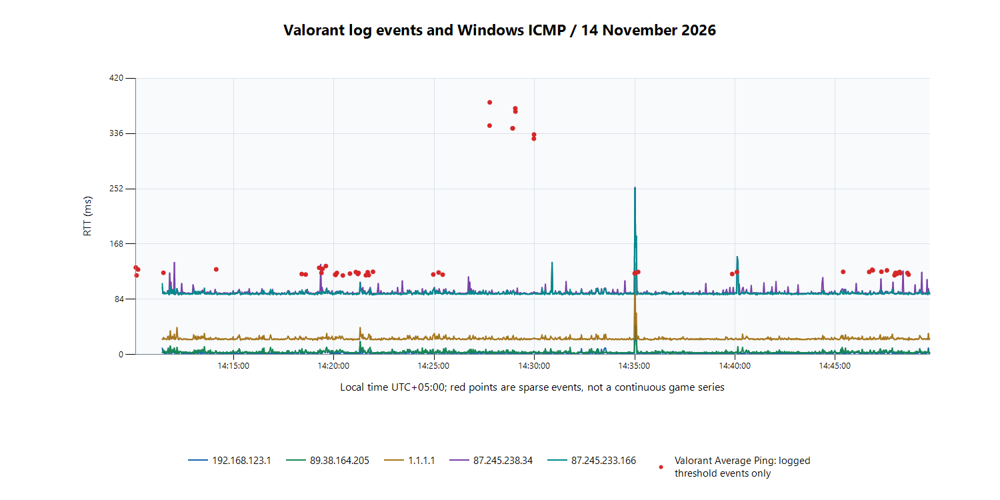
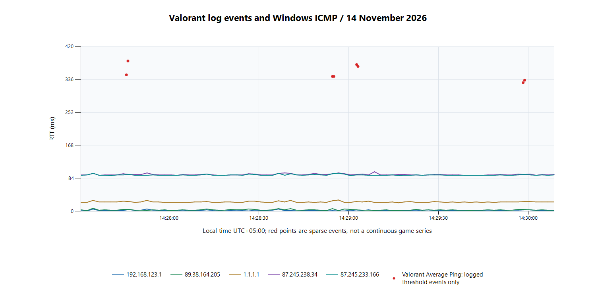

# Анализ Riot Repair Tool: Valorant × Meganet, 13–15 ноября 2026

**Новый отдельный анализ 90–180 мс:** [полный отчёт, 263 числовых события и шесть графиков](VALORANT-RTT-90-180-ANALYSIS.md). Дополнены локальные игровые источники, отсутствовавшие в RRT; 71 событие имеет полное контрольное покрытие, 58 из них — без контрольных превышений. Причина различия с Beeline не установлена; отсутствие игровой серии ниже 120 явно учтено.

Дата анализа: 15 ноября 2026. Все времена в таблицах — **UTC+05:00**, если явно не указано UTC. Исследование выполнено офлайн: новых сетевых тестов, игровых сессий, изменений Windows/сети/игры/Vanguard не выполнялось. Ранее запущенный непрерывный монитор не остановлен. Обращения поддержке не отправлены.

## 1. Что установлено

**Высокий игровой RTT теперь подтверждён числовыми записями самого Valorant. Конкретный виновный участок пока не установлен.**

- 14 ноября в **14:27:45.760–14:29:58.816** игровой компонент `LogInstabilityTrackingDetails` записал восемь критических событий Average Ping: **328,12–383,31 мс**, порог 200 мс. Ранее этот эпизод был известен главным образом со слов игрока. Значения являются редкими пороговыми событиями, а не полной секундной серией Network RTT.
- В том же сеансе **14:27:44.657–14:29:47.995** клиент 26 раз сообщал о прекращении репликации ввода из-за `MaxUnacknowledgedInputDuration exceeded`; рядом — 26 включений `Outgoing Input Queue Overflow` и 26 выключений. Это прямая фиксация нарушения обработки/подтверждения игрового ввода, а не ошибка авторизации или загрузки карты.
- Между первой и последней критическими записями выполнено **67 ICMP-проб на каждую из пяти контрольных целей, 335/335 Success**. Шлюз: 1–6 мс; near-hop Meganet: 2–7; Cloudflare: 22–29; RETN-1: 92–101; RETN-2: 91–97. Общая многоминутная задержка всех направлений этими данными не подтверждается. Игровой UDP, оставшийся участок пути и обратный маршрут этими ICMP не проверены.
- После самостоятельного перезапуска игроком адрес в записях подключения изменился **185.40.64.1:7004 → 162.249.72.1:7004**. Для второго адреса есть более сильное свидетельство: `UNetConnection::ReceivedPacket` с `RemoteAddr`, GameNetDriver и входящим sequence. Игрок сообщил восстановление примерно до 100, затем 100–110 мс. Перезапуск одновременно изменил состояние клиента и соединения, поэтому причинность смены адреса не доказана.
- Штатные игровые журналы содержат семь предупреждений `Burst Loss Detected`, включая три до перезапуска. Потери на уровне игровых диагностических счётчиков подтверждены; их направление, место возникновения и процент потерь именно в период 300–400 мс не установлены.
- Отдельный короткий общий всплеск около **14:35:00** виден и до домашнего шлюза, и в игровом журнале. Его нельзя использовать как объяснение всего предшествующего многоминутного эпизода.

Сводки для передачи человеком: [Riot Support](RIOT-SUPPORT-RRT-BRIEF.md), [Meganet](MEGANET-RRT-BRIEF.md). Полные исходные RRT-архивы в публикацию не включены.

## 2. Источники, целостность и безопасное извлечение

Исходная папка Riot Logs содержит три ZIP. [Машиночитаемая инвентаризация](evidence/riot-rrt-2026-11-15/inventory.json) перечисляет все 811 элементов двух уникальных архивов; пути аккаунтов и crash-каталогов заменены техническими file_id. Полные SHA-256 приведены там же.

| Архив | Размер, байт | Элементов | Распакованный размер, байт | SHA-256, начало |
|---|---:|---:|---:|---|
| SystemLogs-2026-11-14.zip | 30 568 | 3 | 207 319 | 177b7a7b19428d1d |
| VAL-2026-11-14-1 of 2.zip | 14 747 059 | 808 | 135 919 406 | e5bc76282feb0436 |
| VAL-2026-11-14-2 of 2.zip | 14 747 059 | те же 808 | дубликат | e5bc76282feb0436 |

**Оба VAL ZIP побайтово одинаковы.** Надпись «2 of 2» не означает дополнительного временного покрытия. Одни и те же события не учитывались дважды. Файловые mtime архивов — 14 ноября 20:56 UTC, то есть 15 ноября около 01:56 местного времени. Дата в имени архива не является датой каждого события внутри.

| Группа | Файлов в уникальных ZIP | Что изучено |
|---|---:|---|
| Система | 3 | DxDiag, NetworkInfo, Process; содержимое рассмотрено с исключением личных полей |
| VALORANT Logs | 18 | 6 ShooterGame и 12 CEF: временное покрытие, соединения, игровые события и контекст |
| Riot Client Logs | 15 | Запуски 2–14 ноября, контекст launcher/runtime и сетевых ошибок |
| VALORANT Config | 21 | 5 GameUserSettings и 4 RiotUserSettings; только относящиеся к диагностике настройки; остальные не нужны для анализа RTT |
| VALORANT Crashes | 159 | 20 CrashContext XML; дампы памяти и старые вложенные игровые логи не извлекались для анализа текущих сетевых событий |
| Riot Vanguard Logs | 593 | Инвентаризация; имена датированы 24 января–15 ноября, 9 файлов относятся по имени к 13–15 ноября. Проверка формата этих 9 выявила непрозрачные/нетекстовые данные; содержимое не декодировалось и не интерпретировалось |
| Riot Client Config | 2 | Credential-bearing lockfile и RiotClientSettings.yaml не читались и не включались в результаты |

Воспроизводимый анализатор извлекает **65 выбранных текстовых файлов, 14 303 563 байта**, в отдельный приватный scratch вне Git. Предварительная проверка формата 9 Vanguard-файлов выполнена отдельно, без расшифровки. Метаданные всех остальных файлов учтены, но это не заявление о расшифровке/полном семантическом анализе каждого из 811 элементов.

Проверяются выход за каталог, абсолютные пути, `..`, alternate data streams, символические ссылки, шифрование ZIP, CRC выбранных файлов, лимит одного файла 64 МиБ, общего размера 1 ГиБ и коэффициента сжатия. Исполняемые файлы не запускались, minidump не разбирались, оригиналы не изменялись и не удалялись. SHA исходных архивов проверен повторно. RRT — средство сбора существующих журналов, само наличие архива не гарантирует полноту истории: [официальное описание Riot](https://support.riotgames.com/en-us/riot/performance/gathering-logs-riot-repair-tool-rrt).

## 3. Временная шкала и покрытие

В ShooterGame строка `Log file open, 11/14/26 14:01:55` соседствует с первым штампом `[2026.11.14-09.01.56:013]`. После перезапуска заголовок — 14:31:09, первый штамп — 09:31:09.533. Во всех шести файлах разница около пяти часов, с округлением/задержкой открытия до секунды. Это согласуется с ранее записанными отметками Windows и сменой PID. Скобочные штампы обработаны как UTC, к ним добавлены пять часов; они не сдвигались на пять часов повторно.

Точность представления — миллисекунды; это не гарантия абсолютной синхронизации часов с внешним эталоном. ZIP timestamps преимущественно отражают копирование RRT около 01:56, не начало/конец старых событий. NetworkInfo не содержит отдельных временных меток своих команд. CEF-гистограммы агрегированы и также не дают секунд отдельных ошибок.

| ShooterGame-backup, суффикс имени | Первое событие +05 | Последнее событие +05 | Строк |
|---|---|---|---:|
| 2026.11.12-11.53.59 | 12.11 15:30:23.772 | 12.11 16:53:59.725 | 3995 |
| 2026.11.12-18.19.43 | 12.11 23:09:22.714 | 12.11 23:19:43.015 | 5538 |
| 2026.11.13-04.25.29 | 13.11 09:24:26.983 | 13.11 09:25:29.170 | 2103 |
| 2026.11.14-09.30.10 | 14.11 14:01:56.013 | 14.11 14:30:10.301 | 9081 |
| 2026.11.14-11.51.12 | 14.11 14:31:09.533 | 14.11 16:51:12.541 | 15155 |
| 2026.11.14-20.02.40 | 15.11 00:55:51.781 | 15.11 01:02:40.851 | 1838 |

[Точное покрытие и file_id](evidence/riot-rrt-2026-11-15/game-coverage.json). Далее **G1** означает `ShooterGame-backup-2026.11.14-09.30.10.log`, **G2** — `ShooterGame-backup-2026.11.14-11.51.12.log`.

Ограничения покрытия:

- Большого ночного ShooterGame-backup-2026.11.13-20.08.16.log в RRT нет; одноимённый CEF есть. Ночной инцидент 185/189 мс подтверждён прежним скриншотом и материалами, а не этим отсутствующим ShooterGame.
- Текущего ShooterGame.log с матчами 15 ноября около 01:09 и 01:28 в RRT нет. Последний RRT ShooterGame заканчивается 01:02:40.
- Перерыв 14:30:10–14:31:09 относится к завершению/запуску игрового процесса. Windows-монитор дневной серии продолжал работать; это не потеря сбора ICMP.
- Архивы 12 ноября дают исторический контекст, но не заменяют замеры маршрута и условия доступа 13–15 ноября.

## 4. Хронология 14 ноября: от колебаний к тяжёлому эпизоду

| Время +05 | Событие | Источник и предел интерпретации |
|---|---|---|
| 14:08:49.238 | Beginning travel к 185.40.64.1:7004 | G1:2379; намерение игрового подключения |
| 14:09:03.679 / 14:09:04.314 | Match Setup TRUE / Map Ready TRUE | G1:2595/2683; игровой контекст, не ICMP/packet capture |
| 14:10:07.478–14:25:25.546 | 26 предупреждений Average Ping >120; Current 120,36–134,65 | G1; редкие записи порогов, не весь диапазон видимого RTT |
| Без точных секунд | Повторные 95→120→180→120, позже 300–400 | Ретроспективное уточнение игрока; RRT не содержит числового 180 для этого этапа |
| 14:19–14:22 | Много F8; игрок пояснил повторные 120–180 с частичными восстановлениями | Прежняя непрерывная телеметрия; повторные клики не считаются независимыми авариями |
| 14:27:44.657 | Первый input replication stop | G1:7906, превышен MaxUnacknowledgedInputDuration |
| 14:27:44.658–14:29:48.388 | 26 пар ACTIVE/inactive Input Queue Overflow | G1:7907–8624; короткие состояния внутри более длинной проблемы |
| 14:27:45.760–14:29:58.816 | Восемь критических Average Ping, 328,12–383,31 | Точные строки приведены ниже |
| 14:27:50.601 | F8 | Через 4,841/4,337 с после первых двух критических записей; задержка реакции не измерялась |
| 14:29:10.353 | Внесено сообщение игрока о 300–400 | Время сообщения, не начало эпизода. Уточнение «держалось около пяти минут» остаётся приблизительным |
| 14:30:09.253 | Печать NetDriver Lifetime Stats перед завершением | G1:8806–8813 |
| 14:30:28 и 14:30:58 | Прежнего PID уже нет в снимках Windows | Прежняя дневная телеметрия; точная секунда выхода между снимками неизвестна |
| 14:31:09.533 | Начало G2 | Новый клиентский процесс; независимое подтверждение перезапуска |
| 14:31:45.206 | Beginning travel к 162.249.72.1:7004 | G2:1446 |
| 14:31:48.987 | ReceivedPacket, RemoteAddr 162.249.72.1:7004 | G2:1626: 256 полученных пакетов к подтверждению с прошлого sent packet, InSeq 5608; предупреждение при входе |
| 14:31:49.351–14:31:49.894 | Movement Queue Overflow; лимит 96 saved moves | G2:1689/1690/1725, контекст загрузки/присоединения, не многоминутная авария |
| 14:32:53.416 | Игрок сообщает ~100 | Время сообщения; точная секунда восстановления и автоматический avg неизвестны |
| 14:34:59.958 / 14:35:01.603 | Average Ping 123,38 / 124,15 | G2; рядом общий короткий рост ICMP, включая шлюз |
| 14:42:38 | Игрок сообщает 100–110 | Прежняя хронология; отсутствие критических записей не равно полной стабильности |
| 14:46–14:48 | Новые предупреждения 120–129 и поздние F8 | Числовое подтверждение части поздних небольших скачков после восстановления |

Числовые критические события из G1, `LogInstabilityTrackingDetails`, порог **200.00**:

| Строка G1 | UTC | +05 | Current, мс |
|---:|---|---|---:|
| 7914 | 09:27:45.760 | 14:27:45.760 | 348,00 |
| 7915 | 09:27:46.264 | 14:27:46.264 | 383,31 |
| 8196 | 09:28:54.594 | 14:28:54.594 | 343,94 |
| 8197 | 09:28:55.098 | 14:28:55.098 | 343,94 |
| 8418 | 09:29:02.688 | 14:29:02.688 | 374,19 |
| 8422 | 09:29:03.134 | 14:29:03.134 | 369,33 |
| 8686 | 09:29:58.309 | 14:29:58.309 | 328,12 |
| 8695 | 09:29:58.816 | 14:29:58.816 | 334,44 |

Между первой и последней записью 133,056 с. Нельзя считать это точной длительностью всей аварии или соединять точки непрерывной линией. Логирование порогов зависит от клиентской реализации; отсутствующая строка не означает RTT ниже порога. Наблюдения подтверждают тяжёлую задержку как минимум в перечисленные моменты. Смысл High Average Ping как времени обмена клиент–сервер описан [Riot](https://playvalorant.com/en-us/news/game-updates/valorant-game-and-network-instability-basics/); точная формула усреднения и связь с каждым GUI-показателем в данных не раскрыты.





Красные точки — только сохранённые Current Average Ping. Линии относятся исключительно к ICMP. В график не добавлены вымышленные игровые 95, 180 или восстановление 100 между точками.

## 5. Сопоставление с Windows, F8/F9 и нормальными периодами

Исходная дневная серия: [day-2026-11-14](evidence/day-2026-11-14/), 5745 проб / 1149 полных циклов, интервал 2 с, payload 32 байта, timeout 1500 мс. Сохранённые данные не переписаны. Для привязки использован `time_utc` записи; индивидуальные probe send/completion находятся в оригинале. Каждое окно около события — **±4 с**, близкие ручные метки — **±5 с**. Эти окна перекрываются, их выборки нельзя складывать как независимые.

Полные [сопоставления событий](evidence/riot-rrt-2026-11-15/day-correlations.json), [временные метки F8/F9 и сообщения о восстановлении](evidence/riot-rrt-2026-11-15/day-manual-markers.json), [статистика периодов](evidence/riot-rrt-2026-11-15/day-window-statistics.json).

В таблицах корреляции выше/ниже использован момент записи `time_utc`. Для первой тяжёлой F8 `observed_utc` обработки горячей клавиши — 14:27:50.587 местного времени, запись — 14:27:50.601; разница 14 мс сохранена в JSON. Прежние отчёты могли показывать первый из этих штампов. Эти поля не смешаны с временем появления числа на экране.

**Критический интервал 14:27:45.760–14:29:58.816:**

| Цель | N | min / avg / median / p95 / max, мс | ICMP timeout/loss |
|---|---:|---|---|
| Домашний шлюз 192.168.123.1 | 67 | 1 / 2,284 / 2 / 4 / 6 | 0/67 |
| Meganet near-hop 89.38.164.205 | 67 | 2 / 3,672 / 3 / 6 / 7 | 0/67 |
| Cloudflare 1.1.1.1 | 67 | 22 / 24 / 24 / 27 / 29 | 0/67 |
| RETN-1 87.245.238.34 | 67 | 92 / 93,896 / 93 / 98 / 101 | 0/67 |
| RETN-2 87.245.233.166 | 67 | 91 / 92,746 / 92 / 96 / 97 | 0/67 |

Это сильное расхождение игрового RTT и контрольного ICMP. Контрольные RETN — адреса интерфейсов/контрольных узлов, а не последние подтверждённые звенья именно данного UDP-потока. Нельзя вычитать их RTT из игрового и объявлять разницу задержкой конкретного RETN→Riot сегмента. Классы трафика, ECMP, обратный путь и обработка ответов различаются.

**Сравнение периодов, медиана / максимум, мс:**

| Период | N на цель | Шлюз | Near | Cloudflare | RETN-1 | RETN-2 |
|---|---:|---|---|---|---|---|
| 14:11:26–14:27:44, до тяжёлой фазы, но уже с колебаниями | 489 | 2 / 19 | 4 / 20 | 24 / 41 | 93 / 140 | 92 / 109 |
| 14:27:45.760–14:29:58.816, критические игровые записи | 67 | 2 / 6 | 3 / 7 | 24 / 29 | 93 / 101 | 92 / 97 |
| 14:32:00–14:49:20.962, после перезапуска | 521 | 2 / 118 | 3 / 43 | 24 / 139 | 93 / 254 | 92 / 253 |

Все пробы в этих трёх окнах Success. Первое окно не названо «идеально нормальным»: в нём были повторные игровые отклонения. Третье сочетает ручное восстановление игрового RTT и отдельный общий короткий всплеск в 14:35; большие максимумы третьего окна не означают постоянного ухудшения после перезапуска.

Новая полезная корреляция около 14:35: G2 фиксирует Average Ping 123,38 в 14:34:59.958 и 124,15 в 14:35:01.603; ближайший контрольный цикл около 14:35:00.503 имеет шлюз/near/Cloudflare/RETN-1/RETN-2 **118/16/139/254/253**. Это совпадение по времени поддерживает общий локальный/доступный участок либо задержку обработки на ПК/роутере для этого короткого события. Различные времена внутри цикла не позволяют ожидать равенства всех RTT. Оно не объясняет 328–383 при шлюзе 1–6 мс несколькими минутами раньше.

Дневные горячие метки: **107 F8 и 20 F9**, как в прежнем анализе. В дополнительном JSON есть ещё одна запись recovery от сообщения пользователя: это **не 21-я F9**. F10 предыдущей ночи пользователь назвал тестом кнопки/другим событием — она не переклассифицирована в скачок RTT.

Часть поздних отметок теперь имеет числовой контекст в RRT:

| F8 +05 | Близкая игровая запись | Расстояние |
|---|---|---:|
| 14:46:53.486 | Average Ping 128,10 в 14:46:52.253 | 1,233 с до F8 |
| 14:48:17.078 | 125,62 в 14:48:12.467; 123,86 в 14:48:14.544 | 4,611 / 2,534 с до F8 |
| 14:48:40.187 | 124,10 в 14:48:35.829; 121,59 в 14:48:39.416 | 4,358 / 0,771 с до F8 |

Это согласуется с поздним уточнением игрока «до 120–130», но не присваивает одно точное RTT каждому нажатию. Для ранних 95→120→180→120 сохраняется сообщённый порядок без придуманных секунд. RRT добавляет независимые записи 120,36–134,65 и затем 328,12–383,31, а не полное воспроизведение всей видимой последовательности.

## 6. Игровые адреса и степень подтверждения

| Адрес | Дата/связь | Свидетельство | Что подтверждено / что не подтверждено |
|---|---|---|---|
| 185.40.64.1:7004 | 14.11 14:08:49, до тяжёлого эпизода | G1:2379, 2539, 2595, 2683, затем игровой контекст и сетевые ошибки | Адрес назначения игрового travel/map state; сильная связь с этим матчем. Отдельной строки ReceivedPacket с этим RemoteAddr в RRT нет |
| 162.249.72.1:7004 | 14.11 14:31:45–14:49:20, после перезапуска | G2:1446, **1626**, 1679, 1732, 7476 | Подтверждённый исторический remote адрес игрового NetConnection по полученному пакету. Нет независимого packet capture или физической географии |
| 185.40.64.1:7158 | 14.11 16:29:32.496–16:38:13.684 | G2:10340, 10723, 10810, 10899, 13816 | Travel и Match Setup/Map Ready/Map Complete; игровой endpoint по приложению, без отдельного RemoteAddr packet-свидетельства |
| 185.40.64.1:7302 | 12.11 15:31:51.093 | Старый ShooterGame:1782/1877/1943/1958 | Исторический игровой кандидат по travel/map; условия и регион не устанавливаются |
| 162.249.72.1:7076 | 12.11 23:10:06.026 | Старый ShooterGame:1794 ReceivedPacket, RemoteAddr, InSeq 13883 | Исторически подтверждённый приложением игровой NetConnection; к дневному пику не относится |

**Подтверждённый приложением remote адрес** и **текущий peer, независимо наблюдаемый Windows**, — разные уровни доказательства. Никакой адрес не объявлен физическим сервером Stockholm. Названия регионов в фоновых региональных ping-пробах не сопоставляют эти IP с физическим матч-сервером. Stockholm дневного рейтингового матча подтверждён сообщением игрока о выбранном регионе.

В G1 загрузка матча и в G2 после завершения обнаружены ссылки на один и тот же MatchId; в производных данных это `match-f16e5f889ab5`. Это поддерживает продолжение того же матча после перезапуска, а не доказанную смену матча. Исходный UUID не публикуется. Следующий матч в 16:29 имеет другой псевдоним. Совпадение матча не устанавливает неизменность физического backend, входа или маршрута.

Riot описывает UDP для Valorant и архитектуру Riot Direct/Anycast в [официальном техническом материале](https://www.riotgames.com/en/news/leveling-networking-multi-game-future). Это основание осторожно трактовать адрес подключения; **не доказательство конкретного PoP, BGP-переключения или Anycast-механизма для каждого из двух IP в момент аварии**. В RRT нет наблюдения входного PoP, BGP, прямого/обратного пути, смены точки входа или сетевых очередей операторов.

Сервисные HTTPS shared.eu, авторизация, XMPP/Vivox и региональные probe labels отдельно не считаются игровыми remote endpoint. URL travel содержит также чувствительные параметры: они целиком исключены, сохранены только проверенные IP и порт.

## 7. Потери пакетов, очереди и клиентская обработка

`Burst Loss Detected` — буквальное предупреждение игрового `LogAresNetDriver`, не ICMP. Ниже все семь начал; соответствующие окончания находятся в [game-events.json](evidence/riot-rrt-2026-11-15/game-events.json).

| Время +05 | Файл:строка | packets dropped this second |
|---|---|---:|
| 14.11 14:14:28.637 | G1:3865 | 4 |
| 14.11 14:17:40.586 | G1:4685 | 3 |
| 14.11 14:23:30.926 | G1:6410 | 4 |
| 14.11 14:32:34.559 | G2:2099 | 3 |
| 14.11 14:41:47.989 | G2:4928 | 3 |
| 14.11 16:32:47.758 | G2:12267 | 3 |
| 14.11 16:37:38.836 | G2:13662 | 5 |

Для первых пяти предупреждений одновременные ±4-секундные контрольные окна не имеют timeout; все максимумы шлюза ≤4 мс. Для двух событий 16:32/16:37 используется отдельный продолжающийся run. Нельзя суммировать предупреждения и выдавать сумму за уникально потерянные сетевые пакеты: нет знаменателя по секундам и документированной идентичности этих счётчиков lifetime-статистике. Нет burst-warning ровно в критическом интервале 14:27:45–14:29:58; это не отменяет высокий RTT и не доказывает отсутствие игровых потерь в нём.

**Lifetime Stats NetDriver** — отдельные накопительные счётчики при завершении конкретного соединения:

| Время печати +05 | TotalLifetime, с | InTotalPackets | InTotalPacketsLost (как напечатано) | InOutOfOrderPackets | In / Out bytes |
|---|---:|---:|---|---:|---|
| 12.11 15:32:18.261 | 26,94 | 2488 | 0 (0.00%) | 0 | 257160 / 391975 |
| 12.11 23:19:17.754 | 554,83 | 66154 | 28 (0.04%) | 0 | 15096513 / 6515110 |
| 14.11 14:30:09.253 | 1276,15 | 137425 | **1 (0.00%)** | 0 | 34218017 / 21893179 |
| 14.11 14:49:28.428 | 1062,79 | 118470 | **1 (0.00%)** | 0 | 28056295 / 17454967 |
| 14.11 16:38:21.321 | 528,38 | 54067 | **67 (0.12%)** | 0 | 12748786 / 7404762 |

Источник: [netdriver-lifetime-stats.json](evidence/riot-rrt-2026-11-15/netdriver-lifetime-stats.json), с номерами строк и напечатанными rates. **0.00% при ненулевом целочисленном счётчике не означает ноль потерь.** Но и потерю 1/137425 нельзя распространять на все направления, клиентские input ACK, GUI-счётчики или каждый момент матча. Разница с burst warnings требует объяснения Riot: возможны иные определения, окно/уровень учёта или обработка поздних пакетов; ни одно объяснение здесь не утверждается фактом. Автоматической серии входящих/исходящих GUI loss% в RRT не найдено.

Очереди ввода в 14:27–14:29 — значимая новая деталь. Буквальная последовательность: клиент превышает допустимую длительность неподтверждённого ввода → останавливает его репликацию → фиксирует Overflow → состояние вскоре inactive. Пары иногда разделены сотнями миллисекунд; это не 26 отдельных многоминутных аварий. Причиной задержки подтверждений могут быть доставка в обе стороны, серверная обработка или клиентская обработка; журнал не локализует её.

В G1 есть шесть Low Local Framerate пороговых записей (три пары), последняя пара около 14:22:40, но **в 14:27–14:30 таких строк нет**. Это не исключает скрытый клиентский stall, но лог не подтверждает синхронный многоминутный FPS-collapse как достаточное объяснение 300–400. После перезапуска 14:48:12.361 записано Local Framerate 2.50, затем 6.78; в 14:48:12.464 — input replication stop/overflow и Average Ping 125.62. Для этого отдельного короткого эпизода связь с клиентской обработкой существенно правдоподобнее. Строки Server Framerate Threshold в шести ShooterGame не найдены; отсутствие строки не доказывает исправность сервера.

`TimeIndexDiff was negative` у удалённого movement timeline встречается и до, и после перезапуска (106/94 распознанных записей в G1/G2). Это клиентские предупреждения обработки движения, а не измерение потери UDP, физической сети или BGP. Они не локализуют причину и не используются как независимый счётчик сетевых аварий.

## 8. Остальные Riot/CEF события: что нельзя принять за игровой RTT

- **Региональные пробы:** всего 691 `Failure to ping endpoint ... not reporting stats` в шести файлах. В G1 — 27, в G2 — 360, включая длительное меню после матча. Одновременно опрашиваются Stockholm, Frankfurt, London и другие именованные региональные направления. IP, протокол и успешная задержка в таких строках не даны. Повторяемость до/после проблемы не подтверждает недоступность физического сервера Stockholm или потерю игрового потока.
- **HTTP Latency_Stats:** 76 завершённых загрузок, все Response Code 204. Seconds Since Query — длительность HTTPS-запроса телеметрии, а не Network RTT. В G1 таких запросов три, до входа в матч; в G2 — 40. Успешная отправка HTTP не доказывает исправность UDP.
- **Avg.Engine Latency(ms)** и FPS-профили — задержка движка/рендера. Настройки `PlayerPerfShowNetworkRtt` и `PlayerPerfShow...PacketLoss...` — флаги отображения. Они не подставлены в таблицы фактического RTT или loss.
- **XMPP/чат и Vivox/voice:** короткие reconnect-state сообщения встречаются при присоединении; в 14:07:37.709/.710 флаг меняется обратно за миллисекунду, в 14:31:44.128 — в одну миллисекунду. Ошибка управления громкостью Vivox около 14:32:37 относится к голосовому сервису. Нет основания считать эти сообщения точными разрывами игрового UDP. Сообщения ReconnectSpectate при первоначальном появлении игроков также не доказывают сетевой reconnect каждого участника.
- **Match details 404 MATCH_NOT_FOUND:** имеются после окончания матчей, включая 14:49:30.917. Это запрос результатов, а не причина RTT в 14:27–14:29.
- **Riot Client:** единственный launcher-лог с запуском 14 ноября 14:00:29 имеет 52 строки и завершает запуск с `Client already running, exiting.` Большие runtime-логи в наборе относятся к более ранним датам. Их старые SSL/XMPP/timeout-сообщения нельзя переносить на дневной эпизод. Отсутствие свежего подробного runtime-лога — ограничение данных, а не доказательство отсутствия клиентских ошибок.
- **CEF:** изучены контекст и гистограммы встроенного браузера. В CEF до перезапуска есть DNS ResolveFailureTime 4 samples, после — 5; соответствующие DNS и TLS/TCP latency-гистограммы агрегированы и не имеют адреса назначения/секунды каждой ошибки. Это реальные агрегированные браузерные неудачи разрешения, но не доказательство отказа DNS Windows или причины задержки уже подключённого игрового потока. Строка Histogram с названием SSL_Connection_Error сама по себе не означает столько же неуспешных TLS-соединений: без разбора значений buckets это было бы неверным счётом ошибок.

[Обезличенный вспомогательный разбор](evidence/riot-rrt-2026-11-15/auxiliary-summary.json) сохраняет browser histogram names/count/mean и настройки UI отдельно от игровых событий. В него не включены имена игроков, запросы авторизации, cookies, URL query, аккаунтные UUID и содержимое чата.

## 9. Системная диагностика, Wi-Fi и фоновые процессы

DxDiag сделан **15 ноября в 01:56:19 +05**, через много часов после дневного инцидента. Это Windows 11 Pro build 26200, адаптер **Realtek 8852BE Wireless LAN WiFi 6 PCI-E NIC**, driver **rtwlane601.sys 6001.15.0165.0003**, напечатанная дата 7/15/2026 01:08:14. Зафиксированы Ethernet, VirtualBox host-only, Wi-Fi Direct, Teredo и Radmin VPN. Wi-Fi использует шлюз 192.168.123.1; в ipconfig у Radmin есть gateway 26.0.0.1. **ipconfig не показывает победивший маршрут/метрики**; присутствие VPN-адаптера не доказывает прохождение игрового трафика через VPN. Прежние сохранённые выборы маршрутов указывали Wi-Fi; непрерывной записи route каждого игрового пакета нет.

NetworkInfo имеет **смешанную кодировку**: OEM CP866 в ipconfig/ping и UTF-8 в части netsh. Он разобран по строкам; успешное формальное декодирование всего файла как UTF-16 не было принято за правильный формат.

NetworkInfo содержит короткий ping www.google.com / 142.251.157.119: 4/4 ответа, 100/100/99/100 мс; напечатанная Windows статистика min/avg/max 99/99/100. Индивидуальные timestamps отсутствуют. Это другой адрес и позднее время, не сравнение игрового маршрута в 14:29 и не противоречие Cloudflare 24 мс.

Снимок Wi-Fi: MTU 1500, cumulative received/sent bytes 51 132 297 218 / 11 917 504 992. MIB-II IP показывает накопительно: входящих 41 041 602; header errors 0; address errors 137; входящих discarded 236 201; исходящих discarded 3826; no route 476; reassembly timeouts 60. Нет времени начала счётчиков, дельт вокруг инцидента и process/flow attribution. Эти числа **не являются процентом потерь Valorant** и не доказывают отказ Wi-Fi, драйвера или маршрутизации в исследуемую минуту. Детали и строки: [system-summary.json](evidence/riot-rrt-2026-11-15/system-summary.json).

Process.txt — однократный список процессов, не профиль нагрузки CPU/DPC/сети и не доказательство конкурирующей за полосу загрузки. Список несвязанных программ не опубликован. В RRT нет временной серии WLAN retries, радиопомех, DPC/ISR, захвата UDP, EVTX отключения адаптера или BGP. DxDiag «No problems found» в разделах изображения/звука/ввода не является успешным тестом сетевого драйвера.

20 CrashContext XML относятся к **12 марта–23 сентября 2026**, а не к 13–15 ноября: 10 Hang, 9 Assert, 1 GPUCrash. Исторические стеки и дампы исключены. Они не подтверждают crash/сбой драйвера во время нового эпизода; их отсутствие за нужную дату также не исключает незарегистрированные краткие stalls. Vanguard-файлы не интерпретировались; выводов о его влиянии на RTT не сделано.

## 10. Новые данные 14 ноября после 16:32 и матчи 15 ноября

G2 даёт дополнительный игровой контекст для 185.40.64.1:7158: 10 Average Ping предупреждений **120,57–132,20 мс** в **16:32:14.509–16:37:34.296**, два burst-warning и lifetime 67 (0.12%) InTotalPacketsLost. Регион этого отдельного матча независимо не подтверждён.

Непрерывный run f28706ce начался **16:32:40**: для первой игровой записи 16:32:14 контрольных проб ещё нет. Из committed prefix продолжающегося монитора прочитано окно 16:32–16:39, фактические 190 проб на цель начиная после запуска, все Success. Медиана/максимум: шлюз 2/9, near 3/11, Cloudflare 24/31, RETN-1 93/112, RETN-2 92/101. Это снова не подтверждает общую постоянную задержку до всех контролей. [Сопоставления с watermark и точными границами выборок](evidence/riot-rrt-2026-11-15/late-correlations.json). Монитор ради чтения не останавливался, его незавершённый run не объявлен полным.

Для 15 ноября есть ранее сохранённые локальные игровые выдержки: метки **01:09:22.333 и 01:28:46.934**, обе F9, соответствуют travel/map адресам **185.40.64.1:7216 и :7102**. Игрок уточнил общий диапазон **85–93 мс**, без отдельного числа на каждую отметку. В ±4 с контрольные пробы были Success; шлюз 1–3 мс, near 3–6, Cloudflare 25–28, RETN 91–95. Источник — [отдельная прежняя проверка endpoint](MATCH-ENDPOINTS-2026-11-15.md), а не отсутствующий текущий ShooterGame в RRT. В RRT невозможно независимо подтвердить эти два порта, их потери или RTT. F9 не переименованы в F8.

Ночной скриншот 185/189 мс и прежний sampling gap 00:03:21–00:06:13 не заполнялись искусственно новыми данными. Старые native ping/tracert по методике Meganet остаются отдельными проверками: оба Riot IP не отвечали на ICMP echo, что не равно потере UDP; Valve SDR отвечали. RRT не содержит новых доказательств для CS2 и не устанавливает его физический игровой сервер: [прежний инженерный пакет](meganet-package-2026-11-14/README.md).

## 11. Проверка гипотез

Уверенность ниже относится к причинному объяснению, а не к существованию подтверждённых лог-событий.

| Гипотеза | Поддерживающие наблюдения | Против / ограничения | Оценка и недостающие данные |
|---|---|---|---|
| Локальный Wi-Fi / роутер / драйвер | Отдельные общие всплески до шлюза ночью и в 14:35; новый временной контакт с игровыми 123–124; клиентские FPS-провалы в других моментах | При 328–383 мс шлюз 1–6, near 2–7, без ICMP timeout; нет разрыва/роуминга из RRT; retry/DPC не измерены | Средняя поддержка локального/общего короткого явления, низкая для объяснения им всей тяжёлой фазы. Нужны Ethernet/Wi-Fi A/B и синхронные RF/driver данные |
| Маршрут Meganet / транзит | Проблема игрового направления при нормальных независимых контролях; разные адреса до/после восстановления; прежние RETN-only отклонения | Нет маршрутного изменения, operator drops/queues или UDP flow в RRT; контрольные RETN стабильны в тяжёлой фазе; ICMP не весь игровой путь | Возможна, конкретная вина оператора не доказана. Нужны forward/reverse, ECMP/NAT/queues и BGP за точные UTC интервалы |
| Нестабильность игрового UDP/подтверждений ввода | Числовые 328–383; 26 input-stop/overflow; burst warnings; NetDriver счётчики | Клиентский журнал не даёт точки потери; пороговые события не полная серия, типы loss-счётчиков различаются | Высокая уверенность в нарушении игрового сетевого обмена/подтверждения, низкая в локализации. Нужна двусторонняя игровая телеметрия Riot |
| Вход Riot Direct / Anycast | Смена адреса совпала с восстановлением; архитектура допускает различие адреса и backend | Нет per-flow ingress PoP/BGP/Anycast evidence; мог измениться только клиент/новое состояние соединения | Рабочая гипотеза, низкая причинная уверенность. Riot должен сопоставить оба адреса/порта с ingress и backend одного матча |
| Клиент Valorant / обработка ACK / stall | Input queue overflow, max-unack duration, предупреждение ACK при rejoin, FPS-совпадение в 14:48 | Overflow также может быть следствием задержки вне клиента; нет local FPS threshold во время основной тяжёлой фазы; перезапуск изменил и поток | Возможна, средняя обоснованность проверки. Нужны семантика счётчиков, input/ACK timings, client scheduling и безопасный профиль производительности |
| Игровой backend / обратный путь | Только игровой RTT резко вырос, controls спокойны; тот же матч после rejoin лучше | Нет серверных timing/drop/tick событий или одновременных замеров других игроков; отсутствие Server Framerate warning не исключает проблему | Возможна, место не установлено. Нужны серверные данные Riot и обратный путь к абоненту |
| Bufferbloat / конкурирующий трафик | Короткие общие всплески совместимы с очередями | Нет согласованного load-теста/роутерных очередей; тихий ICMP при длительной тяжёлой фазе ослабляет общую перегрузку как единственную причину | Не подтверждена. Измерять отдельно вне игры с разрешением, одновременно ingress/egress загрузку/очереди |
| DNS как основная причина RTT | Есть отдельные браузерные DNS failure aggregates | Нет их точной временной связи; игровой поток уже имеет IP; сервисы и UDP различаются | Низкая поддержка. Нужны привязанные по времени ошибки конкретного имени/запроса; менять DNS на основании этих агрегатов не обосновано |

Ни одну из основных причин нельзя окончательно исключить. Опровергается более узкое утверждение «во время всего тяжёлого эпизода одинаково тормозил любой интернет-трафик до контрольных адресов». Отсутствие ICMP loss не опровергает loss игрового UDP. Базовый международный RTT около 90–100 и временные дополнительные сотни миллисекунд — разные вопросы; RRT не объясняет историческую разницу с Beeline 70–80 без сопоставимого маршрута того провайдера.

## 12. Следующие различающие проверки — только отдельным этапом

1. **Riot:** запросить объяснение Average Ping, MaxUnacknowledgedInputDuration, Burst Loss и InTotalPacketsLost; сопоставить матч и два адреса/порта с ingress/backend и server-side ACK/packet/tick timing за **09:27:44–09:30:10 UTC**, а также rejoin **09:31:45–09:32:54 UTC**. Проверить, могли ли вход/обратный путь/серверная очередь измениться при rejoin того же матча. При необходимости исходный match/account идентификатор передавать только приватно Riot самим владельцем.
2. **Meganet/транзит:** по приватно переданному абонентскому WAN/NAT идентификатору проверить очереди, drops, NAT/ECMP и маршруты к **185.40.64.1:7004**, затем **162.249.72.1:7004**, включая обратное направление. Клиентский source UDP port в RRT не установлен; не подменять его несвязанным локальным binding. Не считать 0/100 ICMP echo у Riot доказанными потерями игры.
3. **Локальное различение:** отдельно согласовать Ethernet/Wi-Fi A/B при сходных времени/регионе/типе матча, с неизменной лёгкой контрольной телеметрией и поддерживаемыми GUI Network RTT/loss/jitter. Для коротких FPS-associated событий нужен синхронный штатный профиль client frame time и сетевой нагрузки; сведения из памяти процесса не нужны.
4. **Покрытие 15 ноября:** при следующем разрешённом разборе нужен актуальный штатный ShooterGame.log и при наличии подробный RiotClient runtime, включающие 01:05–01:30. Для числовых 85–93 и loss нужен поддерживаемый игровой график/экспорт; RRT здесь не даёт полной серии.

Эти проверки предложены, не выполнены. Расширенный пакетный захват, в том числе «весь UDP», не запущен и требует отдельного согласования. Нет оснований сейчас менять настройки Windows, драйверов, DNS, сети или античита.

## 13. Сохранённые производные данные и воспроизведение

- [inventory.json](evidence/riot-rrt-2026-11-15/inventory.json): архивы, размеры, SHA-256, каждый элемент, file_id и выбор для анализа.
- [game-events.json](evidence/riot-rrt-2026-11-15/game-events.json): 1286 типизированных событий; временные метки UTC/+05, номера строк, только явно разрешённые технические поля.
- [netdriver-lifetime-stats.json](evidence/riot-rrt-2026-11-15/netdriver-lifetime-stats.json): пять блоков статистики, без переопределения значений.
- [day-correlations.json](evidence/riot-rrt-2026-11-15/day-correlations.json): ICMP ±4 с и ручные отметки ±5 с для релевантных событий.
- [day-window-statistics.json](evidence/riot-rrt-2026-11-15/day-window-statistics.json): выбранные периоды; nearest-rank p95, только успешные RTT, ошибки отдельно.
- [late-correlations.json](evidence/riot-rrt-2026-11-15/late-correlations.json): чтение committed prefix живого run без остановки; отсутствие контролей до его начала сохранено.
- [system-summary.json](evidence/riot-rrt-2026-11-15/system-summary.json): вручную проверенная техническая сводка системного снимка с номерами строк; индивидуальных timestamps, которых нет в источнике, не добавлено.
- [Нормализованные технические выдержки](evidence/riot-rrt-2026-11-15/reviewed-excerpts.txt): малый набор ключевых событий; это проверенные поля, а не необезличенный log dump.
- [Индекс 65 изученных текстовых файлов](evidence/riot-rrt-2026-11-15/REVIEWED-FILES.md), [контрольные суммы](evidence/riot-rrt-2026-11-15/SHA256SUMS.txt), [проверки экспорта](evidence/riot-rrt-2026-11-15/VALIDATION.json).

Анализатор [analyze_rrt_logs.py](../scripts/analyze_rrt_logs.py) использует только Python standard library, не делает сетевых запросов и не управляет игрой. Из каталога проекта:

```powershell
python -m unittest discover -s tests -p test_rrt_analysis.py -v
python scripts/analyze_rrt_logs.py --source "<приватная папка Riot Logs>" --scratch "<приватный каталог вне Git>" --output "<каталог проверяемых производных данных>" --day-telemetry reports/evidence/day-2026-11-14
```

Для офлайн-анализа не нужен live monitor. Не запускать анализатор с scratch внутри Git или поверх исходников. Файлы с текущим watermark меняются при повторном чтении живого run; завершённые дневные данные неизменны. Графики строятся штатной Windows .NET Charting из chart-specs.json; игровые события рисуются точками, без интерполяции. Исходные архивы/извлечённые журналы, lockfile/settings, tokens/auth headers, player names, account UUID, MAC/BSSID/SSID, адрес ПК и несвязанные пользовательские файлы в производный пакет не перенесены. Full RRT остаётся локальным приватным источником; никакой raw RRT ZIP в публичный или приватный Git не загружен.

**Вывод:** RRT превратил тяжёлый эпизод из одного ручного сообщения в воспроизводимое свидетельство числового высокого игрового RTT и проблем подтверждения ввода. Он усилил необходимость совместной проверки именно игрового пути и клиент/серверной обработки. Он не доказывает конкретную неисправность Meganet, RETN, Riot Direct, Wi-Fi или сервера и не даёт достоверного процента игровых потерь в критические секунды.
