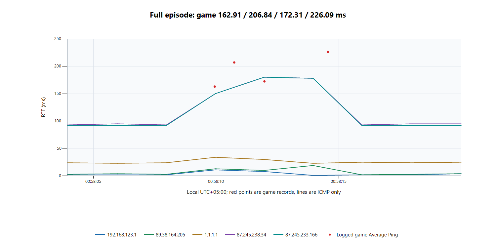
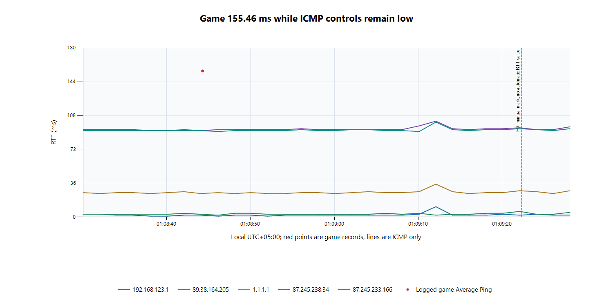
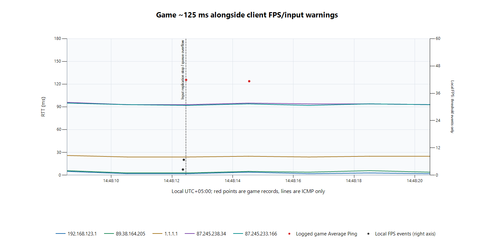
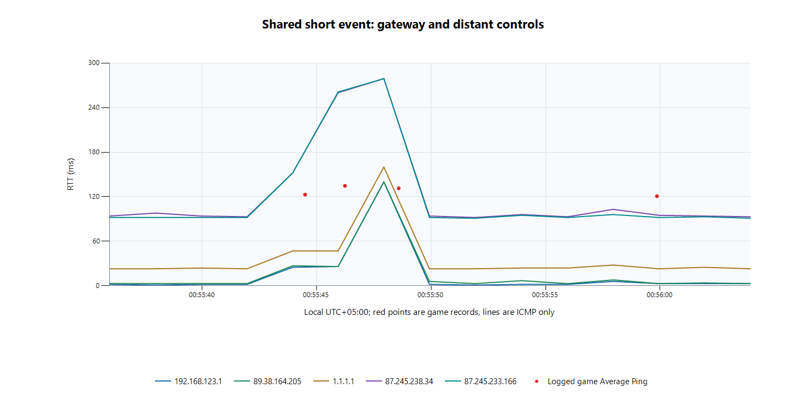
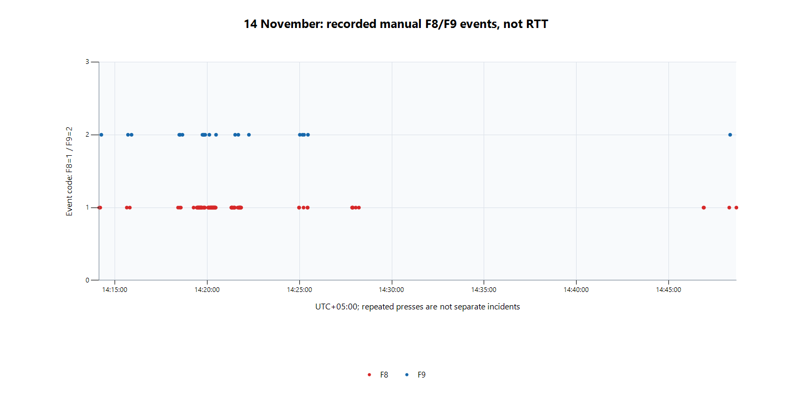
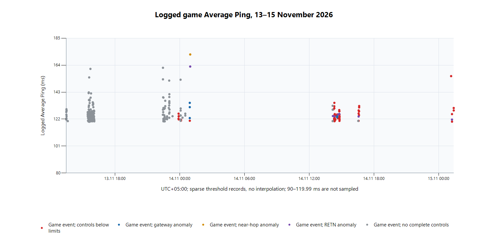

# Valorant × Meganet: отдельный анализ RTT 90–180 мс, 13–15 ноября 2026

**Главный результат:** повторяющиеся небольшие скачки подтверждены 263 числовыми игровыми записями. Данные показывают несколько разных паттернов: общие локальные всплески, совпадения с повышением RETN-контролей, отдельные клиентские FPS/input-события и повышение только игрового показателя при спокойных контролях. Конкретная причина различия Beeline/Meganet пока не установлена. Все случаи одним объяснением данные не объединяют.

Период — местные 13–15 ноября, UTC+05:00. Иллюстрация 90→100→110→120→150→180 из задания не превращена в фактическую последовательность. Числовая таблица ниже содержит только действительно записанные значения; неизвестные исходный RTT и длительность не восстановлены догадками.

**Исправление после независимой перепроверки 15 ноября.** Числа 263 / 58 / 13 и таблица выбранного диапазона воспроизведены без изменений. Однако прежние примеры «последовательных точек» скрывали промежуточные 217,28 и 202,80 из-за верхнего band-фильтра; они восстановлены ниже. Полный 00:58 эпизод содержит также 206,84 и 226,09, график исправлен. 263 — строки logger, а не независимые инциденты. [Новый открытый анализ всех 291 точек](VALORANT-RTT-OPEN-INVESTIGATION.md) проверяет эту ошибку выборки, зависимость/сдвиги/фазы и пределы причинных выводов. Старые download ZIP являются неизменёнными историческими срезами.

Новых игр, ping/tracert, нагрузочных тестов или изменений сети/Windows/Vanguard не выполнялось. Прочитаны существующие журналы и сохранённая телеметрия, отдельно — уже имеющиеся сетевые события Windows. Работающий монитор не остановлен. Ничего поддержке не отправлено.

## 1. Новые результаты этого разбора

- Дополнительно к RRT прочитаны целиком штатные локальные ShooterGame: большой дневной и ночной файлы 13 ноября, а также текущий файл с матчами 15 ноября. Ночной файл имеет 105197 строк; прежний endpoint-экстрактор ограничивался хвостом 100000. Новый разбор не ограничен этим хвостом. Исходные журналы и секреты в Git не копировались.
- Найдено **263 записи в целевом диапазоне: 214 значений 120–<130, 40 значений 130–<150, 9 значений 150–180 мс**. По местным датам: 183 / 74 / 6. Максимум этой выборки — **172,31 мс**. Числового 180,00 в ней нет; ручные сообщения о 180 остаются отдельным источником.
- Для **71/263** событий есть достаточно контрольных проб в ±4 с. **58** имеют все контроли ниже порогов; **13** имеют хотя бы одно контрольное отклонение: 5 с домашним шлюзом, 1 near-hop без шлюза, 7 только RETN. **192** не имеют полного пригодного контрольного покрытия, главным образом до начала диагностики; их нельзя назвать случаями спокойной сети.
- Из девяти значений 150–180 шесть не покрыты пригодными одновременными контролями. Два оставшихся — **162,91 и 172,31 в 00:58 14 ноября** — совпали с ростом обоих RETN-контролей до 150–180. Один — **155,46 в 01:08:44.282 15 ноября** — произошёл при шлюзе 1–2, near 2–4, Cloudflare 25–27, RETN 91–93.
- Только **2/263** числовых записи имеют Local FPS threshold в ±1 с, 3 — в ±4 с. Среди девяти записей 150–180 таких совпадений в ±4 с нет. Это не исключает короткие незафиксированные stalls, но не поддерживает FPS-collapse как универсальную причину диапазона.
- Для всех 71 покрытых событий есть интервал среднего трафика ПК: максимум RX **1,215680**, TX **0,645699 Мбит/с**. Ошибки/discards NIC в доступных разностях не росли. Нагрузка других устройств, субсекундные очереди и Wi-Fi retries этими данными не измерены.

## 2. Покрытие, источники и предел измеряемого

RRT содержит два одинаковых VAL ZIP, как установлено в [предыдущем разборе RRT](RIOT-RRT-LOG-ANALYSIS.md). Четыре из семи локальных игровых файлов побайтово совпадают с выбранными RRT members; их события не посчитаны повторно. Два RRT ShooterGame от 12 ноября вне местного периода 13–15 не включены. Три дополнительных локальных файла существенно расширяют покрытие.

| Код | Штатный игровой файл | Первое / последнее событие +05 | Строк | RTT 90–180 | RRT-дубликат |
|---|---|---|---:|---:|---|
| F1 | ShooterGame-backup-2026.11.13-04.25.29.log | 13.11 09:24:26.983 / 13.11 09:25:29.170 | 2103 | 0 | да |
| F2 | ShooterGame-backup-2026.11.13-11.18.28.log | 13.11 12:45:42.819 / 13.11 16:18:28.118 | 38824 | 135 | нет |
| F3 | ShooterGame-backup-2026.11.13-20.08.16.log | 13.11 22:22:11.880 / 14.11 01:08:16.462 | 105197 | 67 | нет |
| F4 | ShooterGame-backup-2026.11.14-09.30.10.log | 14.11 14:01:56.013 / 14.11 14:30:10.301 | 9081 | 26 | да |
| F5 | ShooterGame-backup-2026.11.14-11.51.12.log | 14.11 14:31:09.533 / 14.11 16:51:12.541 | 15155 | 29 | да |
| F6 | ShooterGame-backup-2026.11.14-20.02.40.log | 15.11 00:55:51.781 / 15.11 01:02:40.851 | 1838 | 0 | да |
| F7 | ShooterGame.log | 15.11 01:03:56.540 / 15.11 03:08:59.203 | 20922 | 6 | нет |

Файлы взяты из штатной папки `%LOCALAPPDATA%/VALORANT/Saved/Logs`, RRT — из предоставленной папки Riot Logs. Для каждого сохранены bytes, SHA-256 и происхождение в [game-sources.json](evidence/rtt-90-180-2026-11-15/inputs/game-sources.json). Текущий ShooterGame.log — зафиксированный префикс, а не обещание полной завершённой истории после его чтения. Его LastWriteTime может отставать при открытом файле; привязка часов основана на содержимом заголовка, а не только filesystem mtime.

**Цензурирование по порогу:** все найденные числовые записи целевого диапазона — `LogInstabilityTrackingDetails: Average Ping Threshold exceeded`, threshold 120 мс. В них нет автоматической серии **90–119,99 мс**. Нижняя часть диапазона известна по сообщениям игрока и отметкам, а не по значениям этих строк. Не найдено отдельного поддерживаемого экспорта непрерывных GUI Network RTT/jitter/inbound/outbound loss. Отсутствие threshold-строки не равно нормальному RTT и не даёт долю времени ниже 120.

Всего в этих файлах 291 числовая Average Ping запись за местные 13–15 ноября, 28 вне целевого диапазона сохранены в типизированном исходном наборе для контекста, но не включены в таблицу 263. Настройки отображения PlayerPerfShowNetworkRtt/PacketLoss, HTTP Latency_Stats, региональные probe failures и Avg. Engine Latency не подменяют игровой RTT. Семантика High Average Ping описана [Riot](https://playvalorant.com/en-us/news/game-updates/valorant-game-and-network-instability-basics/); точная формула усреднения этой версии клиента неизвестна.

При проверке провайдера исторические записи до начала Windows-диагностики имеют дополнительное ограничение: название ISP отдельно для каждого старого игрового сеанса не подтверждено снимком сети. Их нельзя автоматически объявить парным сравнением Meganet и Beeline.

## 3. Метод сопоставления и качество всей контрольной истории

Скобочные игровые штампы интерпретированы как UTC. Во всех семи файлах заголовок Log file open и первый штамп различаются примерно на пять часов; вывод согласуется с прежними данными. Представление с миллисекундами не означает внешней калибровки часов с точностью 1 мс. Для ICMP используется **sent_utc**, одинаково в старом CSV и новом JSONL; отдельно сохранено completed_utc. Это отличается от времени записи результата, применявшегося в некоторых предыдущих сводках.

Окно основного сравнения — ±4 с; опубликованы также ±1, ±2 и ±10 с. Для полноты требуются пять направлений, минимум две пробы на каждое (в ±1 с достаточно одной при двухсекундном опросе). Ближайшее измерение не подставляется из другого часа или из отсутствующей сессии. Пороги заморожены прежней методикой: шлюз **15**, near **16**, Cloudflare **38**, RETN-238 **109**, RETN-233 **106** мс; ранний RETN-234 — **100**. Это критерии описательной классификации ICMP, не пороги неисправности оператора.

QUIET = все доступные контрольные значения в полноценном окне ниже порогов, без отказов. LOCAL = порог/неответ шлюза, NEAR = near без шлюза, PUBLIC = Cloudflare без ближних, RETN = только один/оба RETN. Эти классы описывают **наблюдения контрольного трафика** и не устанавливают место потери игровых пакетов. ProbeError выделяется как ошибка измерителя, а не packet loss.

| Сохранённый источник | Строк/записей | Probe statuses | Пригодность |
|---|---:|---|---|
| 20261114-004449-2aa43789 | 717 | ProbeError=355 | Known failed collector revision: ProbeError artifacts, not packet-loss measurements |
| 20261114-004711-625146fb | 3299 | Success=3215 | да |
| 20261114-141126-ee9e460b | 5988 | Success=5745 | да |
| 20261114-163240-f28706ce | 98771 | Success=96900, TimedOut=35 | да |
| 20261113-234232-Range-1fbb0d | 335 | Success=286, TimedOut=49 | Known early timeout bug; not reliable loss measurements |
| 20261113-234606-Range-721321 | 700 | Success=700 | да |
| 20261113-235053-Unknown-fc7ee9 | 355 | Success=355 | да |
| 20261113-235320-Stockholm-unrated-af5126 | 1495 | Success=1495 | да |
| 20261114-000507-Stockholm-unrated-d3d418 | — | — | No saved probe CSV |
| 20261114-000610-Stockholm-unrated-ee0d94 | 615 | Success=615 | да |
| 20261114-001022-Stockholm-unrated-c5ba53 | 745 | Success=745 | да |

Итого прочитано **110495** строк ICMP; пригодных **109805**: 109770 Success и 35 TimedOut. 690 строк из двух известных ошибочных ревизий сохранены с eligible=0 и не используются для доказательства потерь. Начальный CSV имеет некорректный учёт тайм-аутов; run 00:44 имеет ProbeError. Каталог неудачного запуска 00:05 не содержит probe CSV. Тестовые/loopback/smoke-каталоги не считаются измерениями домашнего доступа.

Три пригодных непрерывных run прочитаны целиком до сохранённой границы: 3299, 5988 и **98771** записей; действующий run остановлен только в логическом чтении на committed watermark, сам процесс продолжил сбор. Первые два закрыты, третий не объявлен завершённым. Последняя выбранная ICMP sent — **15 ноября 03:18:52.080 +05**. Sequence в каждом каноническом префиксе непрерывен, обратных ходов record clock нет; максимальные интервалы целей — 2,062 / 2,148 / 2,737 с. Копии этих же run в reports/evidence не посчитаны ещё раз. Историческая ошибка first_seq manifest ночного сегмента не является пропущенной физической строкой.

Все 35 пригодных ICMP timeout находятся в длинном run. Важный контрпример: **15 ноября 01:31:34.092** в соединении :7102 четыре цели не ответили, а RETN-233 ответил 92 мс; рядом нет числового Average Ping события. Это не доказывает нормальный игровой RTT в ту секунду и не позволяет перевести четыре ICMP timeout в игровые потери. Полная контрольная история сохранена, а не отобрана только по спокойным окнам.

## 4. Подтверждённые случаи 150–180 мс

| ID | +05 | Average Ping, мс | Адрес приложения | Контроль ±4 с |
|---|---|---:|---|---|
| E039 | 13.11 15:36:28.444 | 154.44 | 185.40.64.1:7149 | NO DATA |
| E058 | 13.11 15:43:29.051 | 161.09 | 185.40.64.1:7149 | NO DATA |
| E138 | 13.11 22:26:45.699 | 152.95 | 185.40.64.1:7125 | NO DATA |
| E139 | 13.11 22:26:48.737 | 161.94 | 185.40.64.1:7125 | NO DATA |
| E169 | 13.11 23:01:24.881 | 151.98 | 185.40.64.1:7499 | NO DATA |
| E186 | 14.11 00:04:34.283 | 152.67 | 185.40.64.1:7039 | NO DATA |
| E201 | 14.11 00:58:09.942 | 162.91 | 185.40.64.1:7354 | RETN |
| E202 | 14.11 00:58:11.966 | 172.31 | 185.40.64.1:7354 | NEAR |
| E258 | 15.11 01:08:44.282 | 155.46 | 185.40.64.1:7216 | QUIET |

**00:58, смешанное совпадение с дальними контролями.** На неизменном адресе приложения **185.40.64.1:7354** полный порядок записей: 162,91 (00:58:09.942) → **206,84 (10.737)** → 172,31 (11.966) → **226,09 (14.554)**. Два значения вне выбранного band прежде скрывались при описании полного эпизода; это исправлено. Ни нового travel, ни смены порта нет. Регион/режим этого отдельного соединения независимо не подтверждён. Сопоставление ближайших циклов:

| Начало цикла +05 | Шлюз | Near | Cloudflare | RETN-238 | RETN-233 |
|---|---:|---:|---:|---:|---:|
| 00:58:05.981 | 2 | 4 | 23 | 95 | 92 |
| 00:58:07.975 | 2 | 3 | 24 | 93 | 92 |
| 00:58:09.969 | 11 | 13 | 34 | 150 | 150 |
| 00:58:11.956 | 8 | 10 | 30 | 180 | 180 |
| 00:58:13.946 | 1 | 19 | 23 | 178 | 178 |
| 00:58:15.930 | 2 | 2 | 25 | 93 | 92 |

Совпадение сильнее, чем одно сообщение игрока: четыре игровых числа и два отдельных дальних контроля растут рядом по времени, без FPS/loss/input warning в ±4 с. Но ближние RTT тоже менялись, near достиг 19, а ответ RETN — ICMP control plane с собственным обратным путём. Два band-события имеют RETN класс, два вне band — NEAR по приоритету классификатора, хотя дальние тоже повышены. Нельзя выделить конкретный RETN-линк, транзитный оператор или обратный UDP-маршрут. Возвращение контрольных RTT в 00:58:15.930 не является доказанной секундой восстановления игры. Средняя нагрузка ПК за охватывающие ~30 с: RX/TX **0,323/0,181 Мбит/с**; RSSI ближайшего снимка −65 dBm, AP-01, канал 36.



**15 ноября 01:08:44.282, игровой показатель без контрольного роста.** На **185.40.64.1:7216** Average Ping **155,46**. В ±4 с по четыре Success на цель: шлюз 1–2, near 2–4, Cloudflare 25–27, RETN-238 92–93, RETN-233 91–92. Ближайшие ICMP отличаются от игрового штампа менее чем на секунду. Ни Local FPS threshold, ни Burst Loss/input overflow в ±4 с не записано. Снимок Wi-Fi за 1,871 с до события: RSSI −59, AP-01, канал 36, RX/TX PHY 1201; средний трафик ~30 с RX/TX **0,384/0,270 Мбит/с**, errors/discards delta=0.

Через **38,051 с**, в 01:09:22.333, обработана F9; пользователь позже уточнил общий диапазон 85–93 для двух F9, без отдельного точного значения каждой. Это поддерживает частичное/полное восстановление по наблюдению игрока, но F9 не измеряет 85–93 автоматически и не задаёт длительность 155,46. Следующие числовые записи того же соединения: 121,63 в 01:13:33.911, 125,89 в 01:13:43.192 и 120,02 в 01:13:49.776. Изменение IP или перезапуск для этого типа вариаций не необходимы по наблюдаемой хронологии; неизменность IP не гарантирует неизменный сетевой путь.



**Шесть непокрытых высоких точек.** 154,44/161,09 днём 13 ноября и 152,95/161,94/151,98 вечером были до пригодных контрольных измерений. При 151,98 в 23:01:24.881 есть четыре соседних Burst Loss начала в ±4 с, но нет знаменателя потерь/контролей. **152,67 в 00:04:34.283** попало в известный пробел сбора 00:03:21–00:06:13. Это новая игровая числовая точка внутри прежнего пробела; она не создаёт отсутствующий ICMP и не переносит скриншот 185/189 в диапазон 90–180.

## 5. Повторные 110–130, частичные снижения и клиентский контекст

Полная автоматическая серия ниже 120 отсутствует, поэтому переходы именно 90→100→110 не имеют точных пар чисел из лога. Сохранены ручные наблюдения: 100–110 на стрельбище (сообщение 13.11 23:50:48), 90–100 и недавние 110 в начале Stockholm (сообщение 23:58:40), 100–160 и недавние 160–180 ночью, восстановление 91–96 (сообщение 14.11 00:14:43), дневные 89–95 и поздние 100–110, а 15 ноября общий 85–93. Время сообщения не выдаётся за время каждого перехода. [Исходные проверенные числовые поля ранних сообщений](evidence/rtt-90-180-2026-11-15/inputs/manual-numeric-observations.json).

Дневное ретроспективное уточнение игрока **95→120→180→120**, затем позднее более тяжёлый эпизод, сохранено [отдельным исходным уточнением](evidence/day-2026-11-14/chronology-clarification.json). Для этих четырёх чисел не зафиксированы точные секунды и назначения отдельным F8/F9. Это прежняя сообщённая последовательность; иллюстративный ряд 90→100→110→120→150→180 из нового задания ей не подменён.

Внутри записанного диапазона есть настоящие пары наблюдений с повышением и последующим меньшим значением. Примеры, все на одном адресе/порту в каждой строке:

| Соединение | Последовательные записанные точки +05 | Что известно о времени |
|---|---|---|
| :7149, 13 ноября | 126,95 в 15:36:24.702 → **217,28 в 27.869** → 154,44 в 28.444 → 120,00 в 15:37:35.253 | 3,167 / 0,575 / 66,809 с между точками; длительность уровня неизвестна. Промежуточная >180 восстановлена |
| :7149, 13 ноября | 161,09 в 15:43:29.051 → 127,26 в 15:43:36.944 → 123,16 в 15:43:43.097 | Наблюдаемое частичное снижение за 7,893/6,153 с между записями |
| :7125, 13 ноября | 129,34 в 22:26:44.304 → 152,95 в 45.699 → **202,80 в 48.233** → 161,94 в 48.737 → 138,97 в 22:27:37.164 → 127,44 в 58.217 | Реальный порядок чисел, промежуточная >180 восстановлена, промежутки не заполнены интерполяцией |
| :7039, 14 ноября | 121,68 в 00:04:13.878 → 152,67 в 00:04:34.283 → 120,69 в 00:04:42.361 | Нет одновременных ICMP; падение 31,98 мс между последними двумя точками через 8,078 с |

Это изменения между сохранёнными точками, а не доказанная исходная baseline или непрерывно удерживаемый уровень. [Все последовательные пары и интервалы между точками](rtt-90-180-data/consecutive-logged-points.json); transition_duration_seconds оставлено null.

**Клиентский короткий паттерн:** 14:35:10.445 Average Ping 125,63 через 0,517/0,501 с после Local Framerate 4,00/17,32; контроли в ±4 спокойны. В **14:48:12.467** Average Ping 125,62: за 0,106/0,076 с до него FPS 2,50/6,78, за 0,003 с — input replication stop/queue overflow. Контроли снова спокойны. Это поддерживает участие клиентской обработки в этих конкретных коротких случаях; overflow может быть также следствием запаздывающих внешних ACK, а запись не доказывает первопричину stall.



**Общий локальный паттерн:** 00:55:44.503 / 46.245 / 48.589 — игровые 122,80 / 134,64 / 131,32; рядом прежний цикл шлюз/near/Cloudflare/RETN **140/140/160/279/279**. 14:34:59.958 / 14:35:01.603 — 123,38/124,15 рядом с общим циклом 118/16/139/254/253. Эти случаи не выглядят исключительно проблемой удалённого Riot backend. Ответ шлюза — тоже control plane, а задержка обработки на ПК/драйвере не отделена от Wi-Fi/AP.



## 6. F8/F9: временные отметки без выдуманных значений

Разобраны 107 F8/20 F9 дневного run, одна F10 ночного run (проверка кнопки/другое событие по уточнению владельца), две F9 длинного run 15 ноября. Источник RegisterHotKey отделён от сообщений пользователя. Для горячих клавиш применяется **observed_utc**, время записи хранится отдельно; небольшие очереди между ними не скрыты.

Дневные F8 группируются в **20** интервалов, 19 закрытых F9 и один открытый. Повторные F8 не считаются независимыми авариями. Две F9 15 ноября не имеют предшествующих F8 в этом run и не создают искусственного интервала скачка. Полная таблица меток и длительностей **между кнопками**, а не длительностей RTT: [marker-intervals.json](rtt-90-180-data/marker-intervals.json).



Раннее окно повторных F8 14:19–14:22 связывалось игроком с 120–180; лог даёт там ряд 120–134,65, а точные мгновенные 150–180 для каждого клика не сохранены. Это ограничение разных окон/показателей и порогового логирования, а не основание отвергать наблюдения. Поздние F8 14:46:53/14:48:17/14:48:40 имеют рядом числовые 121–129, как показано в предыдущем RRT-разборе. Указанные значения не назначены автоматически всем меткам.

## 7. Общая классификация и проверка устойчивости сопоставления

| Окно вокруг игрового события | QUIET | LOCAL | NEAR | RETN | Нет полного покрытия |
|---|---:|---:|---:|---:|---:|
| ±1 с | 63 | 5 | 0 | 3 | 192 |
| ±2 с | 60 | 5 | 1 | 4 | 193 |
| ±4 с | 58 | 5 | 1 | 7 | 192 |
| ±10 с | 48 | 8 | 2 | 13 | 192 |

При расширении окна растёт число случайных/неоднозначных совпадений: от 8 контрольных отклонений в ±1 с до 23 в ±10. Поэтому основное ±4 окно сопровождается точными nearest timestamps и предупреждением, что соседние окна перекрываются. 58/71 = **81,7%** покрытых пороговых записей имеют QUIET в ±4; это не доля всех игровых секунд и не вероятность причины Riot.

Дополнительно проверены **21961** полных пятёрочных контрольных циклов всей пригодной истории. В интервалы известных игровых соединений после Map Ready попали **3542** цикла. Из них **223** лежат в объединении ±4-секундных окон выбранных игровых записей: 207 QUIET, 6 LOCAL, 1 NEAR, 9 RETN. В остальных **3319** циклах тех же соединений: 3261 QUIET, 6 LOCAL, 1 NEAR, 1 PUBLIC, 50 RETN. Частота любого контрольного отклонения — 16/223 (**7,17%**) рядом с выбранными записями против 58/3319 (**1,75%**) в остальных циклах.

Это описательная временная ассоциация части скачков с контролями. Циклы зависимы, точки выбраны по threshold logging, фон включает неизвестный игровой RTT (в том числе другие уровни), интервалы соединений и режимы различаются. **Остальные циклы не названы нормальным соединением**, p-value/причинная вероятность не вычислялись. Группировка по соединению и объединение перекрывающихся окон предотвращают многократный счёт одного цикла, но не устраняют смещение отбора.



## 8. Wi-Fi, драйвер, локальная нагрузка и маршруты Windows

Из сохранённых данных получено **1548** обезличенных снимков (непрерывные и ранние CSV-сессии), **1540** интервалов счётчиков. В наблюдаемых снимках нет disconnected, AP один (AP-01), канал 36. RSSI ближайших снимков к покрытым игровым событиям **−65…−53 dBm**. PHY rate менялся, сам по себе это не доказательство неисправности. Более ранняя mojibake-кодировка netsh восстановлена только обратимым CP866→UTF-8 преобразованием; исходные файлы не переписаны.

Для 71 покрытого события средние RX/TX за охватывающий интервал ≤1,216/0,646 Мбит/с. Например, общий локальный 00:55:44 имеет ~0,456/0,254; RETN-события 00:58 ~0,323/0,181; 155 мс 15 ноября ~0,384/0,270; FPS/input-событие 14:48 ~0,254/0,168. Суммарные разности NIC errors/discards в пригодных интервалах равны нулю. Это не показывает исчерпания полосы самим ПК, но **не исключает** burst на субсекундах, очереди/airtime, другие устройства, Wi-Fi retries или DPC/driver stall. Счётчик, который драйвер не обновляет, не является доказательством отсутствия радио-повторов.

Прочитан уже существующий включённый WLAN-AutoConfig/Operational и выбранные сетевые Warning/Error провайдеры System за точные UTC-границы периода. После явного UTC post-filter — **9 WLAN событий**, все до рассматриваемых числовых RTT; выбранных System network Warning/Error **0**. В ±30 с к 263 точкам совпадений нет. Сохранены только время/provider/event ID/числовые reason codes, без сообщений, SSID/MAC/GUID/имён компьютера. Это не полный ETW-профиль драйвера, журнал всех возможных providers или доказательство здоровья радио. [windows-network-events.json](evidence/rtt-90-180-2026-11-15/inputs/windows-network-events.json).

72 полных снимка выбора маршрутов имеют три сигнатуры из-за InterfaceMetric **30/35** и одного смешанного последовательного снимка. В них контролям выбирался тот же ifIndex 7 и тот же gateway 192.168.123.1 (для самого шлюза on-link 0.0.0.0). Это **не смена международного маршрута**, не BGP и не наблюдение каждого пакета. Radmin присутствует в системе, но в этих выборах контролей не становится выходом. Краткое переключение между редкими снимками или другой маршрут игрового UDP не исключены.

## 9. IP, порты и старые ping/tracert

Каждое событие привязано к интервалу travel→NetDriver Stats/следующий travel, с проверкой Map Ready. После закрытия соединения адрес не переносится автоматически на меню. Всего 17 таких интервалов; для 242 точек сила свидетельства — travel + map ready, для 21 в том же соединении есть ReceivedPacket/RemoteAddr. Это историческое подтверждение приложением, не независимый текущий Windows UDP peer и не физический сервер Stockholm.

| Соединение | IP:порт | Travel / окончание +05 | Записей 90–180 | Packet RemoteAddr в интервале |
|---|---|---|---:|---|
| C001 | 185.40.64.1:7394 | 13.11 13:09:08.764 / 13.11 13:44:33.086 | 9 | — |
| C002 | 185.40.64.1:7149 | 13.11 15:23:01.919 / 13.11 16:05:14.928 | 126 | — |
| C003 | 185.40.64.1:7125 | 13.11 22:25:45.729 / 13.11 22:51:22.797 | 30 | — |
| C004 | 185.40.64.1:7499 | 13.11 22:58:54.355 / 13.11 23:04:24.490 | 12 | — |
| C005 | 185.40.64.1:7496 | 13.11 23:05:04.371 / 13.11 23:11:09.289 | 0 | — |
| C006 | 185.40.64.1:7048 | 13.11 23:11:34.945 / 13.11 23:50:22.507 | 1 | — |
| C007 | 185.40.64.1:7039 | 13.11 23:51:55.749 / 14.11 00:29:52.139 | 16 | — |
| C008 | 185.40.64.1:7329 | 14.11 00:30:35.124 / 14.11 00:37:43.082 | 2 | 14.11 00:30:38.159 |
| C009 | 185.40.64.1:7415 | 14.11 00:38:26.070 / 14.11 00:46:01.354 | 0 | — |
| C010 | 185.40.64.1:7382 | 14.11 00:46:47.123 / 14.11 00:52:07.972 | 0 | — |
| C011 | 185.40.64.1:7354 | 14.11 00:53:41.234 / 14.11 01:06:30.140 | 6 | — |
| C012 | 185.40.64.1:7004 | 14.11 14:08:49.238 / 14.11 14:30:09.253 | 26 | — |
| C013 | 162.249.72.1:7004 | 14.11 14:31:45.206 / 14.11 14:49:28.428 | 19 | 14.11 14:31:48.987 |
| C014 | 185.40.64.1:7158 | 14.11 16:29:32.496 / 14.11 16:38:21.321 | 10 | — |
| C015 | 185.40.64.1:7216 | 15.11 01:05:52.823 / 15.11 01:16:54.448 | 4 | — |
| C016 | 185.40.64.1:7102 | 15.11 01:21:06.070 / 15.11 01:33:20.136 | 2 | — |
| C017 | 185.40.64.1:7361 | 15.11 01:35:18.454 / 15.11 01:47:08.971 | 0 | — |

Ноль в колонке событий означает отсутствие пороговых записей выбранного диапазона, а не нормальный RTT всего матча. Адреса/порты 185.40.64.1:7394, :7499 и :7361 расширяют прежнюю инвентаризацию. Region/mode независимо известны только там, где есть соответствующее сообщение игрока; остальные строки нельзя автоматически считать Stockholm. Riot описывает [UDP и Riot Direct/Anycast](https://www.riotgames.com/en/news/leveling-networking-multi-game-future), но конкретный ingress/PoP/backend каждого IP в эти секунды не установлен. Стабильность IP/порта не гарантирует стабильность пути, а их смена не доказывает другой физический сервер.

Старый native пакет по методике Meganet сохранён: `ping -n 100`, `tracert -d -h 32`, полные выводы и времена в [инженерном пакете](meganet-package-2026-11-14/README.md). Batch **14 ноября 16:13:20–16:29:57 +05**: Riot 185.40.64.1 и 162.249.72.1 не дали Echo Reply; это ограничение ICMP, не игровые UDP-потери. Valve SDR sto/sto2 дали 100/100, avg 72/77 мс. Relay не является физическим CS2 game server или эквивалентным маршрутом к Riot.

Последние ~25 секунд batch пересеклись с началом travel :7158 в 16:29:32; первый его сохранённый 120+ — в 16:32:14, уже после batch. Эти ограниченные ICMP-команды не являются доказанной причиной скачков и не являются нагрузочным тестом. Tracert RTT промежуточного интерфейса и прямой Echo RTT/игровой UDP имеют разные ответы и потенциальные обратные пути; разницу нельзя объявлять задержкой конкретного линка. Синхронного такого же набора с Beeline нет.

## 10. Проверка причинных гипотез

| Гипотеза | Новые поддерживающие наблюдения | Против / предел | Уверенность в причине и необходимый различающий факт |
|---|---|---|---|
| Неоптимальная маршрутизация Meganet→Riot Direct | Одна из высоких точек 155,46 при спокойных пяти контролях; вариации в том же игровом потоке; базовый RTT отличается от ретроспективного Beeline | Нет маршрута самого UDP, ingress и парного Beeline-замера; часть скачков общая уже до шлюза | Низкая для конкретного виновного маршрута. Meganet: forward/reverse, egress/peering/ECMP/NAT/queues по UTC и потоку; Riot: ingress/backend |
| Международный транзит | 00:58:09–13 два RETN-контроля 150/180/178 рядом с игровыми 162,91/172,31; ещё отдельные RETN-only окна | Ближние тоже менялись; ICMP control plane/обратный путь не идентичен игровому; 58 покрытых точек без контрольных превышений | Средняя для временного общего дальнего паттерна, низкая для локализации. Нужны транзитные queue/drop/route данные и двусторонние измерения |
| Обратный игровой UDP-путь | Игровой RTT может расти при спокойном ICMP; потеря/задержка ACK может иметь обратное направление | Односторонний клиентский RTT не разлагается на направления; packet capture не выполнялся | Возможна, не подтверждена. Riot/операторы должны дать reverse path и per-flow arrival/ACK timing |
| Wi-Fi/драйвер/AP | Два коротких общих события затрагивают шлюз и игру; 01:31:34 отдельные ICMP отказы | 155,46 и многие 120+ при шлюзе 1–5; AP/канал те же, ошибок NIC/WLAN-корреляции нет, но retries/DPC не измерены | Средняя поддержка локального общего компонента отдельных всплесков, низкая как единственное объяснение. Пользователь: согласованный Ethernet/Wi-Fi A/B; безопасные штатные RF/driver/frame-time данные |
| Клиент/сервер Riot | Два ≤1-секундных совпадения 125 мс с FPS, одно с input stop/overflow; игровые loss warnings в некоторых старых точках | Девять высоких 150–180 без FPS/input warning в ±4, серверных timings нет; клиентская очередь может быть следствием пути | Средняя для клиентского участия в двух случаях, низкая для причины всех. Riot: семантика counters, server tick/input/ACK и ingress; пользователь: поддерживаемый экспорт RTT/frame time |
| Фоновая нагрузка/очереди | Общие короткие всплески совместимы с queueing | Средний трафик ПК в покрытых событиях мал; WAN/router/другие устройства/субсекундные bursts не измерены | Не подтверждена как общая причина. Нужны временные router ingress/egress/queue/airtime counters; load test только отдельно вне игры с разрешением |

В таблице «поддержка паттерна» отделена от «доказана причина». RETN-only классификация не назначает виновным RETN. QUIET не назначает виновным Riot. Сопутствующий FPS warning не назначает виновным драйвер или CPU. Данных недостаточно, чтобы окончательно исключить любой из шести классов для всех событий.

## 11. Ответ на вопрос Beeline против Meganet

**По имеющимся данным нельзя установить, почему именно смена провайдера сделала RTT менее стабильным.** Последнее описание владельца — стабильные Beeline **80–90 мс**; более ранний baseline называл примерно 70–80. Это ретроспективные диапазоны, не две синхронные серии при одном сервере/маршруте/доступе. Числовых игровых/сетевых логов Beeline, позволяющих отделить географическую базу, выбор ingress и вариации, нет.

На Meganet пользователь также наблюдал **85–93**, поэтому объяснение исключительно постоянной надбавкой к базовой задержке недостаточно для повторных подъёмов 120–180. Новый анализ показывает, что дополнительная задержка бывает при изменении контролей и без него. Он не даёт долю времени, когда Meganet выше 120, поскольку журнал пороговый. Скорость ~500 Мбит/с не измеряет время доставки игрового пакета; средний трафик ПК здесь не показывает насыщения.

| Кто предоставляет | Какие данные действительно различат причины | Для чего |
|---|---|---|
| Пользователь | Согласованный Ethernet/Wi-Fi A/B на Meganet, одинаковый регион/режим и время; поддерживаемые числовые Network RTT avg/max, jitter, inbound/outbound loss и client frame time; метки без переключения окон | Отделить RF/AP/driver от дальнейшего пути и увидеть 90–119,99, baseline и реальные длительности |
| Пользователь, если Beeline ещё доступен | Парное сравнение Beeline/Meganet при одинаковом ПК, типе доступа и максимально сопоставимом матч-сервере/ingress; записи actual endpoint, времени, RTT/loss; без обещания одинакового backend по одному IP | Проверить именно эффект ISP, а не память о другом сервере/времени/Wi-Fi |
| Meganet и транзит | Данные по UTC 13.11 19:58:05–19:58:16 и 14.11 20:08:40–20:09:25, направления :7354 и :7216; forward/reverse, peering/ECMP/BNG/NAT/drop/queues; subscriber WAN/NAT privately | Разделить общий дальний всплеск и game-specific случай; сравнить доступ и egress |
| Riot | Match/ingress/backend mapping, per-direction arrival/ACK/input-queue/server-tick timings; определения Average Ping/Burst Loss/InTotalPacketsLost и поддерживаемый безопасный экспорт | Отделить forward/reverse UDP, client scheduling, ingress и backend processing |
| Пользователь/роутер | Синхронные агрегированные WAN/queue/airtime и нагрузка других устройств, без паролей/чужого содержимого | Проверить очереди, которые счётчики одного ПК не видят |

Полный 5-tuple не установлен: client source UDP port нельзя взять из несвязанного локального binding. Публичный абонентский WAN, договор и исходные match/account identifiers передаются поддержке только владельцем приватно. Новые измерения, расширенный UDP-захват и отправка запросов в рамках этого этапа не запускались.

## 12. Полная таблица 263 числовых игровых событий

Время ниже — +05. `Предыд.` — предыдущая **записанная** Average Ping в том же соединении и расстояние до неё, а не RTT непосредственно перед скачком. Истинная baseline и длительность для всех строк **неизвестны** (`?`). F#:line связывает строку с источником из раздела 2; полные UTC и SHA находятся в JSON. Сила endpoint: MAP=travel+Map Ready, NET=в том же соединении есть ReceivedPacket RemoteAddr. Ни один код не означает физический сервер или packet capture.

ICMP: ближайшие GW / near / Cloudflare / RETN-238 / RETN-233 и максимальный модуль временного смещения этих ближайших проб; `*` вместо RETN-233 обозначает ранний RETN-234. Класс основан на **всех** пробах ±4 с, поэтому может отличаться от вида одной ближайшей пятёрки. Полные min/median/max/status/N и точные времена каждой цели есть в [events-90-180.json](rtt-90-180-data/events-90-180.json); [CSV](rtt-90-180-data/events-90-180.csv) удобен для фильтрации.

Предупреждения ±4 с: L=число Burst Loss начал, Q=Queue Overflow ACTIVE, I=input replication stop, A=received-packet ACK warning, M=saved-moves limit, R=negative remote movement TimeIndexDiff. R относится к обработке движения и не является потерей пакета; несколько сообщений могут относиться к разным игровым объектам. `—` означает отсутствие такой **записи** в окне, не нулевую реальную потерю. FPS показывает записанное значение и смещение в секундах. Контекст ±10 с, snapshots и их времена доступны в полной строке JSON; общий процент loss без знаменателя не вычислялся.

| ID | Дата/время +05 | RTT мс | Предыд. мс / Δt с | IP:порт / сила | Ближайший ICMP мс | Класс ±4 | FPS ±4с | L/Q/I/A/M/R ±4с | Baseline / длит. | Источник |
|---|---|---:|---|---|---|---|---|---|---|---|
| E001 | 13.11 13:29:14.721 | 127.51 | — | 185.40.64.1:7394 MAP | нет проб | NO DATA | — | 0/0/0/0/0/2 | ? / ? | F2:11428 |
| E002 | 13.11 13:29:31.336 | 121.60 | 127.51 / 16.615 | 185.40.64.1:7394 MAP | нет проб | NO DATA | — | — | ? / ? | F2:11466 |
| E003 | 13.11 13:29:49.170 | 125.49 | 121.6 / 17.834 | 185.40.64.1:7394 MAP | нет проб | NO DATA | — | 0/0/0/0/0/2 | ? / ? | F2:11490 |
| E004 | 13.11 13:30:02.781 | 129.67 | 125.49 / 13.611 | 185.40.64.1:7394 MAP | нет проб | NO DATA | — | — | ? / ? | F2:11690 |
| E005 | 13.11 13:30:12.944 | 122.71 | 129.67 / 10.163 | 185.40.64.1:7394 MAP | нет проб | NO DATA | — | — | ? / ? | F2:11715 |
| E006 | 13.11 13:30:51.077 | 124.27 | 122.71 / 38.133 | 185.40.64.1:7394 MAP | нет проб | NO DATA | — | 0/0/0/0/0/6 | ? / ? | F2:12228 |
| E007 | 13.11 13:30:52.097 | 128.61 | 124.27 / 1.02 | 185.40.64.1:7394 MAP | нет проб | NO DATA | — | 0/0/0/0/0/6 | ? / ? | F2:12261 |
| E008 | 13.11 13:31:02.739 | 128.46 | 128.61 / 10.642 | 185.40.64.1:7394 MAP | нет проб | NO DATA | — | 0/0/0/0/0/2 | ? / ? | F2:12274 |
| E009 | 13.11 13:37:36.747 | 120.43 | 128.46 / 394.008 | 185.40.64.1:7394 MAP | нет проб | NO DATA | — | — | ? / ? | F2:14526 |
| E010 | 13.11 15:28:12.775 | 125.84 | — | 185.40.64.1:7149 MAP | нет проб | NO DATA | — | 0/0/0/0/0/2 | ? / ? | F2:24619 |
| E011 | 13.11 15:28:14.788 | 127.38 | 125.84 / 2.013 | 185.40.64.1:7149 MAP | нет проб | NO DATA | — | 0/0/0/0/0/2 | ? / ? | F2:24621 |
| E012 | 13.11 15:28:21.855 | 124.40 | 127.38 / 7.067 | 185.40.64.1:7149 MAP | нет проб | NO DATA | — | — | ? / ? | F2:24627 |
| E013 | 13.11 15:30:02.838 | 120.81 | 124.4 / 100.983 | 185.40.64.1:7149 MAP | нет проб | NO DATA | — | — | ? / ? | F2:24966 |
| E014 | 13.11 15:30:07.949 | 123.79 | 120.81 / 5.111 | 185.40.64.1:7149 MAP | нет проб | NO DATA | — | 0/0/0/0/0/8 | ? / ? | F2:24980 |
| E015 | 13.11 15:30:10.474 | 122.75 | 123.79 / 2.525 | 185.40.64.1:7149 MAP | нет проб | NO DATA | — | 1/0/0/0/0/8 | ? / ? | F2:24990 |
| E016 | 13.11 15:31:31.140 | 120.35 | 122.75 / 80.666 | 185.40.64.1:7149 MAP | нет проб | NO DATA | — | — | ? / ? | F2:25391 |
| E017 | 13.11 15:31:34.217 | 121.07 | 120.35 / 3.077 | 185.40.64.1:7149 MAP | нет проб | NO DATA | — | — | ? / ? | F2:25394 |
| E018 | 13.11 15:31:35.741 | 127.60 | 121.07 / 1.524 | 185.40.64.1:7149 MAP | нет проб | NO DATA | — | — | ? / ? | F2:25395 |
| E019 | 13.11 15:31:43.870 | 122.81 | 127.6 / 8.129 | 185.40.64.1:7149 MAP | нет проб | NO DATA | — | — | ? / ? | F2:25399 |
| E020 | 13.11 15:33:15.930 | 125.27 | 122.81 / 92.06 | 185.40.64.1:7149 MAP | нет проб | NO DATA | — | — | ? / ? | F2:25863 |
| E021 | 13.11 15:33:17.430 | 123.91 | 125.27 / 1.5 | 185.40.64.1:7149 MAP | нет проб | NO DATA | — | — | ? / ? | F2:25865 |
| E022 | 13.11 15:33:23.034 | 121.44 | 123.91 / 5.604 | 185.40.64.1:7149 MAP | нет проб | NO DATA | — | — | ? / ? | F2:25870 |
| E023 | 13.11 15:33:25.556 | 142.23 | 121.44 / 2.522 | 185.40.64.1:7149 MAP | нет проб | NO DATA | — | — | ? / ? | F2:25872 |
| E024 | 13.11 15:33:41.750 | 126.01 | 142.23 / 16.194 | 185.40.64.1:7149 MAP | нет проб | NO DATA | — | — | ? / ? | F2:25914 |
| E025 | 13.11 15:33:55.955 | 124.44 | 126.01 / 14.205 | 185.40.64.1:7149 MAP | нет проб | NO DATA | — | — | ? / ? | F2:26038 |
| E026 | 13.11 15:34:00.992 | 131.39 | 124.44 / 5.037 | 185.40.64.1:7149 MAP | нет проб | NO DATA | — | — | ? / ? | F2:26054 |
| E027 | 13.11 15:34:05.692 | 129.47 | 131.39 / 4.7 | 185.40.64.1:7149 MAP | нет проб | NO DATA | — | — | ? / ? | F2:26055 |
| E028 | 13.11 15:34:17.601 | 120.02 | 129.47 / 11.909 | 185.40.64.1:7149 MAP | нет проб | NO DATA | — | — | ? / ? | F2:26057 |
| E029 | 13.11 15:34:20.648 | 142.80 | 120.02 / 3.047 | 185.40.64.1:7149 MAP | нет проб | NO DATA | — | — | ? / ? | F2:26058 |
| E030 | 13.11 15:34:27.299 | 121.69 | 142.8 / 6.651 | 185.40.64.1:7149 MAP | нет проб | NO DATA | — | — | ? / ? | F2:26060 |
| E031 | 13.11 15:34:40.651 | 122.03 | 121.69 / 13.352 | 185.40.64.1:7149 MAP | нет проб | NO DATA | — | — | ? / ? | F2:26087 |
| E032 | 13.11 15:34:58.216 | 122.16 | 122.03 / 17.565 | 185.40.64.1:7149 MAP | нет проб | NO DATA | — | 0/0/0/0/0/4 | ? / ? | F2:26095 |
| E033 | 13.11 15:35:01.245 | 121.49 | 122.16 / 3.029 | 185.40.64.1:7149 MAP | нет проб | NO DATA | — | 0/0/0/0/0/4 | ? / ? | F2:26098 |
| E034 | 13.11 15:35:07.315 | 120.93 | 121.49 / 6.07 | 185.40.64.1:7149 MAP | нет проб | NO DATA | — | — | ? / ? | F2:26109 |
| E035 | 13.11 15:35:10.962 | 132.57 | 120.93 / 3.647 | 185.40.64.1:7149 MAP | нет проб | NO DATA | — | — | ? / ? | F2:26144 |
| E036 | 13.11 15:35:12.801 | 136.82 | 132.57 / 1.839 | 185.40.64.1:7149 MAP | нет проб | NO DATA | — | — | ? / ? | F2:26147 |
| E037 | 13.11 15:35:18.243 | 132.62 | 136.82 / 5.442 | 185.40.64.1:7149 MAP | нет проб | NO DATA | — | — | ? / ? | F2:26186 |
| E038 | 13.11 15:36:24.702 | 126.95 | 132.62 / 66.459 | 185.40.64.1:7149 MAP | нет проб | NO DATA | — | — | ? / ? | F2:26683 |
| E039 | 13.11 15:36:28.444 | 154.44 | 217.28 / 0.575 | 185.40.64.1:7149 MAP | нет проб | NO DATA | — | — | ? / ? | F2:26691 |
| E040 | 13.11 15:37:35.253 | 120.00 | 154.44 / 66.809 | 185.40.64.1:7149 MAP | нет проб | NO DATA | — | 0/0/0/0/0/2 | ? / ? | F2:27151 |
| E041 | 13.11 15:37:36.388 | 120.09 | 120 / 1.135 | 185.40.64.1:7149 MAP | нет проб | NO DATA | — | 0/0/0/0/0/2 | ? / ? | F2:27155 |
| E042 | 13.11 15:37:40.627 | 120.87 | 120.09 / 4.239 | 185.40.64.1:7149 MAP | нет проб | NO DATA | — | — | ? / ? | F2:27161 |
| E043 | 13.11 15:37:43.053 | 128.77 | 120.87 / 2.426 | 185.40.64.1:7149 MAP | нет проб | NO DATA | — | — | ? / ? | F2:27172 |
| E044 | 13.11 15:37:57.661 | 121.30 | 128.77 / 14.608 | 185.40.64.1:7149 MAP | нет проб | NO DATA | — | — | ? / ? | F2:27183 |
| E045 | 13.11 15:38:10.396 | 123.58 | 121.3 / 12.735 | 185.40.64.1:7149 MAP | нет проб | NO DATA | — | — | ? / ? | F2:27279 |
| E046 | 13.11 15:38:17.066 | 121.46 | 123.58 / 6.67 | 185.40.64.1:7149 MAP | нет проб | NO DATA | — | — | ? / ? | F2:27383 |
| E047 | 13.11 15:38:20.720 | 137.19 | 121.46 / 3.654 | 185.40.64.1:7149 MAP | нет проб | NO DATA | — | — | ? / ? | F2:27388 |
| E048 | 13.11 15:38:37.139 | 125.10 | 137.19 / 16.419 | 185.40.64.1:7149 MAP | нет проб | NO DATA | — | 0/0/0/0/0/2 | ? / ? | F2:27650 |
| E049 | 13.11 15:38:47.808 | 127.01 | 125.1 / 10.669 | 185.40.64.1:7149 MAP | нет проб | NO DATA | — | — | ? / ? | F2:27657 |
| E050 | 13.11 15:38:50.371 | 136.46 | 127.01 / 2.563 | 185.40.64.1:7149 MAP | нет проб | NO DATA | — | — | ? / ? | F2:27659 |
| E051 | 13.11 15:38:55.960 | 127.54 | 136.46 / 5.589 | 185.40.64.1:7149 MAP | нет проб | NO DATA | — | — | ? / ? | F2:27668 |
| E052 | 13.11 15:38:57.990 | 134.52 | 127.54 / 2.03 | 185.40.64.1:7149 MAP | нет проб | NO DATA | — | — | ? / ? | F2:27670 |
| E053 | 13.11 15:39:12.751 | 121.33 | 134.52 / 14.761 | 185.40.64.1:7149 MAP | нет проб | NO DATA | — | 0/0/0/0/0/2 | ? / ? | F2:27691 |
| E054 | 13.11 15:39:21.489 | 121.08 | 121.33 / 8.738 | 185.40.64.1:7149 MAP | нет проб | NO DATA | — | 0/0/0/0/0/2 | ? / ? | F2:27816 |
| E055 | 13.11 15:39:23.332 | 126.12 | 121.08 / 1.843 | 185.40.64.1:7149 MAP | нет проб | NO DATA | — | 0/0/0/0/0/2 | ? / ? | F2:27824 |
| E056 | 13.11 15:39:39.273 | 120.02 | 126.12 / 15.941 | 185.40.64.1:7149 MAP | нет проб | NO DATA | — | — | ? / ? | F2:27913 |
| E057 | 13.11 15:39:43.706 | 127.70 | 120.02 / 4.433 | 185.40.64.1:7149 MAP | нет проб | NO DATA | — | — | ? / ? | F2:27914 |
| E058 | 13.11 15:43:29.051 | 161.09 | 204.12 / 0.584 | 185.40.64.1:7149 MAP | нет проб | NO DATA | — | 0/0/0/0/0/4 | ? / ? | F2:29061 |
| E059 | 13.11 15:43:36.944 | 127.26 | 161.09 / 7.893 | 185.40.64.1:7149 MAP | нет проб | NO DATA | — | — | ? / ? | F2:29090 |
| E060 | 13.11 15:43:43.097 | 123.16 | 127.26 / 6.153 | 185.40.64.1:7149 MAP | нет проб | NO DATA | — | — | ? / ? | F2:29097 |
| E061 | 13.11 15:44:17.539 | 126.29 | 123.16 / 34.442 | 185.40.64.1:7149 MAP | нет проб | NO DATA | — | — | ? / ? | F2:29180 |
| E062 | 13.11 15:44:24.125 | 120.58 | 126.29 / 6.586 | 185.40.64.1:7149 MAP | нет проб | NO DATA | — | — | ? / ? | F2:29207 |
| E063 | 13.11 15:44:25.360 | 138.69 | 120.58 / 1.235 | 185.40.64.1:7149 MAP | нет проб | NO DATA | — | — | ? / ? | F2:29213 |
| E064 | 13.11 15:44:38.094 | 124.81 | 138.69 / 12.734 | 185.40.64.1:7149 MAP | нет проб | NO DATA | — | — | ? / ? | F2:29245 |
| E065 | 13.11 15:44:39.319 | 123.76 | 124.81 / 1.225 | 185.40.64.1:7149 MAP | нет проб | NO DATA | — | — | ? / ? | F2:29246 |
| E066 | 13.11 15:44:57.829 | 129.54 | 123.76 / 18.51 | 185.40.64.1:7149 MAP | нет проб | NO DATA | — | — | ? / ? | F2:29469 |
| E067 | 13.11 15:44:59.876 | 120.37 | 129.54 / 2.047 | 185.40.64.1:7149 MAP | нет проб | NO DATA | — | — | ? / ? | F2:29470 |
| E068 | 13.11 15:45:13.127 | 120.54 | 120.37 / 13.251 | 185.40.64.1:7149 MAP | нет проб | NO DATA | — | — | ? / ? | F2:29480 |
| E069 | 13.11 15:45:14.658 | 122.01 | 120.54 / 1.531 | 185.40.64.1:7149 MAP | нет проб | NO DATA | — | — | ? / ? | F2:29493 |
| E070 | 13.11 15:45:42.515 | 121.71 | 122.01 / 27.857 | 185.40.64.1:7149 MAP | нет проб | NO DATA | — | 0/0/0/0/0/2 | ? / ? | F2:29620 |
| E071 | 13.11 15:46:57.201 | 141.98 | 121.71 / 74.686 | 185.40.64.1:7149 MAP | нет проб | NO DATA | — | — | ? / ? | F2:30323 |
| E072 | 13.11 15:46:59.720 | 120.84 | 141.98 / 2.519 | 185.40.64.1:7149 MAP | нет проб | NO DATA | — | — | ? / ? | F2:30329 |
| E073 | 13.11 15:48:10.060 | 121.54 | 120.84 / 70.34 | 185.40.64.1:7149 MAP | нет проб | NO DATA | — | 0/0/0/0/0/2 | ? / ? | F2:30760 |
| E074 | 13.11 15:48:11.071 | 124.29 | 121.54 / 1.011 | 185.40.64.1:7149 MAP | нет проб | NO DATA | — | 0/0/0/0/0/2 | ? / ? | F2:30761 |
| E075 | 13.11 15:49:24.710 | 124.31 | 124.29 / 73.639 | 185.40.64.1:7149 MAP | нет проб | NO DATA | — | — | ? / ? | F2:31103 |
| E076 | 13.11 15:49:45.098 | 123.99 | 124.31 / 20.388 | 185.40.64.1:7149 MAP | нет проб | NO DATA | — | — | ? / ? | F2:31410 |
| E077 | 13.11 15:49:49.711 | 122.30 | 123.99 / 4.613 | 185.40.64.1:7149 MAP | нет проб | NO DATA | — | — | ? / ? | F2:31453 |
| E078 | 13.11 15:50:39.346 | 123.94 | 122.3 / 49.635 | 185.40.64.1:7149 MAP | нет проб | NO DATA | — | — | ? / ? | F2:31588 |
| E079 | 13.11 15:50:43.890 | 128.10 | 123.94 / 4.544 | 185.40.64.1:7149 MAP | нет проб | NO DATA | — | — | ? / ? | F2:31591 |
| E080 | 13.11 15:51:59.498 | 121.47 | 128.1 / 75.608 | 185.40.64.1:7149 MAP | нет проб | NO DATA | — | 0/0/0/0/0/6 | ? / ? | F2:31985 |
| E081 | 13.11 15:52:00.822 | 127.08 | 121.47 / 1.324 | 185.40.64.1:7149 MAP | нет проб | NO DATA | — | 0/0/0/0/0/6 | ? / ? | F2:31986 |
| E082 | 13.11 15:52:14.205 | 127.41 | 127.08 / 13.383 | 185.40.64.1:7149 MAP | нет проб | NO DATA | — | — | ? / ? | F2:32121 |
| E083 | 13.11 15:52:25.070 | 124.66 | 127.41 / 10.865 | 185.40.64.1:7149 MAP | нет проб | NO DATA | — | 0/0/0/0/0/2 | ? / ? | F2:32236 |
| E084 | 13.11 15:52:47.933 | 120.28 | 124.66 / 22.863 | 185.40.64.1:7149 MAP | нет проб | NO DATA | — | 0/0/0/0/0/2 | ? / ? | F2:32274 |
| E085 | 13.11 15:52:58.605 | 125.94 | 120.28 / 10.672 | 185.40.64.1:7149 MAP | нет проб | NO DATA | — | — | ? / ? | F2:32481 |
| E086 | 13.11 15:53:07.531 | 121.90 | 125.94 / 8.926 | 185.40.64.1:7149 MAP | нет проб | NO DATA | — | — | ? / ? | F2:32487 |
| E087 | 13.11 15:53:13.115 | 124.24 | 121.9 / 5.584 | 185.40.64.1:7149 MAP | нет проб | NO DATA | — | — | ? / ? | F2:32491 |
| E088 | 13.11 15:53:18.183 | 127.51 | 124.24 / 5.068 | 185.40.64.1:7149 MAP | нет проб | NO DATA | — | — | ? / ? | F2:32498 |
| E089 | 13.11 15:54:37.474 | 120.72 | 127.51 / 79.291 | 185.40.64.1:7149 MAP | нет проб | NO DATA | — | — | ? / ? | F2:32675 |
| E090 | 13.11 15:54:58.596 | 125.30 | 120.72 / 21.122 | 185.40.64.1:7149 MAP | нет проб | NO DATA | — | — | ? / ? | F2:32680 |
| E091 | 13.11 15:55:00.411 | 126.01 | 125.3 / 1.815 | 185.40.64.1:7149 MAP | нет проб | NO DATA | — | — | ? / ? | F2:32682 |
| E092 | 13.11 15:55:05.185 | 126.24 | 126.01 / 4.774 | 185.40.64.1:7149 MAP | нет проб | NO DATA | — | — | ? / ? | F2:32683 |
| E093 | 13.11 15:55:06.277 | 120.79 | 126.24 / 1.092 | 185.40.64.1:7149 MAP | нет проб | NO DATA | — | — | ? / ? | F2:32684 |
| E094 | 13.11 15:55:41.019 | 122.45 | 120.79 / 34.742 | 185.40.64.1:7149 MAP | нет проб | NO DATA | — | — | ? / ? | F2:33644 |
| E095 | 13.11 15:55:54.675 | 124.58 | 122.45 / 13.656 | 185.40.64.1:7149 MAP | нет проб | NO DATA | — | 0/0/0/0/0/2 | ? / ? | F2:33675 |
| E096 | 13.11 15:55:56.190 | 126.83 | 124.58 / 1.515 | 185.40.64.1:7149 MAP | нет проб | NO DATA | — | 0/0/0/0/0/2 | ? / ? | F2:33678 |
| E097 | 13.11 15:55:58.199 | 120.52 | 126.83 / 2.009 | 185.40.64.1:7149 MAP | нет проб | NO DATA | — | 0/0/0/0/0/2 | ? / ? | F2:33888 |
| E098 | 13.11 15:56:00.726 | 120.99 | 120.52 / 2.527 | 185.40.64.1:7149 MAP | нет проб | NO DATA | — | 0/0/0/0/0/2 | ? / ? | F2:33889 |
| E099 | 13.11 15:56:02.238 | 123.12 | 120.99 / 1.512 | 185.40.64.1:7149 MAP | нет проб | NO DATA | — | 0/0/0/0/0/2 | ? / ? | F2:33898 |
| E100 | 13.11 15:56:07.796 | 125.02 | 123.12 / 5.558 | 185.40.64.1:7149 MAP | нет проб | NO DATA | — | — | ? / ? | F2:33907 |
| E101 | 13.11 15:56:09.816 | 121.67 | 125.02 / 2.02 | 185.40.64.1:7149 MAP | нет проб | NO DATA | — | — | ? / ? | F2:33912 |
| E102 | 13.11 15:56:22.538 | 121.45 | 121.67 / 12.722 | 185.40.64.1:7149 MAP | нет проб | NO DATA | — | — | ? / ? | F2:33951 |
| E103 | 13.11 15:56:23.592 | 135.08 | 121.45 / 1.054 | 185.40.64.1:7149 MAP | нет проб | NO DATA | — | — | ? / ? | F2:33952 |
| E104 | 13.11 15:56:41.403 | 133.02 | 135.08 / 17.811 | 185.40.64.1:7149 MAP | нет проб | NO DATA | — | — | ? / ? | F2:34181 |
| E105 | 13.11 15:58:20.753 | 124.76 | 133.02 / 99.35 | 185.40.64.1:7149 MAP | нет проб | NO DATA | — | 0/0/0/0/0/2 | ? / ? | F2:35040 |
| E106 | 13.11 15:58:27.442 | 133.37 | 124.76 / 6.689 | 185.40.64.1:7149 MAP | нет проб | NO DATA | — | 0/0/0/0/0/2 | ? / ? | F2:35050 |
| E107 | 13.11 15:58:35.624 | 134.25 | 133.37 / 8.182 | 185.40.64.1:7149 MAP | нет проб | NO DATA | — | — | ? / ? | F2:35259 |
| E108 | 13.11 15:58:40.865 | 123.66 | 134.25 / 5.241 | 185.40.64.1:7149 MAP | нет проб | NO DATA | — | — | ? / ? | F2:35266 |
| E109 | 13.11 15:58:51.019 | 120.51 | 123.66 / 10.154 | 185.40.64.1:7149 MAP | нет проб | NO DATA | — | — | ? / ? | F2:35275 |
| E110 | 13.11 15:59:46.222 | 123.20 | 191.35 / 26.35 | 185.40.64.1:7149 MAP | нет проб | NO DATA | — | 0/0/0/0/0/4 | ? / ? | F2:35467 |
| E111 | 13.11 15:59:49.113 | 131.28 | 123.2 / 2.891 | 185.40.64.1:7149 MAP | нет проб | NO DATA | — | 0/0/0/0/0/2 | ? / ? | F2:35481 |
| E112 | 13.11 15:59:51.009 | 125.76 | 131.28 / 1.896 | 185.40.64.1:7149 MAP | нет проб | NO DATA | — | — | ? / ? | F2:35485 |
| E113 | 13.11 16:00:04.554 | 128.39 | 125.76 / 13.545 | 185.40.64.1:7149 MAP | нет проб | NO DATA | — | — | ? / ? | F2:35701 |
| E114 | 13.11 16:00:15.199 | 124.80 | 128.39 / 10.645 | 185.40.64.1:7149 MAP | нет проб | NO DATA | — | — | ? / ? | F2:35707 |
| E115 | 13.11 16:00:17.222 | 121.25 | 124.8 / 2.023 | 185.40.64.1:7149 MAP | нет проб | NO DATA | — | — | ? / ? | F2:35710 |
| E116 | 13.11 16:00:18.235 | 120.81 | 121.25 / 1.013 | 185.40.64.1:7149 MAP | нет проб | NO DATA | — | — | ? / ? | F2:35711 |
| E117 | 13.11 16:00:31.448 | 123.60 | 120.81 / 13.213 | 185.40.64.1:7149 MAP | нет проб | NO DATA | — | 0/0/0/0/0/2 | ? / ? | F2:35731 |
| E118 | 13.11 16:00:33.479 | 124.95 | 123.6 / 2.031 | 185.40.64.1:7149 MAP | нет проб | NO DATA | — | 0/0/0/0/0/2 | ? / ? | F2:35745 |
| E119 | 13.11 16:00:46.150 | 123.54 | 124.95 / 12.671 | 185.40.64.1:7149 MAP | нет проб | NO DATA | — | 0/0/0/0/0/4 | ? / ? | F2:35837 |
| E120 | 13.11 16:00:52.241 | 121.42 | 123.54 / 6.091 | 185.40.64.1:7149 MAP | нет проб | NO DATA | — | 0/0/0/0/0/4 | ? / ? | F2:35851 |
| E121 | 13.11 16:00:55.801 | 127.65 | 121.42 / 3.56 | 185.40.64.1:7149 MAP | нет проб | NO DATA | — | — | ? / ? | F2:35871 |
| E122 | 13.11 16:01:22.699 | 120.81 | 127.65 / 26.898 | 185.40.64.1:7149 MAP | нет проб | NO DATA | — | — | ? / ? | F2:35894 |
| E123 | 13.11 16:02:38.408 | 121.23 | 120.81 / 75.709 | 185.40.64.1:7149 MAP | нет проб | NO DATA | — | — | ? / ? | F2:36559 |
| E124 | 13.11 16:02:39.641 | 123.62 | 121.23 / 1.233 | 185.40.64.1:7149 MAP | нет проб | NO DATA | — | — | ? / ? | F2:36563 |
| E125 | 13.11 16:02:42.592 | 120.95 | 123.62 / 2.951 | 185.40.64.1:7149 MAP | нет проб | NO DATA | — | — | ? / ? | F2:36568 |
| E126 | 13.11 16:02:46.224 | 122.79 | 120.95 / 3.632 | 185.40.64.1:7149 MAP | нет проб | NO DATA | — | — | ? / ? | F2:36571 |
| E127 | 13.11 16:03:08.670 | 122.33 | 122.79 / 22.446 | 185.40.64.1:7149 MAP | нет проб | NO DATA | — | — | ? / ? | F2:36710 |
| E128 | 13.11 16:03:17.041 | 126.50 | 122.33 / 8.371 | 185.40.64.1:7149 MAP | нет проб | NO DATA | — | — | ? / ? | F2:37054 |
| E129 | 13.11 16:03:19.593 | 128.64 | 126.5 / 2.552 | 185.40.64.1:7149 MAP | нет проб | NO DATA | — | — | ? / ? | F2:37061 |
| E130 | 13.11 16:03:23.672 | 124.09 | 128.64 / 4.079 | 185.40.64.1:7149 MAP | нет проб | NO DATA | — | — | ? / ? | F2:37067 |
| E131 | 13.11 16:04:20.059 | 128.13 | 124.09 / 56.387 | 185.40.64.1:7149 MAP | нет проб | NO DATA | — | 1/0/0/0/0/2 | ? / ? | F2:37243 |
| E132 | 13.11 16:04:22.078 | 121.78 | 128.13 / 2.019 | 185.40.64.1:7149 MAP | нет проб | NO DATA | — | 1/0/0/0/0/2 | ? / ? | F2:37252 |
| E133 | 13.11 16:04:48.452 | 120.95 | 121.78 / 26.374 | 185.40.64.1:7149 MAP | нет проб | NO DATA | — | — | ? / ? | F2:37267 |
| E134 | 13.11 16:04:49.955 | 120.76 | 120.95 / 1.503 | 185.40.64.1:7149 MAP | нет проб | NO DATA | — | — | ? / ? | F2:37268 |
| E135 | 13.11 16:04:50.976 | 120.26 | 120.76 / 1.021 | 185.40.64.1:7149 MAP | нет проб | NO DATA | — | — | ? / ? | F2:37269 |
| E136 | 13.11 22:26:06.160 | 125.35 | — | 185.40.64.1:7125 MAP | нет проб | NO DATA | — | — | ? / ? | F3:2957 |
| E137 | 13.11 22:26:44.304 | 129.34 | 125.35 / 38.144 | 185.40.64.1:7125 MAP | нет проб | NO DATA | — | 0/0/0/0/0/2 | ? / ? | F3:2984 |
| E138 | 13.11 22:26:45.699 | 152.95 | 129.34 / 1.395 | 185.40.64.1:7125 MAP | нет проб | NO DATA | — | 0/0/0/0/0/2 | ? / ? | F3:2992 |
| E139 | 13.11 22:26:48.737 | 161.94 | 202.8 / 0.504 | 185.40.64.1:7125 MAP | нет проб | NO DATA | — | 0/0/0/0/0/2 | ? / ? | F3:3002 |
| E140 | 13.11 22:27:37.164 | 138.97 | 161.94 / 48.427 | 185.40.64.1:7125 MAP | нет проб | NO DATA | — | — | ? / ? | F3:3303 |
| E141 | 13.11 22:27:58.217 | 127.44 | 138.97 / 21.053 | 185.40.64.1:7125 MAP | нет проб | NO DATA | — | 2/0/0/0/0/2 | ? / ? | F3:3363 |
| E142 | 13.11 22:29:08.563 | 120.27 | 127.44 / 70.346 | 185.40.64.1:7125 MAP | нет проб | NO DATA | — | — | ? / ? | F3:3736 |
| E143 | 13.11 22:29:13.599 | 125.40 | 120.27 / 5.036 | 185.40.64.1:7125 MAP | нет проб | NO DATA | — | — | ? / ? | F3:3745 |
| E144 | 13.11 22:29:16.135 | 122.28 | 125.4 / 2.536 | 185.40.64.1:7125 MAP | нет проб | NO DATA | — | — | ? / ? | F3:3755 |
| E145 | 13.11 22:29:24.243 | 138.74 | 122.28 / 8.108 | 185.40.64.1:7125 MAP | нет проб | NO DATA | — | 0/0/0/0/0/2 | ? / ? | F3:3770 |
| E146 | 13.11 22:29:29.294 | 130.67 | 138.74 / 5.051 | 185.40.64.1:7125 MAP | нет проб | NO DATA | — | — | ? / ? | F3:3792 |
| E147 | 13.11 22:29:37.372 | 122.11 | 130.67 / 8.078 | 185.40.64.1:7125 MAP | нет проб | NO DATA | — | 4/0/0/0/0/0 | ? / ? | F3:3799 |
| E148 | 13.11 22:29:45.955 | 120.82 | 122.11 / 8.583 | 185.40.64.1:7125 MAP | нет проб | NO DATA | — | 5/0/0/0/0/0 | ? / ? | F3:3825 |
| E149 | 13.11 22:29:46.964 | 121.42 | 120.82 / 1.009 | 185.40.64.1:7125 MAP | нет проб | NO DATA | — | 5/0/0/0/0/0 | ? / ? | F3:3827 |
| E150 | 13.11 22:31:34.193 | 122.43 | 121.42 / 107.229 | 185.40.64.1:7125 MAP | нет проб | NO DATA | — | 1/0/0/0/0/4 | ? / ? | F3:4267 |
| E151 | 13.11 22:31:48.325 | 130.60 | 122.43 / 14.132 | 185.40.64.1:7125 MAP | нет проб | NO DATA | — | — | ? / ? | F3:4276 |
| E152 | 13.11 22:34:05.813 | 129.93 | 130.6 / 137.488 | 185.40.64.1:7125 MAP | нет проб | NO DATA | — | — | ? / ? | F3:5053 |
| E153 | 13.11 22:34:07.846 | 120.31 | 129.93 / 2.033 | 185.40.64.1:7125 MAP | нет проб | NO DATA | — | — | ? / ? | F3:5058 |
| E154 | 13.11 22:34:17.966 | 122.49 | 120.31 / 10.12 | 185.40.64.1:7125 MAP | нет проб | NO DATA | — | 0/0/0/0/0/2 | ? / ? | F3:5106 |
| E155 | 13.11 22:34:23.071 | 124.90 | 122.49 / 5.105 | 185.40.64.1:7125 MAP | нет проб | NO DATA | — | 0/0/0/0/0/2 | ? / ? | F3:5110 |
| E156 | 13.11 22:36:26.421 | 123.51 | 124.9 / 123.35 | 185.40.64.1:7125 MAP | нет проб | NO DATA | — | 3/0/0/0/0/0 | ? / ? | F3:5832 |
| E157 | 13.11 22:36:30.721 | 120.25 | 123.51 / 4.3 | 185.40.64.1:7125 MAP | нет проб | NO DATA | — | 2/0/0/0/0/0 | ? / ? | F3:5839 |
| E158 | 13.11 22:36:32.514 | 123.60 | 120.25 / 1.793 | 185.40.64.1:7125 MAP | нет проб | NO DATA | — | — | ? / ? | F3:5840 |
| E159 | 13.11 22:36:51.588 | 130.53 | 123.6 / 19.074 | 185.40.64.1:7125 MAP | нет проб | NO DATA | — | 0/0/0/0/0/2 | ? / ? | F3:5928 |
| E160 | 13.11 22:39:16.721 | 136.26 | 130.53 / 145.133 | 185.40.64.1:7125 MAP | нет проб | NO DATA | — | — | ? / ? | F3:6753 |
| E161 | 13.11 22:39:25.708 | 122.02 | 136.26 / 8.987 | 185.40.64.1:7125 MAP | нет проб | NO DATA | — | — | ? / ? | F3:6763 |
| E162 | 13.11 22:39:28.243 | 132.09 | 122.02 / 2.535 | 185.40.64.1:7125 MAP | нет проб | NO DATA | — | — | ? / ? | F3:6768 |
| E163 | 13.11 22:49:18.096 | 122.97 | 132.09 / 589.853 | 185.40.64.1:7125 MAP | нет проб | NO DATA | — | 0/0/0/0/0/2 | ? / ? | F3:9820 |
| E164 | 13.11 22:49:33.774 | 124.15 | 122.97 / 15.678 | 185.40.64.1:7125 MAP | нет проб | NO DATA | — | 0/0/0/0/0/2 | ? / ? | F3:9841 |
| E165 | 13.11 22:49:35.795 | 121.89 | 124.15 / 2.021 | 185.40.64.1:7125 MAP | нет проб | NO DATA | — | 1/0/0/0/0/2 | ? / ? | F3:9844 |
| E166 | 13.11 22:59:15.918 | 130.68 | — | 185.40.64.1:7499 MAP | нет проб | NO DATA | — | — | ? / ? | F3:13753 |
| E167 | 13.11 23:01:16.305 | 126.28 | 130.68 / 120.387 | 185.40.64.1:7499 MAP | нет проб | NO DATA | — | 3/0/0/0/0/0 | ? / ? | F3:13782 |
| E168 | 13.11 23:01:19.347 | 132.61 | 126.28 / 3.042 | 185.40.64.1:7499 MAP | нет проб | NO DATA | — | 5/0/0/0/0/0 | ? / ? | F3:13799 |
| E169 | 13.11 23:01:24.881 | 151.98 | 132.61 / 5.534 | 185.40.64.1:7499 MAP | нет проб | NO DATA | — | 4/0/0/0/0/0 | ? / ? | F3:13820 |
| E170 | 13.11 23:01:51.647 | 123.05 | 151.98 / 26.766 | 185.40.64.1:7499 MAP | нет проб | NO DATA | — | — | ? / ? | F3:14734 |
| E171 | 13.11 23:01:56.208 | 134.98 | 123.05 / 4.561 | 185.40.64.1:7499 MAP | нет проб | NO DATA | — | — | ? / ? | F3:14735 |
| E172 | 13.11 23:02:00.756 | 139.22 | 134.98 / 4.548 | 185.40.64.1:7499 MAP | нет проб | NO DATA | — | — | ? / ? | F3:14736 |
| E173 | 13.11 23:02:06.814 | 135.94 | 139.22 / 6.058 | 185.40.64.1:7499 MAP | нет проб | NO DATA | — | 1/0/0/0/0/0 | ? / ? | F3:14737 |
| E174 | 13.11 23:02:12.875 | 141.39 | 135.94 / 6.061 | 185.40.64.1:7499 MAP | нет проб | NO DATA | — | — | ? / ? | F3:15499 |
| E175 | 13.11 23:02:23.573 | 134.36 | 141.39 / 10.698 | 185.40.64.1:7499 MAP | нет проб | NO DATA | — | 1/0/0/0/0/0 | ? / ? | F3:15519 |
| E176 | 13.11 23:02:53.065 | 127.24 | 134.36 / 29.492 | 185.40.64.1:7499 MAP | нет проб | NO DATA | — | 1/0/0/0/0/0 | ? / ? | F3:15538 |
| E177 | 13.11 23:03:09.241 | 129.46 | 127.24 / 16.176 | 185.40.64.1:7499 MAP | нет проб | NO DATA | — | 2/0/0/0/0/0 | ? / ? | F3:15557 |
| E178 | 13.11 23:20:00.020 | 124.24 | — | 185.40.64.1:7048 MAP | нет проб | NO DATA | — | 0/0/0/0/0/2 | ? / ? | F3:25092 |
| E179 | 13.11 23:53:03.170 | 122.23 | — | 185.40.64.1:7039 MAP | 1/3/23/92/85*; δ≤0.829с | QUIET | — | — | ? / ? | F3:59842 |
| E180 | 13.11 23:53:31.184 | 126.24 | 122.23 / 28.014 | 185.40.64.1:7039 MAP | 5/6/26/97/89*; δ≤0.411с | QUIET | — | — | ? / ? | F3:59919 |
| E181 | 13.11 23:54:17.588 | 124.04 | 126.24 / 46.404 | 185.40.64.1:7039 MAP | 2/3/23/92/87*; δ≤0.912с | QUIET | — | — | ? / ? | F3:60023 |
| E182 | 13.11 23:54:21.846 | 121.78 | 124.04 / 4.258 | 185.40.64.1:7039 MAP | 2/4/23/93/85*; δ≤0.958с | QUIET | — | — | ? / ? | F3:60040 |
| E183 | 13.11 23:54:24.874 | 124.33 | 121.78 / 3.028 | 185.40.64.1:7039 MAP | 2/3/23/93/86*; δ≤0.076с | QUIET | — | — | ? / ? | F3:60042 |
| E184 | 14.11 00:04:10.795 | 124.95 | 124.33 / 585.921 | 185.40.64.1:7039 MAP | нет проб | NO DATA | — | 0/0/0/0/0/2 | ? / ? | F3:69369 |
| E185 | 14.11 00:04:13.878 | 121.68 | 124.95 / 3.083 | 185.40.64.1:7039 MAP | нет проб | NO DATA | — | 0/0/0/0/0/6 | ? / ? | F3:69374 |
| E186 | 14.11 00:04:34.283 | 152.67 | 121.68 / 20.405 | 185.40.64.1:7039 MAP | нет проб | NO DATA | — | — | ? / ? | F3:69428 |
| E187 | 14.11 00:04:42.361 | 120.69 | 152.67 / 8.078 | 185.40.64.1:7039 MAP | нет проб | NO DATA | — | — | ? / ? | F3:69503 |
| E188 | 14.11 00:05:07.201 | 128.64 | 120.69 / 24.84 | 185.40.64.1:7039 MAP | нет проб | NO DATA | — | 0/0/0/0/0/2 | ? / ? | F3:69631 |
| E189 | 14.11 00:05:14.829 | 130.30 | 128.64 / 7.628 | 185.40.64.1:7039 MAP | нет проб | NO DATA | — | 0/0/0/0/0/2 | ? / ? | F3:69652 |
| E190 | 14.11 00:05:21.387 | 124.74 | 130.3 / 6.558 | 185.40.64.1:7039 MAP | нет проб | NO DATA | — | — | ? / ? | F3:69667 |
| E191 | 14.11 00:06:39.838 | 121.59 | 124.74 / 78.451 | 185.40.64.1:7039 MAP | 4/4/23/93/86*; δ≤0.115с | QUIET | — | — | ? / ? | F3:70133 |
| E192 | 14.11 00:06:46.950 | 120.76 | 121.59 / 7.112 | 185.40.64.1:7039 MAP | 2/3/23/93/85*; δ≤0.807с | QUIET | — | — | ? / ? | F3:70147 |
| E193 | 14.11 00:06:49.971 | 121.54 | 120.76 / 3.021 | 185.40.64.1:7039 MAP | 2/3/23/106/86*; δ≤0.267с | QUIET | — | — | ? / ? | F3:70148 |
| E194 | 14.11 00:15:33.785 | 123.14 | 198.45 / 497.159 | 185.40.64.1:7039 MAP | нет проб | NO DATA | — | 0/0/0/0/0/2 | ? / ? | F3:73169 |
| E195 | 14.11 00:30:55.753 | 126.28 | — | 185.40.64.1:7329 NET | нет проб | NO DATA | — | 0/0/0/0/0/8 | ? / ? | F3:81139 |
| E196 | 14.11 00:30:56.906 | 124.76 | 126.28 / 1.153 | 185.40.64.1:7329 NET | нет проб | NO DATA | — | 0/0/0/0/0/8 | ? / ? | F3:81143 |
| E197 | 14.11 00:55:44.503 | 122.80 | 183.84 / 14.491 | 185.40.64.1:7354 MAP | 25/27/47/152/152; δ≤0.542с | LOCAL | — | — | ? / ? | F3:100895 |
| E198 | 14.11 00:55:46.245 | 134.64 | 122.8 / 1.742 | 185.40.64.1:7354 MAP | 26/26/47/260/261; δ≤0.300с | LOCAL | — | — | ? / ? | F3:100896 |
| E199 | 14.11 00:55:48.589 | 131.32 | 134.64 / 2.344 | 185.40.64.1:7354 MAP | 140/140/160/279/279; δ≤0.648с | LOCAL | — | — | ? / ? | F3:100897 |
| E200 | 14.11 00:55:59.863 | 120.74 | 131.32 / 11.274 | 185.40.64.1:7354 MAP | 3/3/23/95/92; δ≤0.091с | QUIET | — | 0/0/0/0/0/2 | ? / ? | F3:100914 |
| E201 | 14.11 00:58:09.942 | 162.91 | 120.74 / 130.079 | 185.40.64.1:7354 MAP | 11/13/34/150/150; δ≤0.027с | RETN | — | 0/0/0/0/0/4 | ? / ? | F3:101441 |
| E202 | 14.11 00:58:11.966 | 172.31 | 206.84 / 1.229 | 185.40.64.1:7354 MAP | 8/10/30/180/180; δ≤0.010с | NEAR | — | 0/0/0/0/0/2 | ? / ? | F3:101453 |
| E203 | 14.11 14:10:07.478 | 132.36 | — | 185.40.64.1:7004 MAP | нет проб | NO DATA | — | 0/0/0/0/0/2 | ? / ? | F4:2838 |
| E204 | 14.11 14:10:09.733 | 120.43 | 132.36 / 2.255 | 185.40.64.1:7004 MAP | нет проб | NO DATA | — | — | ? / ? | F4:2840 |
| E205 | 14.11 14:10:14.134 | 129.32 | 120.43 / 4.401 | 185.40.64.1:7004 MAP | нет проб | NO DATA | — | 0/0/0/0/0/2 | ? / ? | F4:2846 |
| E206 | 14.11 14:11:30.049 | 124.40 | 129.32 / 75.915 | 185.40.64.1:7004 MAP | 4/7/26/95/95; δ≤0.453с | RETN | — | 0/0/0/0/0/2 | ? / ? | F4:3174 |
| E207 | 14.11 14:14:07.881 | 129.57 | 124.4 / 157.832 | 185.40.64.1:7004 MAP | 3/5/25/95/94; δ≤0.677с | QUIET | — | — | ? / ? | F4:3813 |
| E208 | 14.11 14:18:23.774 | 122.52 | 129.57 / 255.893 | 185.40.64.1:7004 MAP | 2/9/23/98/98; δ≤0.725с | QUIET | — | — | ? / ? | F4:4960 |
| E209 | 14.11 14:18:35.593 | 121.75 | 122.52 / 11.819 | 185.40.64.1:7004 MAP | 6/7/27/98/98; δ≤0.920с | QUIET | — | — | ? / ? | F4:4973 |
| E210 | 14.11 14:19:16.120 | 131.98 | 121.75 / 40.527 | 185.40.64.1:7004 MAP | 4/5/25/93/93; δ≤0.401с | QUIET | — | 0/0/0/0/0/2 | ? / ? | F4:5113 |
| E211 | 14.11 14:19:22.810 | 124.18 | 131.98 / 6.69 | 185.40.64.1:7004 MAP | 5/6/26/96/95; δ≤0.272с | RETN | — | — | ? / ? | F4:5152 |
| E212 | 14.11 14:19:25.938 | 130.40 | 124.18 / 3.128 | 185.40.64.1:7004 MAP | 5/5/27/97/95; δ≤0.584с | QUIET | — | 0/0/0/0/0/2 | ? / ? | F4:5153 |
| E213 | 14.11 14:19:36.020 | 134.65 | 130.4 / 10.082 | 185.40.64.1:7004 MAP | 9/9/25/95/99; δ≤0.535с | QUIET | — | 0/0/0/0/0/2 | ? / ? | F4:5167 |
| E214 | 14.11 14:20:03.785 | 121.59 | 134.65 / 27.765 | 185.40.64.1:7004 MAP | 4/5/27/95/94; δ≤0.727с | QUIET | — | — | ? / ? | F4:5469 |
| E215 | 14.11 14:20:05.326 | 121.15 | 121.59 / 1.541 | 185.40.64.1:7004 MAP | 4/5/27/95/94; δ≤0.814с | QUIET | — | — | ? / ? | F4:5471 |
| E216 | 14.11 14:20:08.893 | 124.16 | 121.15 / 3.567 | 185.40.64.1:7004 MAP | 1/7/27/94/96; δ≤0.393с | QUIET | — | — | ? / ? | F4:5472 |
| E217 | 14.11 14:20:26.762 | 120.36 | 124.16 / 17.869 | 185.40.64.1:7004 MAP | 5/6/26/96/95; δ≤0.214с | QUIET | — | — | ? / ? | F4:5529 |
| E218 | 14.11 14:20:48.016 | 123.12 | 120.36 / 21.254 | 185.40.64.1:7004 MAP | 1/3/24/93/93; δ≤0.541с | QUIET | — | 0/0/0/0/0/2 | ? / ? | F4:5605 |
| E219 | 14.11 14:21:05.706 | 125.48 | 123.12 / 17.69 | 185.40.64.1:7004 MAP | 3/5/23/92/93; δ≤0.818с | QUIET | — | — | ? / ? | F4:5618 |
| E220 | 14.11 14:21:11.806 | 122.58 | 125.48 / 6.1 | 185.40.64.1:7004 MAP | 2/3/23/92/92; δ≤0.700с | QUIET | — | — | ? / ? | F4:5620 |
| E221 | 14.11 14:21:13.845 | 124.08 | 122.58 / 2.039 | 185.40.64.1:7004 MAP | 2/3/24/93/92; δ≤0.709с | QUIET | — | — | ? / ? | F4:5628 |
| E222 | 14.11 14:21:35.635 | 120.62 | 124.08 / 21.79 | 185.40.64.1:7004 MAP | 2/3/23/93/92; δ≤0.903с | QUIET | — | — | ? / ? | F4:5857 |
| E223 | 14.11 14:21:41.227 | 125.31 | 120.62 / 5.592 | 185.40.64.1:7004 MAP | 3/4/24/94/94; δ≤0.711с | QUIET | — | — | ? / ? | F4:5860 |
| E224 | 14.11 14:21:44.274 | 120.86 | 125.31 / 3.047 | 185.40.64.1:7004 MAP | 6/8/31/97/96; δ≤0.283с | QUIET | — | — | ? / ? | F4:5861 |
| E225 | 14.11 14:21:57.038 | 125.90 | 120.86 / 12.764 | 185.40.64.1:7004 MAP | 2/2/23/93/91; δ≤0.536с | QUIET | — | 0/0/0/0/0/4 | ? / ? | F4:5912 |
| E226 | 14.11 14:24:57.359 | 121.82 | 125.9 / 180.321 | 185.40.64.1:7004 MAP | 8/8/29/98/98; δ≤0.846с | QUIET | — | — | ? / ? | F4:6961 |
| E227 | 14.11 14:25:13.214 | 124.79 | 121.82 / 15.855 | 185.40.64.1:7004 MAP | 3/4/24/93/93; δ≤0.702с | QUIET | — | — | ? / ? | F4:7078 |
| E228 | 14.11 14:25:25.546 | 121.56 | 124.79 / 12.332 | 185.40.64.1:7004 MAP | 2/3/24/94/92; δ≤0.975с | QUIET | — | — | ? / ? | F4:7086 |
| E229 | 14.11 14:34:59.958 | 123.38 | — | 162.249.72.1:7004 NET | 118/16/139/254/253; δ≤0.545с | LOCAL | — | — | ? / ? | F5:2577 |
| E230 | 14.11 14:35:01.603 | 124.15 | 123.38 / 1.645 | 162.249.72.1:7004 NET | 25/26/46/163/163; δ≤0.940с | LOCAL | — | — | ? / ? | F5:2582 |
| E231 | 14.11 14:35:10.445 | 125.63 | 124.15 / 8.842 | 162.249.72.1:7004 NET | 3/4/28/93/93; δ≤0.056с | QUIET | 4@-0.517; 17.32@-0.501 | — | ? / ? | F5:2803 |
| E232 | 14.11 14:39:51.608 | 122.57 | 125.63 / 281.163 | 162.249.72.1:7004 NET | 2/4/24/93/92; δ≤0.937с | QUIET | — | — | ? / ? | F5:4495 |
| E233 | 14.11 14:40:05.833 | 125.58 | 122.57 / 14.225 | 162.249.72.1:7004 NET | 2/3/23/149/149; δ≤0.714с | RETN | — | 0/0/0/0/0/2 | ? / ? | F5:4517 |
| E234 | 14.11 14:45:23.617 | 125.86 | 125.58 / 317.784 | 162.249.72.1:7004 NET | 2/6/24/96/95; δ≤0.901с | QUIET | — | 0/0/0/0/0/2 | ? / ? | F5:6145 |
| E235 | 14.11 14:46:41.520 | 125.65 | 125.86 / 77.903 | 162.249.72.1:7004 NET | 4/4/25/94/94; δ≤0.986с | QUIET | — | — | ? / ? | F5:6516 |
| E236 | 14.11 14:46:50.686 | 129.04 | 125.65 / 9.166 | 162.249.72.1:7004 NET | 2/3/24/92/92; δ≤0.184с | QUIET | — | — | ? / ? | F5:6530 |
| E237 | 14.11 14:46:52.253 | 128.10 | 129.04 / 1.567 | 162.249.72.1:7004 NET | 2/3/23/93/92; δ≤0.304с | QUIET | — | — | ? / ? | F5:6533 |
| E238 | 14.11 14:47:18.007 | 125.97 | 128.1 / 25.754 | 162.249.72.1:7004 NET | 2/3/24/93/92; δ≤0.521с | RETN | — | — | ? / ? | F5:6739 |
| E239 | 14.11 14:47:34.447 | 128.06 | 125.97 / 16.44 | 162.249.72.1:7004 NET | 3/4/24/93/93; δ≤0.064с | QUIET | — | 0/0/0/0/0/2 | ? / ? | F5:6784 |
| E240 | 14.11 14:47:57.312 | 120.61 | 128.06 / 22.865 | 162.249.72.1:7004 NET | 3/4/23/93/93; δ≤0.769с | QUIET | — | — | ? / ? | F5:6797 |
| E241 | 14.11 14:47:59.606 | 123.75 | 120.61 / 2.294 | 162.249.72.1:7004 NET | 1/3/23/93/92; δ≤0.900с | QUIET | — | — | ? / ? | F5:6801 |
| E242 | 14.11 14:48:01.423 | 124.28 | 123.75 / 1.817 | 162.249.72.1:7004 NET | 1/3/23/93/92; δ≤0.917с | QUIET | — | — | ? / ? | F5:6804 |
| E243 | 14.11 14:48:04.400 | 122.75 | 124.28 / 2.977 | 162.249.72.1:7004 NET | 2/4/25/93/93; δ≤0.100с | QUIET | — | — | ? / ? | F5:6805 |
| E244 | 14.11 14:48:12.467 | 125.62 | 122.75 / 8.067 | 162.249.72.1:7004 NET | 2/3/24/93/92; δ≤0.060с | QUIET | 2.5@-0.106; 6.78@-0.076 | 0/1/1/0/0/0 | ? / ? | F5:7040 |
| E245 | 14.11 14:48:14.544 | 123.86 | 125.62 / 2.077 | 162.249.72.1:7004 NET | 4/5/25/95/94; δ≤0.026с | QUIET | 2.5@-2.183; 6.78@-2.153 | 0/1/1/0/0/0 | ? / ? | F5:7049 |
| E246 | 14.11 14:48:35.829 | 124.10 | 123.86 / 21.285 | 162.249.72.1:7004 NET | 2/3/24/93/92; δ≤0.686с | QUIET | — | — | ? / ? | F5:7074 |
| E247 | 14.11 14:48:39.416 | 121.59 | 124.1 / 3.587 | 162.249.72.1:7004 NET | 1/2/22/92/91; δ≤0.909с | QUIET | — | — | ? / ? | F5:7076 |
| E248 | 14.11 16:32:14.509 | 120.57 | — | 185.40.64.1:7158 MAP | нет проб | NO DATA | — | 0/0/0/0/0/2 | ? / ? | F5:12201 |
| E249 | 14.11 16:34:23.036 | 124.03 | 120.57 / 128.527 | 185.40.64.1:7158 MAP | 3/3/23/93/92; δ≤0.952с | RETN | — | 0/0/0/0/0/6 | ? / ? | F5:12792 |
| E250 | 14.11 16:34:28.069 | 126.37 | 124.03 / 5.033 | 185.40.64.1:7158 MAP | 2/3/24/93/92; δ≤0.016с | QUIET | — | 0/0/0/0/0/2 | ? / ? | F5:12806 |
| E251 | 14.11 16:34:30.095 | 120.64 | 126.37 / 2.026 | 185.40.64.1:7158 MAP | 2/3/23/93/93; δ≤0.009с | QUIET | — | — | ? / ? | F5:12812 |
| E252 | 14.11 16:34:37.665 | 128.77 | 120.64 / 7.57 | 185.40.64.1:7158 MAP | 2/3/23/93/93; δ≤0.400с | QUIET | — | — | ? / ? | F5:12835 |
| E253 | 14.11 16:36:41.222 | 128.05 | 128.77 / 123.557 | 185.40.64.1:7158 MAP | 3/3/24/94/93; δ≤0.844с | QUIET | — | 0/0/0/0/0/2 | ? / ? | F5:13354 |
| E254 | 14.11 16:36:44.771 | 125.11 | 128.05 / 3.549 | 185.40.64.1:7158 MAP | 2/3/23/93/93; δ≤0.705с | QUIET | — | — | ? / ? | F5:13362 |
| E255 | 14.11 16:36:56.331 | 128.12 | 125.11 / 11.56 | 185.40.64.1:7158 MAP | 2/3/31/102/101; δ≤0.246с | QUIET | — | — | ? / ? | F5:13409 |
| E256 | 14.11 16:37:27.304 | 131.12 | 128.12 / 30.973 | 185.40.64.1:7158 MAP | 2/2/23/93/92; δ≤0.799с | QUIET | — | — | ? / ? | F5:13651 |
| E257 | 14.11 16:37:34.296 | 132.20 | 131.12 / 6.992 | 185.40.64.1:7158 MAP | 2/3/24/93/92; δ≤0.214с | QUIET | — | — | ? / ? | F5:13660 |
| E258 | 15.11 01:08:44.282 | 155.46 | — | 185.40.64.1:7216 MAP | 2/3/25/92/92; δ≤0.209с | QUIET | — | — | ? / ? | F7:4699 |
| E259 | 15.11 01:13:33.911 | 121.63 | 155.46 / 289.629 | 185.40.64.1:7216 MAP | 3/3/26/93/93; δ≤0.155с | RETN | — | — | ? / ? | F7:6057 |
| E260 | 15.11 01:13:43.192 | 125.89 | 121.63 / 9.281 | 185.40.64.1:7216 MAP | 2/2/25/92/92; δ≤0.896с | QUIET | — | — | ? / ? | F7:6060 |
| E261 | 15.11 01:13:49.776 | 120.02 | 125.89 / 6.584 | 185.40.64.1:7216 MAP | 2/3/26/94/92; δ≤0.308с | QUIET | — | — | ? / ? | F7:6063 |
| E262 | 15.11 01:23:11.740 | 130.64 | — | 185.40.64.1:7102 MAP | 1/3/25/93/91; δ≤0.353с | QUIET | — | — | ? / ? | F7:10904 |
| E263 | 15.11 01:23:14.793 | 128.74 | 130.64 / 3.053 | 185.40.64.1:7102 MAP | 1/3/26/93/92; δ≤0.705с | QUIET | — | — | ? / ? | F7:10905 |

## 13. Проверки, воспроизведение и сохранение

Выбранные производные inputs содержат **все** 110495 просмотренных probe-строк с флагом пригодности, типизированные игровые события, обезличенные Wi-Fi/counter/route снимки, F8/F9 и проверенную Windows event-выборку. Полные raw ShooterGame/RRT, URL query, player names, account UUID, токены, SSID/MAC/GUID, клиентский LAN/WAN и сообщения Windows не публикуются. Сырые источники остаются локально вне Git; в приватной ветке сохраняются проверенные производные и полный отчёт. Обезличенная публичная версия сохраняет те же числовые inputs, все 263 строки, графики и выводы.

Из каталога проекта, только офлайн, без запуска измерений:

```powershell
python -m unittest discover -s tests -p test_rtt_90_180.py -v
python scripts/analyze_rtt_90_180.py analyze --inputs reports/evidence/rtt-90-180-2026-11-15/inputs --output <новый-каталог-результатов>
```

Полная подготовка новых производных (`prepare`) читает уже сохранённые источники, а не запускает collector; для повторения этого среза нужно передать monitor-audit.json через --watermarks. Скрипт Read-SavedNetworkEvents.ps1 читает существующие события, не включает журнал и не меняет систему. Новый офлайн replay анализируемых inputs проверяется побайтово; тематические тесты проверяют неполные окна, ProbeError, ранний RETN, incremental snapshots, counter reset, границы соединений и отделение button spans от длительности RTT. [Аудит и контрольные суммы](evidence/rtt-90-180-2026-11-15/VALIDATION.json).

Основные машиночитаемые результаты: [summary](rtt-90-180-data/summary.json), [все 263 события](rtt-90-180-data/events-90-180.json), [соединения](rtt-90-180-data/connections.json), [все пятёрочные циклы](rtt-90-180-data/control-cycles.csv), [фон/соседние циклы](rtt-90-180-data/cycle-context-summary.json), [интервалы Wi-Fi трафика](rtt-90-180-data/wifi-rate-intervals.json), [аудит каждого исходного run](evidence/rtt-90-180-2026-11-15/inputs/monitor-audit.json). Ограничения и источники указаны явно; отчёт не утверждает установленной вины оператора, транзита, клиента или Riot.
