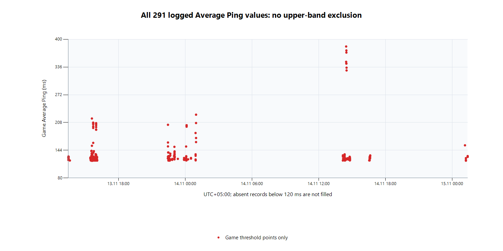
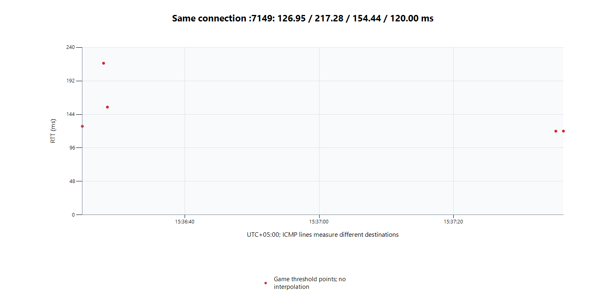
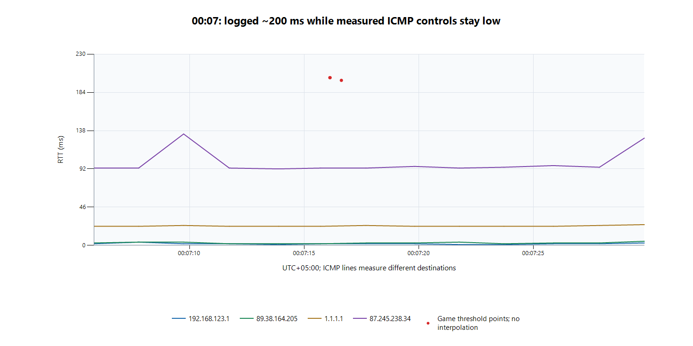
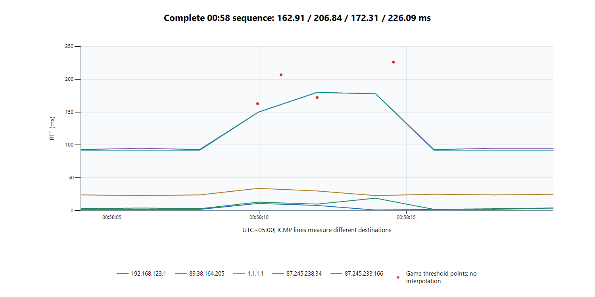
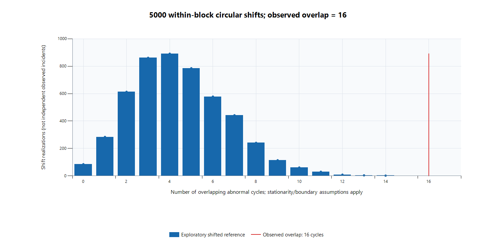
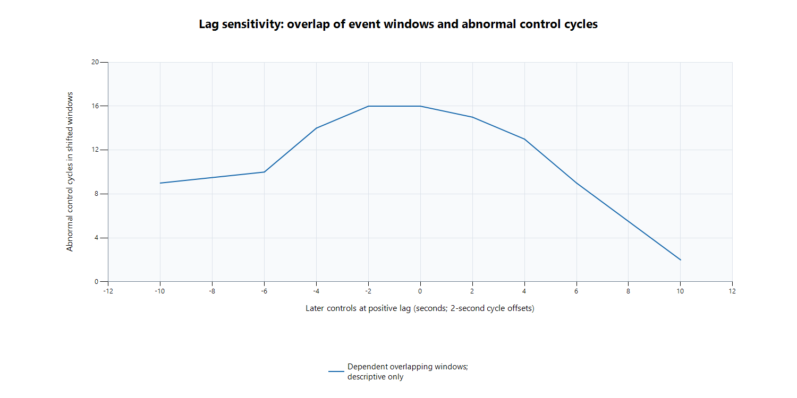
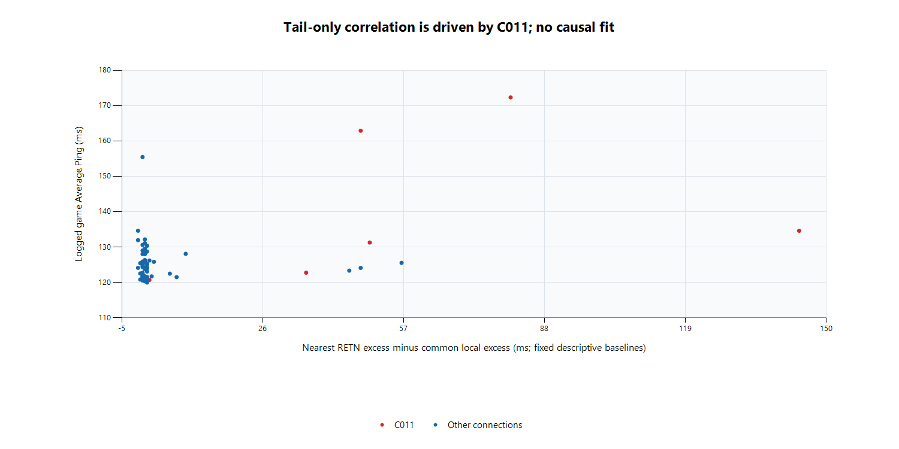
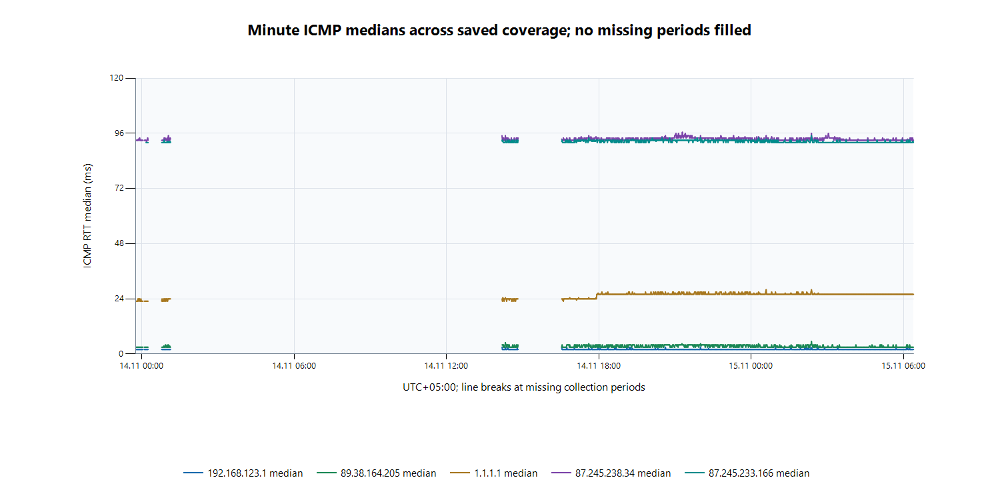

# Открытое исследование изменения игрового RTT Valorant, Meganet, 13–15 ноября 2026

Это самостоятельный повторный анализ исходных игровых последовательностей, непрерывной телеметрии и методики прежних отчётов. Он не ищет заранее выбранного виновного. Время таблиц и графиков — **UTC+05:00**, машиночитаемые файлы содержат UTC. Число десятичных знаков в метке не означает независимую миллисекундную синхронизацию всех часов. Статические графики встроены в [HTML-версию](VALORANT-RTT-OPEN-INVESTIGATION.html).

## 1. Что удалось установить и что изменилось

**Единственную причину всех колебаний установить нельзя. Но объяснение «каждый игровой скачок вызван одинаковой общей перегрузкой Meganet/RETN» не соответствует наблюдениям.** Есть краткие общие всплески, есть игровой рост при спокойных контрольных направлениях и есть отдельные клиентские FPS/input-события. Они требуют разных проверок. Спокойный ICMP не доказывает исправность конкретного игрового UDP-пути и не назначает виновным Riot.

- Перепроверены **291** реальная числовая запись Average Ping из семи полных/зафиксированных игровых источников. 263 относятся к 120–180; **28 выше 180**. Полного ряда 90–119,99 нет. Ни разу не подставлен выдуманный RTT вместо отсутствующей записи.

- Обнаружена ошибка представления прежней хронологии: ограничение выборки сверху скрывало промежуточные значения **217,28** и **202,80**, а эпизод 00:58 включал также **206,84 и 226,09 мс**. Фильтр был корректен для подсчёта 263 точек, но непригоден для изображения полного эпизода. Исправлены прежний отчёт и его генератор; исторические ZIP остаются исходными срезами.

- Независимый повтор классификации всех 263 точек сохранил **58 QUIET / 13 с отклонениями / 192 без полного покрытия** при ±4 с. Это числа строк, не независимых происшествий и не доли игрового времени. Для всех 291: **69 QUIET / 6 LOCAL / 3 NEAR / 7 RETN / 206 без покрытия**.

- Порядок во времени важен: близость игровых предупреждений к контрольным отклонениям чаще, чем при сдвиге внутри тех же подключений. Но величина RTT не демонстрирует устойчивой общей зависимости от дальнего контроля: Pearson 0,449 для дальнего остатка становится −0,049 после исключения C011; Spearman всего 0,029. Это против вывода о едином количественном механизме для всей выборки.

- Найдено дополнительное противонаблюдение: **14.11 00:07:16 — около 200 мс в игре при спокойных доступных контролях**. Игра после одного IP может ухудшаться и частично восстанавливаться без travel/restart; обязательная смена IP для такого колебания не нужна.

- Проверены фазы раундов, агрегаты frametime, предупреждения подгрузки ресурсов и часы измерителя. Устойчивой общей привязки RTT к границам раундов или resource-hitch предупреждениям не найдено. Сборщик продолжает работать; новые игровые сессии, ping/tracert, нагрузочные тесты и захват пакетов не запускались.

## 2. Данные, происхождение и границы покрытия

| Источник | Использование и ограничение |
|---|---|
| RRT и оригинальные ShooterGame | Четыре совпадающих RRT/local источника учитываются однократно; три локальных файла добавляют отсутствующие в RRT периоды. Полные оригиналы остаются вне Git |
| Семь frozen игровых файлов | SHA-256 и номер строки для каждого извлечённого события. Проверена неизменность соответствующих префиксов текущих оригиналов; в дописанном хвосте нет новых Average Ping/ClientTravel/Browse строк |
| Предыдущие reviewed numerical inputs | 110495 ICMP-строк, 109805 пригодных; 690 известным образом ошибочных исключены из сетевых выводов. Сохранены все причины исключения |
| Новый committed prefix того же работающего монитора | Ещё **27690** probe-строк без повторения старых seq; общий пригодный ICMP массив **137495**, последняя отправка **15.11 06:23:28.056**. Продолжение ночного контроля, а не новые игровые измерения |
| Ручные записи | F8/F9, отдельные сообщения и скриншот; кнопка не измеряет RTT, время ответа в чате не равно времени начала скачка |
| Системные данные | Прежние 1548 обезличенных снимков Wi-Fi/счётчиков/маршрутов, новый snapshot delta, сохранённая выборка Windows событий; отсутствие записи не доказывает отсутствия короткого сбоя |
| Ping/tracert и CS2 | Завершённый пакет команд читается как отдельное измерение, не подменяет синхронный игровой RTT; Valve relay не считается физическим матч-сервером |

Пригодные данные непрерывного сборщика пересмотрены до конкретного committed seq, а не до произвольной последней строки открытого файла. Активный run зафиксирован на **126931**, старый срез был **98771**. В новом delta нет дубликатов старого префикса. Для старых завершённых runs caps 3299 и 5988. Нет команды остановки или перезапуска. Публикация — срез, GitHub не является live-трансляцией.

Состав, хеши и водоразделы: [source-lineage](evidence/rtt-open-2026-11-15/source-lineage.json), [границы monitor](evidence/rtt-open-2026-11-15/monitor-boundaries.json), [аудит оригинальных префиксов](evidence/rtt-open-2026-11-15/INTEGRITY-AUDIT.json). Прежняя [инвентаризация RRT](RIOT-RRT-LOG-ANALYSIS.md) и [таблица 263 точек](VALORANT-RTT-90-180-ANALYSIS.md) сохраняют подробности; новый разбор не считает их непререкаемыми.

| Обозначение | Источник |
|---|---|
| F1 | `ShooterGame-backup-2026.11.13-04.25.29.log` |
| F2 | `ShooterGame-backup-2026.11.13-11.18.28.log` |
| F3 | `ShooterGame-backup-2026.11.13-20.08.16.log` |
| F4 | `ShooterGame-backup-2026.11.14-09.30.10.log` |
| F5 | `ShooterGame-backup-2026.11.14-11.51.12.log` |
| F6 | `ShooterGame-backup-2026.11.14-20.02.40.log` |
| F7 | `ShooterGame.log` |

## 3. Что действительно представляет временной ряд

Имеются **пороговые сообщения**, а не равномерная выборка Network RTT. Минимальное записанное Average Ping — 120,00, максимальное — 383,31 мс. В строках явно указаны Threshold 120,00 для 270 обычных сообщений и Threshold 200,00 для 21 «critically exceeded»; категория лога у обоих Error. Распределение ниже условно на срабатывание logger; медиана около 125 не означает, что большую часть матча пинг был 125. Сглаживание, повторная выдача, частота проверки и возможный гистерезис не документированы для данной сборки. Три равные последовательные пары могут быть повторной выдачей/округлением; это не три независимых сетевых эксперимента.

| Записанный диапазон, мс | Число строк |
|---|---:|
| 120–<130 | 214 |
| 130–<150 | 40 |
| 150–180 | 9 |
| >180–<200 | 7 |
| 200–<300 | 13 |
| ≥300 | 8 |

Из 160 последовательных пар одного подключения с расстоянием не более 10 с медиана модуля изменения **4,185 мс**, p95 **34,53**, максимум **90,33**. Эти числа описывают изменения между сохранёнными threshold точками, а не непрерывную скорость роста. Встречаются движения вверх и вниз, включая возврат из 200+ в 150–180; единого монотонного сценария нет.

Группировка точек по разрыву 5/10/30/60 с даёт **181 / 131 / 61 / 50** групп. Различие почти в четыре раза показывает, почему нельзя объявить количество warning строк количеством отдельных сетевых аварий. Размах времени от первой до последней точки — support span, не доказанная продолжительность высокого RTT. Все continuous_duration_seconds оставлены null.

Ни HMM, ни change-point, ни спектр «периодического пинга» здесь не дают надёжных состояний 90/100/110: вход цензурирован и нерегулярен, отсутствуют значения и знаменатель времени в состояниях. Вычислять частоту/периодичность из интервалов выдачи Warning означало бы смешать работу logger с физикой сети. [Полные короткие переходы](rtt-open-data/logged-point-transitions.json), [группы по 10 с](rtt-open-data/point-clusters-10s.json).

## 4. Подключения и вариации внутри них

В таблице min/median/max рассчитаны **только по сохранённому хвосту ≥120**. Ни один показатель не является baseline матча. `0` означает отсутствие threshold строки, не гарантирует нормальное соединение. Порт — удалённый, привязанный travel/map-ready/NetDriver контекстом; это не локальный ephemeral port. Публичный IP не устанавливает физическую площадку или маршрут конкретного UDP-пакета.

| Conn | IP:порт | Начало → конец +05 | N | Условные min / median / max, мс | Первая threshold после MapReady, с |
|---|---|---|---:|---|---:|
| C001 | 185.40.64.1:7394 | 13.11 13:09:08.764 → 13.11 13:44:33.086 | 9 | 120.43 / 125.49 / 129.67 | 1190.8 |
| C002 | 185.40.64.1:7149 | 13.11 15:23:01.919 → 13.11 16:05:14.928 | 139 | 120 / 124.44 / 217.28 | 295.592 |
| C003 | 185.40.64.1:7125 | 13.11 22:25:45.729 → 13.11 22:51:22.797 | 31 | 120.25 / 124.9 / 202.8 | 6.604 |
| C004 | 185.40.64.1:7499 | 13.11 22:58:54.355 → 13.11 23:04:24.490 | 12 | 123.05 / 133.485 / 151.98 | 18.454 |
| C005 | 185.40.64.1:7496 | 13.11 23:05:04.371 → 13.11 23:11:09.289 | 0 | — / — / — | — |
| C006 | 185.40.64.1:7048 | 13.11 23:11:34.945 → 13.11 23:50:22.507 | 1 | 124.24 / 124.24 / 124.24 | 492.895 |
| C007 | 185.40.64.1:7039 | 13.11 23:51:55.749 → 14.11 00:29:52.139 | 19 | 120.69 / 124.33 / 201.7 | 52.333 |
| C008 | 185.40.64.1:7329 | 14.11 00:30:35.124 → 14.11 00:37:43.082 | 2 | 124.76 / 125.52 / 126.28 | 17.567 |
| C009 | 185.40.64.1:7415 | 14.11 00:38:26.070 → 14.11 00:46:01.354 | 0 | — / — / — | — |
| C010 | 185.40.64.1:7382 | 14.11 00:46:47.123 → 14.11 00:52:07.972 | 0 | — / — / — | — |
| C011 | 185.40.64.1:7354 | 14.11 00:53:41.234 → 14.11 01:06:30.140 | 9 | 120.74 / 162.91 / 226.09 | 93.477 |
| C012 | 185.40.64.1:7004 | 14.11 14:08:49.238 → 14.11 14:30:09.253 | 34 | 120.36 / 125.05 / 383.31 | 63.164 |
| C013 | 162.249.72.1:7004 | 14.11 14:31:45.206 → 14.11 14:49:28.428 | 19 | 120.61 / 124.28 / 129.04 | 189.95 |
| C014 | 185.40.64.1:7158 | 14.11 16:29:32.496 → 14.11 16:38:21.321 | 10 | 120.57 / 127.21 / 132.2 | 147.427 |
| C015 | 185.40.64.1:7216 | 15.11 01:05:52.823 → 15.11 01:16:54.448 | 4 | 120.02 / 123.76 / 155.46 | 138.523 |
| C016 | 185.40.64.1:7102 | 15.11 01:21:06.070 → 15.11 01:33:20.136 | 2 | 128.74 / 129.69 / 130.64 | 110.343 |
| C017 | 185.40.64.1:7361 | 15.11 01:35:18.454 → 15.11 01:47:08.971 | 0 | — / — / — | — |

Первый порог появляется и через **6,604 с** после MapReady (C003), и через **1190,802 с** (C001). Поэтому рост RTT нельзя объяснить исключительно обязательной задержкой при загрузке карты. Сравнивать N между соединениями как долю плохого времени нельзя: различаются длина подключения, число раундов, режим, время суток и полнота игровой серии.

C002 содержит 139 точек от 120 до 217,28 на одном :7149. C011 — девять от 120,74 до 226,09 на одном :7354. C015 — 155,46 и позднее 121–126 на одном :7216; рядом пользователь подтвердил низкий диапазон 85–93 без числовой привязки к каждой F9. Эти наблюдения опровергают необходимость смены публичного IP/порта для каждой вариации. Они не исключают смену внутреннего пути/ECMP/обратного маршрута при неизменном адресе.

После перезапуска 14 ноября C012 `185.40.64.1:7004` сменилось C013 `162.249.72.1:7004`, снизился сообщённый RTT. Одновременно изменились процесс, соединение, время, возможные NAT/ingress и состояние клиента. Это полезный естественный эксперимент с несколькими изменившимися факторами, но не изоляция эффекта адреса. Привязка к тому же матчу не означает тот же ingress и не доказывает смену физического backend.

## 5. Исправленная хронология и новые контрпримеры

**13 ноября 15:36, C002 :7149.** Полная последовательность: 126,95 в 15:36:24.702 → **217,28 в 27.869** → 154,44 в 28.444 → 120,00 в 15:37:35.253. Интервалы 3,167 / 0,575 / 66,809 с. Ранее запись 217,28 ошибочно исчезла из иллюстрации последовательности из-за фильтра. ICMP тогда не собирался; нельзя назначить виновным домашнюю сеть, Meganet или Riot.

**13 ноября 15:43 и 15:59, то же C002.** 15:43:25.305–28.467 есть 195,45–207,62; в начале рядом Burst Loss. Позднее 161,09 в 29.051 и 127,26 в 36.944 — частичное снижение среди сохранённых точек, а не точно установленная длительность восстановления до нормы. В 15:59:06.735–19.872 снова 191,35–206,55. Так в одном подключении повторяются отдельные серии; их нельзя свести к единственному isolated spike. Пригодных одновременных контролей нет.

**13 ноября 22:26, C003 :7125.** 129,34 в 44.304 → 152,95 в 45.699 → **202,80 в 48.233** → 161,94 в 48.737 → 138,97 в 22:27:37.164 → 127,44 в 58.217. Предыдущая таблица пропускала 202,80. Переходы не заполнены интерполяцией; ICMP отсутствует.

**14 ноября 00:03–00:07, C007 :7039.** Пользователь сообщил высокий RTT, скриншот показывает 185/189 avg/max и накопленные 48 lost packets при текущем 0%. В старой серии действительно был пробел 00:03:21–00:06:13; новая игравая threshold точка 152,67 в 00:04:34.283 не восстанавливает отсутствующий ICMP. Но **00:07:16.121 и .134 — 201,70**, .626 — **198,45**, уже при пригодных контролях ±4 с ниже лимитов. Это три строки, включая повтор равного значения через 13 мс, а не три независимых инцидента. Новое наблюдение ограничивает версию о необходимом общем ICMP-всплеске для повышенного игрового RTT.

**14 ноября 00:55, C011 :7354.** В 00:55:30.012 Average Ping 183,84 совпадает с локальным классом окна. Позднее в 44.503 / 46.245 / 48.589 — 122,80 / 134,64 / 131,32; есть общий цикл порядка GW/near/CF/RETN1/RETN2 **140/140/160/279/279**. Одновременный рост до шлюза и дальних целей поддерживает общий локальный/доступовый/планировочный компонент конкретного эпизода. Он не локализует Wi-Fi против AP, драйвера или host scheduling и не объясняет все другие случаи.

**14 ноября 00:58, тот же :7354.** Полный ряд: **162,91 в 09.942 → 206,84 в 10.737 → 172,31 в 11.966 → 226,09 в 14.554**. До этого контролям соответствуют примерно 2/3/24/93/92; в 09.969 — 11/13/34/150/150, в 11.956 — 8/10/30/180/180, в 13.946 — 1/19/23/178/178; в 15.930 снова 2/2/25/93/92. Это смешанное совместное ухудшение, а не изолированный скачок только RETN или только игры. Более поздние игровые точки классифицированы NEAR из-за near=19; приоритет класса скрывает одновременные RETN-превышения, поэтому классы не следует читать как взаимоисключающие причины.

Величина роста игры находится рядом по времени с дальним ростом, но приложение может сглаживать RTT; самая высокая игровая точка позже контрольного максимума. Одна такая последовательность не определяет ни точное причинное запаздывание, ни конкретный участок. В ±4 с этих четырёх точек нет соответствующих FPS/loss/input warnings. Контроли восстановились в 15.930; точная секунда восстановления игры неизвестна.

**14 ноября дневной матч.** Уточнение владельца **95→120→180→120**, позднее 300–400, относится к неоднократным колебаниям. Точные секунды этих четырёх ручных уровней неизвестны. 107 F8 и 20 F9 дают 21 группу нажатий (20 закрыты, одна открыта); частые F8 около 14:19–14:22 отражают колебания 120–180 по пояснению игрока, а не 107 отдельных измеренных пиков. В отчёте не назначены секунды числам по ближайшей кнопке.

**14:27:45.760–14:29:58.816** — восемь числовых 328,12–383,31 на :7004, 26 input-stop/overflow в исследованном критическом окне. Прежние **335/335** успешных контролей за эпизод и медианы **2/3/24/93/92** подтверждаются исходным отдельным анализом. Это не означает, что игра была высокой все 133,056 с между первой и последней threshold строкой; пользователь независимо сообщил около пяти минут. Игровой UDP, обратный путь и обработка клиента/сервера не контролировались этими ICMP.

**После перезахода** пользователь сообщил 100–110, поздние F8 — 120–130. 14:35:10.445 (125,63) и 14:48:12.467 (125,62) близки к FPS/input событиям, но большинство точек не имеет такого совпадения. В 14:48 local FPS 2,5/6,78 за 106/76 мс и input-stop/overflow за 3 мс до ping warning: это сильное временное совпадение обработки клиента, не установленное направление причинности.

**15 ноября 01:08:44.282**, C015 :7216 — **155,46**, GW 1–2 / near 2–4 / CF 25–27 / RETN 91–93 в ±4 с, без FPS/loss/input warning в таком окне. F9 в 01:09:22.333 на **38,051 с позже**. Сообщённые 85–93 относятся к двум F9 в разных матчах в целом; это не измеренная секунда восстановления. В этом же C015 позднее 01:13:33.911 / 43.192 / 49.776 — 121,63 / 125,89 / 120,02.

**15 ноября 01:28:46.934**, C016 :7102 — вторая F9 с общим сообщённым диапазоном 85–93. В 01:31:34.092 отдельный цикл содержит четыре ICMP-тайм-аута при отвечающем RETN2 около 92. Соседней игровой threshold строки нет. Это контрпример превращению любого контрольного отклонения в доказанный игровой скачок; отсутствие строки не доказывает низкий игровой RTT.

[Отдельная хронология с UTC, +05, границами точности](VALORANT-RTT-OPEN-CHRONOLOGY.md) и [все 291 контекста](rtt-open-data/all-game-points-context.json).

## 6. Совпадение с контролями: устойчивость и контрпримеры

Классификация ±4 с использует все пробы окна, минимум две на каждую из пяти целей, статусы и заранее сохранённые лимиты: GW≥15 / near≥16 / CF≥38 / RETN238≥109 / RETN233≥106; ранний RETN234≥100 мс. Иерархия GW→near→CF→RETN — описание наблюдения, не алгоритм установления виновного. Максимумы разных целей внутри окна могут принадлежать разным циклам. Для проверок одновременности использованы отдельные полные циклы.

Для 263 выбранных точек окна ±1/2/4/10 с дают спокойные **63/60/58/48**. Рост числа совпадений при расширении окна ожидаем и сам по себе не подтверждает причину. Среди девяти выбранных 150–180 точек шесть без контролей, две — C011 с дальним ростом, одна — C015 со спокойными контролями. Новая полная выборка показывает, что целевой band не исчерпывает ни тяжесть, ни структуру эпизодов.

Ранее 16 аномальных циклов из 223 около выбранных событий сравнивались с 58 из 3319 прочих циклов во время подключений. Это **7,17% против 1,75%**, но прочие циклы не размечены как «нормальная игра». Соседние пробы и повторяющиеся warning зависимы. Простая независимая binomial/Fisher интерпретация была бы чрезмерно сильной.

Новая проверка сохраняет целиком сгруппированную маску ±4 с относительно warning, отдельно в каждом непрерывном блоке **того же conn/source**, и циклически сдвигает её относительно контрольных аномалий. Блоки <30 циклов и без событий не участвуют; разрывы >3 с разделены. Сдвиги от 10 циклов до n−10 исключают почти исходное совмещение. **5000** воспроизводимых реализаций, seed 20261115; 9 блоков / **2769** циклов / 223 отмеченных окна.

Наблюдается **16** пересечений; в сдвинутой reference медиана **4**, p95 **8**, максимум **14**, среднее **4.4452**. Tail fraction с поправкой +1 — **0.000200**. Это исследовательская мера необычности совмещения при предположениях стационарности внутри блока и циклической границы; **не вероятность виновности, не причинный p-value и не подтверждающий тест с заранее зарегистрированной гипотезой**. Мы проверяем несколько паттернов и не объявляем поправку на все исследовательские решения.

После исключения C011 остаётся 10 пересечений, reference p95=7, tail fraction≈0,00550; следовательно, факт близости событий не целиком создаётся одним 00:58. Однако другие блоки иерархически смешивают LOCAL/NEAR/RETN и обработку клиента; это не выделяет транзит. Без C013 — также 10 пересечений, p95=7. Все leave-one-connection-out результаты опубликованы, а не только выгодный пример.

Описательная lag-проверка для сдвига окон −10/−6/−4/−2/0/+2/+4/+6/+10 с даёт **9/10/14/16/16/15/13/9/2** аномальных цикла. Максимум широк около нуля, а соседние окна перекрываются. Это поддерживает близость по времени, но не определяет, что именно предшествует чему на уровне миллисекунд. Сдвиг делается на целые 2-секундные циклы; для этого анализа нельзя заявлять субсекундное запаздывание.

Дополнительно взяты ближайшие RTT для 71 покрытой band-точки. Описательный общий ближний остаток — median(GW−2, near−3, CF−23), дальний — median(RETN238−93, RETN233−92); их разность уменьшает общий локальный компонент, но **не является задержкой физического участка**: адреса и обратные пути разные. Pearson(game, far−common)=**0,448745**, Spearman=**0,029340**. После исключения C011 Pearson=**−0,049375**, Spearman=**−0,112694**. У самого дальнего остатка Pearson 0,313, Spearman 0,021. Значит, видимая линейная связь величин в основном опирается на отдельный leverage-эпизод, а не на устойчивый монотонный закон во всей цензурированной выборке.

Центрирование каждой величины внутри своего подключения дополнительно снижает Pearson дальнего остатка до −0,006, far−common до 0,181; Spearman −0,127 и −0,053. Это подчёркивает влияние различий между соединениями и редких крупных точек. Центрирование не устраняет цензурирование и зависимость соседних записей. Выводы «аномалии иногда близки во времени» и «рост игрового RTT пропорционален росту RETN» различаются. Первый выдерживает эту ограниченную проверку, второй — нет. Опубликованы [reference и LOCO](rtt-open-data/control-alignment-shift-reference.json), [lag](rtt-open-data/lagged-control-window-overlap.json), [корреляции](rtt-open-data/tail-correlations.json) и [исходные 71 feature rows](rtt-open-data/point-control-features.json).

## 7. Новые объяснения: фазы раундов и состояние клиента

Из полных исходников извлечены **137 Gameplay(server time=0)**, **151 Gameplay(nonzero)**, **141 OnRoundEnded**, **94 asset-preload warnings**, **17 configured tickrate**; дополнительно **846** числовых метрик из 141 per-round performance summaries. Поля local/server game time — относительное игровое время; их разность нельзя читать как UDP RTT, one-way latency или рассинхронизацию Windows. Configured tickrate не измеряет фактические server-tick stalls.

| Событие | Окно | Ping строк рядом / 291 | Доля строк | Доля времени подключения в объединении окон |
|---|---:|---:|---:|---:|
| gameplay_zero | ±1 с | 9 | 3.09% | 1.50% |
| gameplay_zero | ±5 с | 17 | 5.84% | 7.51% |
| gameplay_zero | ±10 с | 41 | 14.09% | 15.03% |
| gameplay_nonzero | ±1 с | 7 | 2.41% | 1.64% |
| gameplay_nonzero | ±5 с | 25 | 8.59% | 8.17% |
| gameplay_nonzero | ±10 с | 47 | 16.15% | 16.35% |
| round_end | ±1 с | 8 | 2.75% | 1.55% |
| round_end | ±5 с | 17 | 5.84% | 7.73% |
| round_end | ±10 с | 41 | 14.09% | 15.41% |
| asset_preload_warning | ±1 с | 0 | 0.00% | 0.20% |
| asset_preload_warning | ±5 с | 0 | 0.00% | 0.87% |
| asset_preload_warning | ±10 с | 1 | 0.34% | 1.54% |

Окна обрезаны MapReady→NetDriver end и объединены; общий наблюдаемый интервал подключений **18234,995 с**. Доли — диагностика плотности logger, не независимый rate-ratio тест: разные матчи имеют разную интенсивность предупреждений и фазы пересекаются. На ±10 с Gameplay-zero находятся 41/291=14,09% строк при 15,03% временного покрытия, round-end 14,09% при 15,41%. Общего обогащения около этих границ нет. На ±1 с локально есть 9/291 против 1,50% экспозиции; это малый, зависимый и неустойчивый эффект. После исключения C012: 7/257 против 1,46% времени на ±1; на ±10 — 33/257 против 14,61% времени. Это не устойчивое доказательство «раунд вызывает пинг».

В критическом эпизоде есть конкретная последовательность: **14:27:43.702 round 11 end → 44.273 Gameplay-zero → 44.657 input-stop → 45.760/46.264 ping 348/383**; затем **14:29:02.315 round 12 end → 02.676 Gameplay-zero → 02.688/03.134 ping 374/369**. Но другие высокие точки в 14:28:54 и 14:29:58 не ограничены этими границами. Возможны reset/возобновление обработки или выдачи предупреждений при смене фазы, а не начало физической задержки на этой секунде. Чтобы различить это, нужен непрерывный RTT и схема logger от Riot; один порядок сообщений не доказывает механизм.

94 предупреждения «asset not preloaded / hitching» не совпадают с ping-точками в ±1 или ±5 с; в ±10 с совпала одна строка. Это ослабляет механизм, при котором **каждый** подъём RTT объясняется именно этим типом asset hitch. Предупреждение — о риске подгрузки, не измеренный stall; отсутствие его не исключает другие CPU/GPU/I/O/driver паузы.

Агрегированные frametime перед границами критических раундов: **11,52** мс около 14:27:43.700 и **6,26** мс около 14:29:02.314; Avg. Engine Latency **9,08 / 7,79**. Это per-round means, не одновременный сетевой RTT и не доказательство отсутствия коротких локальных зависаний. «Engine Latency» в performance summary не подменяет Network RTT. Мгновенные FPS threshold совпадения остаются отдельным меньшинством: среди 263 точек 2/3/12 при ±1/4/10 с; ни одна из девяти band-точек 150–180 не имеет FPS warning в ±4 с.

Историческая документация Riot описывает задержку обработки и адаптивное buffering после jitter/low FPS, но также подчёркивает, что некоторые buffering delays **не отражались в Network RTT Avg/Max и scoreboard**; изменения внесены в 4.10 в 2022 году. Поэтому нельзя сослаться на старый buffering bug как доказанную причину измеренных Network RTT в 2026. Проверяемая современная гипотеза — различить wire RTT, processing delay и фактическую задержку ACK/обработки; для этого нужны определения и текущая телеметрия Riot. [Официальное объяснение 2022](https://playvalorant.com/en-us/news/game-updates/valorant-gameplay-consistency-update-2/), [patch 4.10](https://playvalorant.com/en-gb/news/game-updates/valorant-patch-notes-4-10/).

Логирование не содержит найденного непрерывного числового ряда Network RTT+Processing Delay/Jitter, данных client focus/alt-tab, DPC/ISR или реальной server-tick latency. Мы не приписываем пользователю alt-tab и не объявляем известную старую ошибку актуальной. [Фазы](evidence/rtt-open-2026-11-15/phase-events.json), [performance aggregates](evidence/rtt-open-2026-11-15/performance-summaries.json), [ближайшие фазы всех точек](rtt-open-data/all-291-points-phase-context.json).

## 8. Аудит измерителя, часов и пробелов

Нативный collector читает IcmpSendEcho2 RoundTripTime; cumulative elapsed_ms служит монотонным временем от начала run, **не RTT**. Его нельзя подставлять в график задержки. Поля Address/Status/RoundTripTime — первые три 32-bit ULONG/DWORD с offsets 0/4/8. На этой Windows проверен layout синтетическим буфером без вызова API. По Microsoft 64-bit IcmpSendEcho2 использует ICMP_ECHO_REPLY32: неиспользуемые trailing pointer fields текущей ctypes модели требуют отдельной аккуратной ревизии в будущем, но читаемый 12-byte prefix имеет правильные offsets. Оснований объявить нативные RTT недействительными по этой причине нет. [IcmpSendEcho2](https://learn.microsoft.com/en-us/windows/win32/api/icmpapi/nf-icmpapi-icmpsendecho2), [структура REPLY32](https://learn.microsoft.com/en-us/windows/win32/api/ipexport/ns-ipexport-icmp_echo_reply32). Работающий collector не изменён.

| Run | Проверенные seq | Контроль wall−monotonic, min/max мс | Max first-sent cycle gap, с | Max completed→record delay, мс |
|---|---:|---|---:|---:|
| 20261114-004711-625146fb | 3299 | -0.029 / 0.970 | 2.062 | 172.000 |
| 20261114-141126-ee9e460b | 5988 | -0.400 / 0.602 | 2.145 | 146.000 |
| 20261114-163240-f28706ce | 126931 | -28.078 / 0.687 | 2.736 | 237.000 |

В трёх пригодных continuous префиксах проверены seq без пропусков/дубликатов и SHA точных байтов; вращение файлов не создаёт разрыва сессии. Для живого run единственный cycle gap >2,5 с — 2,736; нет исчезнувших 10-минутных периодов внутри этого непрерывного префикса. Времена sent могут идти не по порядку seq из-за параллельного завершения пяти проб; сравнивать нужно по sent_utc/cycle, не считать каждую перестановку корректировкой часов.

Wall−monotonic у дневного 300-мс эпизода остаётся в пределах примерно −0,4…+0,6 мс. В текущем run отдельные residual до −28,078 мс быстро возвращаются (01:12:36 +05); это может включать планирование между чтением wall и monotonic, а не подтверждённый NTP step. Максимальные задержки записи — 172/146/237 мс. Поэтому сопоставление ведётся по **sent_utc/game event time**, а не по времени появления строки на диске. Аудит не обнаруживает минутного сдвига, который объяснил бы стабильные ICMP при многоминутном игровом 300–400. Он не доказывает независимую синхронизацию game/server clocks с точностью 1 мс.

Native wait−RTT у Success имеет median≈1,25–1,28 мс, p95<2 мс; отдельные максимумы до 149 мс показывают возможную задержку возврата/планирования. Это ещё один повод не выдавать Python elapsed wait за wire RTT. Success без RTT нет. Известные ранние дефектные серии по-прежнему не включаются; история пробела 00:03–00:06 сохранена, а не «исправлена» данными более позднего мониторинга.

[Нативный аудит](evidence/rtt-open-2026-11-15/native-clock-audit.json) и [целостность/cadence](evidence/rtt-open-2026-11-15/INTEGRITY-AUDIT.json).

## 9. Wi-Fi, нагрузка, маршруты и время суток

Прежние снимки, реально близкие к игровым точкам, показывают AP-01, канал 36, RSSI −65…−53 dBm; все 1548 снимков connected, errors/discards без прироста. Для 71 покрытой band-точки средние интервальные RX≤1,216 и TX≤0,646 Мбит/с. Это не подтверждает насыщение канала именно трафиком ПК. В общем локальном эпизоде 00:55 контролям стало хуже даже до шлюза; такой вклад не следует игнорировать только потому, что во многих других случаях ICMP тихий.

Нет пер-пакетных Wi-Fi retries/airtime/queue occupancy, загрузки других устройств и коротких burst; долгий средний интервал может скрыть очередь. Router CPU/радиоканал/драйвер/host scheduling не разделены. Windows route snapshots отличаются InterfaceMetric 30/35, но сохраняют ifIndex 7/тот же gateway для контролей. Это не доказательство ECMP/BGP изменения или игрового VPN-пути. Сохранённые Windows сетевые события не дают синхронной ошибки адаптера/DNS для выбранных ping-точек, однако журнал не является непрерывным аппаратным трассировщиком.

Новые почасовые ICMP распределения по **всему пригодному покрытию**, включая продолжение ночи: gateway hourly median всегда 2, near 3–4, Cloudflare 23–26, RETN238 93–95, RETN233 92–93, ранний RETN234 85 мс. Наибольшие hourly p95 соответственно 6/8/31/102/97/90. Это не выглядит как длительное общее повышение всех контрольных маршрутов на десятки–сотни мс. Но часовые медианы скрывают короткие spikes и смешивают разную полноту часов. Нельзя переносить их на игровой UDP.

Дневные и ночные threshold записи присутствуют, но игровое покрытие и идентичность backend различны, часть 13 ноября не имеет контролей. Статистически отделить час суток от игры/сервера/длительности/режима невозможно. Нет основания объявить «вечернюю перегрузку Meganet» или повторяющийся периодический таймер. [Поминутные числа](rtt-open-data/minute-control-series.json), [почасовые min/median/p95/max/N](rtt-open-data/hourly-control-distributions.json).

Завершённые traceroute к двум Riot адресам заканчиваются отвечающими RETN-интерфейсами, а обе цели не отвечают на 100 ICMP echo. Это ограничение измерения, не 100% игровых потерь. Трассы выполнены после дневного критического эпизода. Старый однократный hop около 70 мс и текущие медианы RETN около 92–95 — разные адреса/времена/ответные пути, без повторного синхронного контекста их нельзя превратить в доказанную смену международного маршрута. CS2 relay 72–81 мс показывает доступность другого Valve направления в отдельном тесте, а не здоровый физический Stockholm backend Valorant. [Полный неизменённый пакет](meganet-package-2026-11-14/README.md).

## 10. Проверка гипотез и различающие наблюдения

Confidence ниже относится к поддержке механизма наблюдениями, а не к вероятности вины организации. Ни одна версия не объясняет доказанно все классы эпизодов. [Отдельный перечень проверок](VALORANT-RTT-OPEN-HYPOTHESES.md) даёт владельца данных и ожидаемый опровергающий результат.

| Гипотеза | Что поддерживает | Контрпример / ограничение | Текущий вывод |
|---|---|---|---|
| Общий локальный/доступовый краткий stall | GW и дальние цели вместе растут 00:55; отдельные LOCAL окна | 69 полных игровых окон при низких контролях, в том числе 300+ и 155 | Средняя уверенность в существовании локального компонента отдельных случаев; источник внутри LAN/host не локализован |
| Общий дальний маршрут/очередь/транзит | Полный 00:58 эпизод до 226 рядом с двумя RETN rises; reference совмещения | Ближние тоже растут, ICMP другой, величинная связь исчезает без C011 | Средняя для конкретного совместного дальнего паттерна; низкая для общей причины и конкретного оператора |
| Специфический UDP forward/reverse, NAT/ECMP/QoS или ingress | Тяжёлый и 155-мс эпизоды без общих контролей; смена адреса при rejoin | Нет наблюдения пути/потоковых очередей; тот же IP тоже даёт колебания | Совместимо и существенно не проверено; нужны двусторонние flow данные |
| Клиент/сервер задерживает ACK/сетевую обработку | Input-stop/overflow критического периода, отдельные FPS coincidences, rejoin reset | 150–180 обычно без FPS warnings; input события могут быть следствием, не причиной | Средняя для наличия обработочных симптомов, низкая для происхождения RTT |
| Переходы фаз раунда/особенность выдачи logger | Два onset-подобных critical warning рядом с Gameplay-zero | Большинство точек вне фаз; ±10 доля не выше времени; другие critical вне границ | Новая, слабая; не общий механизм. Различить logger reset и физический spike |
| Asset streaming вызывает все RTT spikes | В логах 94 resource-hitch предупреждения | 0 совпадений ±5 с; только 1 на ±10 с | Конкретная универсальная версия ослаблена; другие локальные stalls не исключены |
| Насыщение/очереди от фоновой нагрузки | Возможны bursts, другие устройства и QoS различия | Средний трафик ПК низкий, queue/airtime отсутствуют | Не подтверждено, не исключено; speed test во время игры не нужен |
| Ошибка измерителя/часов создаёт всё расхождение | Известны старые дефектные серии, нативная и Python wait различны | Они исключены; проверенный prefix, native RTT, cadence и часы дневного run не дают минутного сдвига | Универсальная версия не поддержана; остаточная точность/сглаживание остаются ограничениями |

## 11. Доказанные факты, закономерности, гипотезы, неизвестное и новые открытия

**А. Доказанные факты.** 291 пороговая строка с time/file/line; 17 соединений; внутри одного подключения есть рост и снижение; проверенные отдельные игры/контроли расходятся; известные capture gaps и 690 ошибочных проб не замаскированы. Точные все 263 классификации воспроизведены. Packet-loss предупреждения и input overflow присутствуют, но общего непрерывного игрового процента потерь нет.

**Б. Повторяющиеся наблюдения.** Несколько серий повышений/частичных снижений на одном IP/порту, а не единственная эскалация 95→400. Краткие общие ICMP всплески бывают; игровые warnings бывают и без них. Близость событий к контрольным отклонениям сохраняется при внутриподключенческом сдвиге, но не означает единую количественную зависимость величин.

**В. Рабочие гипотезы.** Общий локальный компонент части событий; дальний общий компонент 00:58; game-flow-specific путь/обратное направление/NAT/ingress; клиентская/серверная обработка и особенности RTT/logger. Привязка к фазам и asset streaming проверены как альтернативы, не приняты как готовое объяснение.

**Г. Неизвестное.** Истинный RTT 90–119,99 по секундам, точные начало/конец большинства уровней, определение/окно Average Ping logger, реальные one-way UDP delays, drop/reorder/jitter по направлениям, ingress/backend mapping, состояние очередей/airtime и временные тики сервера. Нет сопоставимой Beeline серии.

**Д. Новые открытия.** Пропущенные верхним фильтром промежуточные пики; новый 00:07 игровой ~200 при тихих контролях; leverage-зависимость Pearson против почти нулевого Spearman; кластер-сохраняющая проверка совпадений и lag; отрицательные результаты фаз/asset-preload; аудит clock/monotonic/write delay и отсутствие минутного сдвига измерителя. Эти результаты добавляют проверки, а не повторяют старые 58/13.

## 12. Почему Beeline казался стабильнее и какие данные закроют вопрос

Разница пока является наблюдением владельца: позднее Beeline описан как 80–90, ранний baseline — примерно 70–80; Meganet иногда 85–93, а иногда 120–180 и выше. Это не контролируемое сравнение провайдеров. Более высокая пропускная способность не гарантирует меньший RTT. Нельзя вычислить ни постоянную «надбавку Meganet», ни долю времени в плохом состоянии по цензурированному журналу.

Круг неопределённости сужен: **одна лишь постоянная географическая длина маршрута не объясняет колебания внутри подключения; один общий постоянно перегруженный участок также недостаточен для разных классов совпадений.** Но путь конкретного UDP может деградировать без изменения контрольных ICMP; высокий Network RTT также может включать временную обработку/ответ приложения в зависимости от определения метрики. Утверждение «контроли хорошие, значит провайдер исправен» так же необоснованно, как «RETN ответил поздно, значит он виноват».

1. **Riot:** поддерживаемый числовой экспорт хотя бы 1 Гц: Network RTT avg/max, RTT+Processing Delay, jitter, loss in/out, client frame time, server/network processing, endpoint/ingress/backend mapping. Запросить определения и smoothing/reset/порог выдачи logger текущей сборки. В приватном канале Riot может сопоставить match IDs, которые исключены из публичного пакета. Это различит wire/path, обработки и артефакт фазы/logger.

2. **Meganet/транзит:** по указанным UTC и направлениям — egress/peering/ECMP/BNG/CGNAT, QoS и очереди/drop, route changes, обратные пути к абоненту и сопоставление по реальному NAT 5-tuple. Нужен WAN/NAT абонента в приватном канале от владельца; IP:порт назначения сам по себе недостаточен. Это различит общий путь и специфический UDP-поток.

3. **Пользователь в отдельном согласованном этапе:** Ethernet/Wi-Fi A/B на одном Meganet и том же игровом контексте; если Beeline доступен — сопоставимые чередующиеся серии на одном ПК и типе доступа, с фактическими endpoint и временем. Одинаковый публичный IP Riot не гарантирует одинаковый backend. Менять доступ автоматически или во время текущего матча не требуется.

4. **Безопасная полнота 90–119,99:** сначала запросить штатный экспорт у Riot. Если его нет, согласовать видимые штатные графики и запись пользователем с часами/словесными диапазонами; при необходимости отдельно обсудить поддерживаемую запись экрана/OCR. Не использовать инъекции, память процесса, Vanguard bypass или произвольный захват UDP. Текущий этап ничего из этого не включает.

5. **Очереди/локальная обработка:** при отдельном согласовании получить агрегированные WAN/airtime/retry/queue counters роутера и DPC/ISR/frame-time трассу без содержимого пользовательского трафика. Если после Ethernet сохраняется game-only RTT при нормальной обработке клиента, приоритет переходит к UDP пути/ingress/backend, а не к Wi-Fi.

## 13. Полная таблица найденных числовых точек

Все строки Average Ping, включая >180. UTC и полные окна в JSON; время ниже +05. QUIET означает ниже сохранённых контрольных лимитов, не нулевую UDP-потерю. N/A — недостаточное покрытие. Warnings — количество зарегистрированных L=burst_loss / Q=queue_overflow (включая сообщения об окончании) / I=input-stop / F=framerate; не число потерянных пакетов. У всех строк исходный baseline и continuous duration неизвестны. Номера строк и SHA позволяют Riot сверить оригинал, не публикуя токены/имена.

| Point | Время +05 | Average Ping мс | Conn / удалённый IP:порт | Класс ±4с | L/Q/I/F ±4с | Источник:строка |
|---|---|---:|---|---|---|---|
| P001 | 13.11 13:29:14.721 | 127.51 | C001 / 185.40.64.1:7394 | NO DATA | 0/0/0/0 | F2:11428 |
| P002 | 13.11 13:29:31.336 | 121.60 | C001 / 185.40.64.1:7394 | NO DATA | 0/0/0/0 | F2:11466 |
| P003 | 13.11 13:29:49.170 | 125.49 | C001 / 185.40.64.1:7394 | NO DATA | 0/0/0/0 | F2:11490 |
| P004 | 13.11 13:30:02.781 | 129.67 | C001 / 185.40.64.1:7394 | NO DATA | 0/0/0/0 | F2:11690 |
| P005 | 13.11 13:30:12.944 | 122.71 | C001 / 185.40.64.1:7394 | NO DATA | 0/0/0/0 | F2:11715 |
| P006 | 13.11 13:30:51.077 | 124.27 | C001 / 185.40.64.1:7394 | NO DATA | 0/0/0/0 | F2:12228 |
| P007 | 13.11 13:30:52.097 | 128.61 | C001 / 185.40.64.1:7394 | NO DATA | 0/0/0/0 | F2:12261 |
| P008 | 13.11 13:31:02.739 | 128.46 | C001 / 185.40.64.1:7394 | NO DATA | 0/0/0/0 | F2:12274 |
| P009 | 13.11 13:37:36.747 | 120.43 | C001 / 185.40.64.1:7394 | NO DATA | 0/0/0/0 | F2:14526 |
| P010 | 13.11 15:28:12.775 | 125.84 | C002 / 185.40.64.1:7149 | NO DATA | 0/0/0/0 | F2:24619 |
| P011 | 13.11 15:28:14.788 | 127.38 | C002 / 185.40.64.1:7149 | NO DATA | 0/0/0/0 | F2:24621 |
| P012 | 13.11 15:28:21.855 | 124.40 | C002 / 185.40.64.1:7149 | NO DATA | 0/0/0/0 | F2:24627 |
| P013 | 13.11 15:30:02.838 | 120.81 | C002 / 185.40.64.1:7149 | NO DATA | 0/0/0/0 | F2:24966 |
| P014 | 13.11 15:30:07.949 | 123.79 | C002 / 185.40.64.1:7149 | NO DATA | 0/0/0/0 | F2:24980 |
| P015 | 13.11 15:30:10.474 | 122.75 | C002 / 185.40.64.1:7149 | NO DATA | 1/0/0/0 | F2:24990 |
| P016 | 13.11 15:31:31.140 | 120.35 | C002 / 185.40.64.1:7149 | NO DATA | 0/0/0/0 | F2:25391 |
| P017 | 13.11 15:31:34.217 | 121.07 | C002 / 185.40.64.1:7149 | NO DATA | 0/0/0/0 | F2:25394 |
| P018 | 13.11 15:31:35.741 | 127.60 | C002 / 185.40.64.1:7149 | NO DATA | 0/0/0/0 | F2:25395 |
| P019 | 13.11 15:31:43.870 | 122.81 | C002 / 185.40.64.1:7149 | NO DATA | 0/0/0/0 | F2:25399 |
| P020 | 13.11 15:33:15.930 | 125.27 | C002 / 185.40.64.1:7149 | NO DATA | 0/0/0/0 | F2:25863 |
| P021 | 13.11 15:33:17.430 | 123.91 | C002 / 185.40.64.1:7149 | NO DATA | 0/0/0/0 | F2:25865 |
| P022 | 13.11 15:33:23.034 | 121.44 | C002 / 185.40.64.1:7149 | NO DATA | 0/0/0/0 | F2:25870 |
| P023 | 13.11 15:33:25.556 | 142.23 | C002 / 185.40.64.1:7149 | NO DATA | 0/0/0/0 | F2:25872 |
| P024 | 13.11 15:33:41.750 | 126.01 | C002 / 185.40.64.1:7149 | NO DATA | 0/0/0/0 | F2:25914 |
| P025 | 13.11 15:33:55.955 | 124.44 | C002 / 185.40.64.1:7149 | NO DATA | 0/0/0/0 | F2:26038 |
| P026 | 13.11 15:34:00.992 | 131.39 | C002 / 185.40.64.1:7149 | NO DATA | 0/0/0/0 | F2:26054 |
| P027 | 13.11 15:34:05.692 | 129.47 | C002 / 185.40.64.1:7149 | NO DATA | 0/0/0/0 | F2:26055 |
| P028 | 13.11 15:34:17.601 | 120.02 | C002 / 185.40.64.1:7149 | NO DATA | 0/0/0/0 | F2:26057 |
| P029 | 13.11 15:34:20.648 | 142.80 | C002 / 185.40.64.1:7149 | NO DATA | 0/0/0/0 | F2:26058 |
| P030 | 13.11 15:34:27.299 | 121.69 | C002 / 185.40.64.1:7149 | NO DATA | 0/0/0/0 | F2:26060 |
| P031 | 13.11 15:34:40.651 | 122.03 | C002 / 185.40.64.1:7149 | NO DATA | 0/0/0/0 | F2:26087 |
| P032 | 13.11 15:34:58.216 | 122.16 | C002 / 185.40.64.1:7149 | NO DATA | 0/0/0/0 | F2:26095 |
| P033 | 13.11 15:35:01.245 | 121.49 | C002 / 185.40.64.1:7149 | NO DATA | 0/0/0/0 | F2:26098 |
| P034 | 13.11 15:35:07.315 | 120.93 | C002 / 185.40.64.1:7149 | NO DATA | 0/0/0/0 | F2:26109 |
| P035 | 13.11 15:35:10.962 | 132.57 | C002 / 185.40.64.1:7149 | NO DATA | 0/0/0/0 | F2:26144 |
| P036 | 13.11 15:35:12.801 | 136.82 | C002 / 185.40.64.1:7149 | NO DATA | 0/0/0/0 | F2:26147 |
| P037 | 13.11 15:35:18.243 | 132.62 | C002 / 185.40.64.1:7149 | NO DATA | 0/0/0/0 | F2:26186 |
| P038 | 13.11 15:36:24.702 | 126.95 | C002 / 185.40.64.1:7149 | NO DATA | 0/0/0/0 | F2:26683 |
| P039 | 13.11 15:36:27.869 | 217.28 | C002 / 185.40.64.1:7149 | NO DATA | 0/0/0/0 | F2:26689 |
| P040 | 13.11 15:36:28.444 | 154.44 | C002 / 185.40.64.1:7149 | NO DATA | 0/0/0/0 | F2:26691 |
| P041 | 13.11 15:37:35.253 | 120.00 | C002 / 185.40.64.1:7149 | NO DATA | 0/0/0/0 | F2:27151 |
| P042 | 13.11 15:37:36.388 | 120.09 | C002 / 185.40.64.1:7149 | NO DATA | 0/0/0/0 | F2:27155 |
| P043 | 13.11 15:37:40.627 | 120.87 | C002 / 185.40.64.1:7149 | NO DATA | 0/0/0/0 | F2:27161 |
| P044 | 13.11 15:37:43.053 | 128.77 | C002 / 185.40.64.1:7149 | NO DATA | 0/0/0/0 | F2:27172 |
| P045 | 13.11 15:37:57.661 | 121.30 | C002 / 185.40.64.1:7149 | NO DATA | 0/0/0/0 | F2:27183 |
| P046 | 13.11 15:38:10.396 | 123.58 | C002 / 185.40.64.1:7149 | NO DATA | 0/0/0/0 | F2:27279 |
| P047 | 13.11 15:38:17.066 | 121.46 | C002 / 185.40.64.1:7149 | NO DATA | 0/0/0/0 | F2:27383 |
| P048 | 13.11 15:38:20.720 | 137.19 | C002 / 185.40.64.1:7149 | NO DATA | 0/0/0/0 | F2:27388 |
| P049 | 13.11 15:38:37.139 | 125.10 | C002 / 185.40.64.1:7149 | NO DATA | 0/0/0/0 | F2:27650 |
| P050 | 13.11 15:38:47.808 | 127.01 | C002 / 185.40.64.1:7149 | NO DATA | 0/0/0/0 | F2:27657 |
| P051 | 13.11 15:38:50.371 | 136.46 | C002 / 185.40.64.1:7149 | NO DATA | 0/0/0/0 | F2:27659 |
| P052 | 13.11 15:38:55.960 | 127.54 | C002 / 185.40.64.1:7149 | NO DATA | 0/0/0/0 | F2:27668 |
| P053 | 13.11 15:38:57.990 | 134.52 | C002 / 185.40.64.1:7149 | NO DATA | 0/0/0/0 | F2:27670 |
| P054 | 13.11 15:39:12.751 | 121.33 | C002 / 185.40.64.1:7149 | NO DATA | 0/0/0/0 | F2:27691 |
| P055 | 13.11 15:39:21.489 | 121.08 | C002 / 185.40.64.1:7149 | NO DATA | 0/0/0/0 | F2:27816 |
| P056 | 13.11 15:39:23.332 | 126.12 | C002 / 185.40.64.1:7149 | NO DATA | 0/0/0/0 | F2:27824 |
| P057 | 13.11 15:39:39.273 | 120.02 | C002 / 185.40.64.1:7149 | NO DATA | 0/0/0/0 | F2:27913 |
| P058 | 13.11 15:39:43.706 | 127.70 | C002 / 185.40.64.1:7149 | NO DATA | 0/0/0/0 | F2:27914 |
| P059 | 13.11 15:43:25.305 | 207.62 | C002 / 185.40.64.1:7149 | NO DATA | 1/0/0/0 | F2:29047 |
| P060 | 13.11 15:43:25.804 | 207.62 | C002 / 185.40.64.1:7149 | NO DATA | 1/0/0/0 | F2:29048 |
| P061 | 13.11 15:43:25.977 | 199.18 | C002 / 185.40.64.1:7149 | NO DATA | 1/0/0/0 | F2:29049 |
| P062 | 13.11 15:43:26.591 | 204.82 | C002 / 185.40.64.1:7149 | NO DATA | 0/0/0/0 | F2:29052 |
| P063 | 13.11 15:43:27.224 | 195.45 | C002 / 185.40.64.1:7149 | NO DATA | 0/0/0/0 | F2:29055 |
| P064 | 13.11 15:43:28.467 | 204.12 | C002 / 185.40.64.1:7149 | NO DATA | 0/0/0/0 | F2:29058 |
| P065 | 13.11 15:43:29.051 | 161.09 | C002 / 185.40.64.1:7149 | NO DATA | 0/0/0/0 | F2:29061 |
| P066 | 13.11 15:43:36.944 | 127.26 | C002 / 185.40.64.1:7149 | NO DATA | 0/0/0/0 | F2:29090 |
| P067 | 13.11 15:43:43.097 | 123.16 | C002 / 185.40.64.1:7149 | NO DATA | 0/0/0/0 | F2:29097 |
| P068 | 13.11 15:44:17.539 | 126.29 | C002 / 185.40.64.1:7149 | NO DATA | 0/0/0/0 | F2:29180 |
| P069 | 13.11 15:44:24.125 | 120.58 | C002 / 185.40.64.1:7149 | NO DATA | 0/0/0/0 | F2:29207 |
| P070 | 13.11 15:44:25.360 | 138.69 | C002 / 185.40.64.1:7149 | NO DATA | 0/0/0/0 | F2:29213 |
| P071 | 13.11 15:44:38.094 | 124.81 | C002 / 185.40.64.1:7149 | NO DATA | 0/0/0/0 | F2:29245 |
| P072 | 13.11 15:44:39.319 | 123.76 | C002 / 185.40.64.1:7149 | NO DATA | 0/0/0/0 | F2:29246 |
| P073 | 13.11 15:44:57.829 | 129.54 | C002 / 185.40.64.1:7149 | NO DATA | 0/0/0/0 | F2:29469 |
| P074 | 13.11 15:44:59.876 | 120.37 | C002 / 185.40.64.1:7149 | NO DATA | 0/0/0/0 | F2:29470 |
| P075 | 13.11 15:45:13.127 | 120.54 | C002 / 185.40.64.1:7149 | NO DATA | 0/0/0/0 | F2:29480 |
| P076 | 13.11 15:45:14.658 | 122.01 | C002 / 185.40.64.1:7149 | NO DATA | 0/0/0/0 | F2:29493 |
| P077 | 13.11 15:45:42.515 | 121.71 | C002 / 185.40.64.1:7149 | NO DATA | 0/0/0/0 | F2:29620 |
| P078 | 13.11 15:46:57.201 | 141.98 | C002 / 185.40.64.1:7149 | NO DATA | 0/0/0/0 | F2:30323 |
| P079 | 13.11 15:46:59.720 | 120.84 | C002 / 185.40.64.1:7149 | NO DATA | 0/0/0/0 | F2:30329 |
| P080 | 13.11 15:48:10.060 | 121.54 | C002 / 185.40.64.1:7149 | NO DATA | 0/0/0/0 | F2:30760 |
| P081 | 13.11 15:48:11.071 | 124.29 | C002 / 185.40.64.1:7149 | NO DATA | 0/0/0/0 | F2:30761 |
| P082 | 13.11 15:49:24.710 | 124.31 | C002 / 185.40.64.1:7149 | NO DATA | 0/0/0/0 | F2:31103 |
| P083 | 13.11 15:49:45.098 | 123.99 | C002 / 185.40.64.1:7149 | NO DATA | 0/0/0/0 | F2:31410 |
| P084 | 13.11 15:49:49.711 | 122.30 | C002 / 185.40.64.1:7149 | NO DATA | 0/0/0/0 | F2:31453 |
| P085 | 13.11 15:50:39.346 | 123.94 | C002 / 185.40.64.1:7149 | NO DATA | 0/0/0/0 | F2:31588 |
| P086 | 13.11 15:50:43.890 | 128.10 | C002 / 185.40.64.1:7149 | NO DATA | 0/0/0/0 | F2:31591 |
| P087 | 13.11 15:51:59.498 | 121.47 | C002 / 185.40.64.1:7149 | NO DATA | 0/0/0/0 | F2:31985 |
| P088 | 13.11 15:52:00.822 | 127.08 | C002 / 185.40.64.1:7149 | NO DATA | 0/0/0/0 | F2:31986 |
| P089 | 13.11 15:52:14.205 | 127.41 | C002 / 185.40.64.1:7149 | NO DATA | 0/0/0/0 | F2:32121 |
| P090 | 13.11 15:52:25.070 | 124.66 | C002 / 185.40.64.1:7149 | NO DATA | 0/0/0/0 | F2:32236 |
| P091 | 13.11 15:52:47.933 | 120.28 | C002 / 185.40.64.1:7149 | NO DATA | 0/0/0/0 | F2:32274 |
| P092 | 13.11 15:52:58.605 | 125.94 | C002 / 185.40.64.1:7149 | NO DATA | 0/0/0/0 | F2:32481 |
| P093 | 13.11 15:53:07.531 | 121.90 | C002 / 185.40.64.1:7149 | NO DATA | 0/0/0/0 | F2:32487 |
| P094 | 13.11 15:53:13.115 | 124.24 | C002 / 185.40.64.1:7149 | NO DATA | 0/0/0/0 | F2:32491 |
| P095 | 13.11 15:53:18.183 | 127.51 | C002 / 185.40.64.1:7149 | NO DATA | 0/0/0/0 | F2:32498 |
| P096 | 13.11 15:54:37.474 | 120.72 | C002 / 185.40.64.1:7149 | NO DATA | 0/0/0/0 | F2:32675 |
| P097 | 13.11 15:54:58.596 | 125.30 | C002 / 185.40.64.1:7149 | NO DATA | 0/0/0/0 | F2:32680 |
| P098 | 13.11 15:55:00.411 | 126.01 | C002 / 185.40.64.1:7149 | NO DATA | 0/0/0/0 | F2:32682 |
| P099 | 13.11 15:55:05.185 | 126.24 | C002 / 185.40.64.1:7149 | NO DATA | 0/0/0/0 | F2:32683 |
| P100 | 13.11 15:55:06.277 | 120.79 | C002 / 185.40.64.1:7149 | NO DATA | 0/0/0/0 | F2:32684 |
| P101 | 13.11 15:55:41.019 | 122.45 | C002 / 185.40.64.1:7149 | NO DATA | 0/0/0/0 | F2:33644 |
| P102 | 13.11 15:55:54.675 | 124.58 | C002 / 185.40.64.1:7149 | NO DATA | 0/0/0/0 | F2:33675 |
| P103 | 13.11 15:55:56.190 | 126.83 | C002 / 185.40.64.1:7149 | NO DATA | 0/0/0/0 | F2:33678 |
| P104 | 13.11 15:55:58.199 | 120.52 | C002 / 185.40.64.1:7149 | NO DATA | 0/0/0/0 | F2:33888 |
| P105 | 13.11 15:56:00.726 | 120.99 | C002 / 185.40.64.1:7149 | NO DATA | 0/0/0/0 | F2:33889 |
| P106 | 13.11 15:56:02.238 | 123.12 | C002 / 185.40.64.1:7149 | NO DATA | 0/0/0/0 | F2:33898 |
| P107 | 13.11 15:56:07.796 | 125.02 | C002 / 185.40.64.1:7149 | NO DATA | 0/0/0/0 | F2:33907 |
| P108 | 13.11 15:56:09.816 | 121.67 | C002 / 185.40.64.1:7149 | NO DATA | 0/0/0/0 | F2:33912 |
| P109 | 13.11 15:56:22.538 | 121.45 | C002 / 185.40.64.1:7149 | NO DATA | 0/0/0/0 | F2:33951 |
| P110 | 13.11 15:56:23.592 | 135.08 | C002 / 185.40.64.1:7149 | NO DATA | 0/0/0/0 | F2:33952 |
| P111 | 13.11 15:56:41.403 | 133.02 | C002 / 185.40.64.1:7149 | NO DATA | 0/0/0/0 | F2:34181 |
| P112 | 13.11 15:58:20.753 | 124.76 | C002 / 185.40.64.1:7149 | NO DATA | 0/0/0/0 | F2:35040 |
| P113 | 13.11 15:58:27.442 | 133.37 | C002 / 185.40.64.1:7149 | NO DATA | 0/0/0/0 | F2:35050 |
| P114 | 13.11 15:58:35.624 | 134.25 | C002 / 185.40.64.1:7149 | NO DATA | 0/0/0/0 | F2:35259 |
| P115 | 13.11 15:58:40.865 | 123.66 | C002 / 185.40.64.1:7149 | NO DATA | 0/0/0/0 | F2:35266 |
| P116 | 13.11 15:58:51.019 | 120.51 | C002 / 185.40.64.1:7149 | NO DATA | 0/0/0/0 | F2:35275 |
| P117 | 13.11 15:59:06.735 | 206.55 | C002 / 185.40.64.1:7149 | NO DATA | 0/0/0/0 | F2:35292 |
| P118 | 13.11 15:59:08.747 | 191.80 | C002 / 185.40.64.1:7149 | NO DATA | 0/0/0/0 | F2:35305 |
| P119 | 13.11 15:59:16.334 | 201.62 | C002 / 185.40.64.1:7149 | NO DATA | 0/0/0/0 | F2:35366 |
| P120 | 13.11 15:59:16.846 | 197.35 | C002 / 185.40.64.1:7149 | NO DATA | 0/0/0/0 | F2:35367 |
| P121 | 13.11 15:59:18.359 | 204.58 | C002 / 185.40.64.1:7149 | NO DATA | 0/0/0/0 | F2:35375 |
| P122 | 13.11 15:59:19.872 | 191.35 | C002 / 185.40.64.1:7149 | NO DATA | 0/0/0/0 | F2:35384 |
| P123 | 13.11 15:59:46.222 | 123.20 | C002 / 185.40.64.1:7149 | NO DATA | 0/0/0/0 | F2:35467 |
| P124 | 13.11 15:59:49.113 | 131.28 | C002 / 185.40.64.1:7149 | NO DATA | 0/0/0/0 | F2:35481 |
| P125 | 13.11 15:59:51.009 | 125.76 | C002 / 185.40.64.1:7149 | NO DATA | 0/0/0/0 | F2:35485 |
| P126 | 13.11 16:00:04.554 | 128.39 | C002 / 185.40.64.1:7149 | NO DATA | 0/0/0/0 | F2:35701 |
| P127 | 13.11 16:00:15.199 | 124.80 | C002 / 185.40.64.1:7149 | NO DATA | 0/0/0/0 | F2:35707 |
| P128 | 13.11 16:00:17.222 | 121.25 | C002 / 185.40.64.1:7149 | NO DATA | 0/0/0/0 | F2:35710 |
| P129 | 13.11 16:00:18.235 | 120.81 | C002 / 185.40.64.1:7149 | NO DATA | 0/0/0/0 | F2:35711 |
| P130 | 13.11 16:00:31.448 | 123.60 | C002 / 185.40.64.1:7149 | NO DATA | 0/0/0/0 | F2:35731 |
| P131 | 13.11 16:00:33.479 | 124.95 | C002 / 185.40.64.1:7149 | NO DATA | 0/0/0/0 | F2:35745 |
| P132 | 13.11 16:00:46.150 | 123.54 | C002 / 185.40.64.1:7149 | NO DATA | 0/0/0/0 | F2:35837 |
| P133 | 13.11 16:00:52.241 | 121.42 | C002 / 185.40.64.1:7149 | NO DATA | 0/0/0/0 | F2:35851 |
| P134 | 13.11 16:00:55.801 | 127.65 | C002 / 185.40.64.1:7149 | NO DATA | 0/0/0/0 | F2:35871 |
| P135 | 13.11 16:01:22.699 | 120.81 | C002 / 185.40.64.1:7149 | NO DATA | 0/0/0/0 | F2:35894 |
| P136 | 13.11 16:02:38.408 | 121.23 | C002 / 185.40.64.1:7149 | NO DATA | 0/0/0/0 | F2:36559 |
| P137 | 13.11 16:02:39.641 | 123.62 | C002 / 185.40.64.1:7149 | NO DATA | 0/0/0/0 | F2:36563 |
| P138 | 13.11 16:02:42.592 | 120.95 | C002 / 185.40.64.1:7149 | NO DATA | 0/0/0/0 | F2:36568 |
| P139 | 13.11 16:02:46.224 | 122.79 | C002 / 185.40.64.1:7149 | NO DATA | 0/0/0/0 | F2:36571 |
| P140 | 13.11 16:03:08.670 | 122.33 | C002 / 185.40.64.1:7149 | NO DATA | 0/0/0/0 | F2:36710 |
| P141 | 13.11 16:03:17.041 | 126.50 | C002 / 185.40.64.1:7149 | NO DATA | 0/0/0/0 | F2:37054 |
| P142 | 13.11 16:03:19.593 | 128.64 | C002 / 185.40.64.1:7149 | NO DATA | 0/0/0/0 | F2:37061 |
| P143 | 13.11 16:03:23.672 | 124.09 | C002 / 185.40.64.1:7149 | NO DATA | 0/0/0/0 | F2:37067 |
| P144 | 13.11 16:04:20.059 | 128.13 | C002 / 185.40.64.1:7149 | NO DATA | 1/0/0/0 | F2:37243 |
| P145 | 13.11 16:04:22.078 | 121.78 | C002 / 185.40.64.1:7149 | NO DATA | 1/0/0/0 | F2:37252 |
| P146 | 13.11 16:04:48.452 | 120.95 | C002 / 185.40.64.1:7149 | NO DATA | 0/0/0/0 | F2:37267 |
| P147 | 13.11 16:04:49.955 | 120.76 | C002 / 185.40.64.1:7149 | NO DATA | 0/0/0/0 | F2:37268 |
| P148 | 13.11 16:04:50.976 | 120.26 | C002 / 185.40.64.1:7149 | NO DATA | 0/0/0/0 | F2:37269 |
| P149 | 13.11 22:26:06.160 | 125.35 | C003 / 185.40.64.1:7125 | NO DATA | 0/0/0/0 | F3:2957 |
| P150 | 13.11 22:26:44.304 | 129.34 | C003 / 185.40.64.1:7125 | NO DATA | 0/0/0/0 | F3:2984 |
| P151 | 13.11 22:26:45.699 | 152.95 | C003 / 185.40.64.1:7125 | NO DATA | 0/0/0/0 | F3:2992 |
| P152 | 13.11 22:26:48.233 | 202.80 | C003 / 185.40.64.1:7125 | NO DATA | 0/0/0/0 | F3:2995 |
| P153 | 13.11 22:26:48.737 | 161.94 | C003 / 185.40.64.1:7125 | NO DATA | 0/0/0/0 | F3:3002 |
| P154 | 13.11 22:27:37.164 | 138.97 | C003 / 185.40.64.1:7125 | NO DATA | 0/0/0/0 | F3:3303 |
| P155 | 13.11 22:27:58.217 | 127.44 | C003 / 185.40.64.1:7125 | NO DATA | 2/0/0/0 | F3:3363 |
| P156 | 13.11 22:29:08.563 | 120.27 | C003 / 185.40.64.1:7125 | NO DATA | 0/0/0/0 | F3:3736 |
| P157 | 13.11 22:29:13.599 | 125.40 | C003 / 185.40.64.1:7125 | NO DATA | 0/0/0/0 | F3:3745 |
| P158 | 13.11 22:29:16.135 | 122.28 | C003 / 185.40.64.1:7125 | NO DATA | 0/0/0/0 | F3:3755 |
| P159 | 13.11 22:29:24.243 | 138.74 | C003 / 185.40.64.1:7125 | NO DATA | 0/0/0/0 | F3:3770 |
| P160 | 13.11 22:29:29.294 | 130.67 | C003 / 185.40.64.1:7125 | NO DATA | 0/0/0/0 | F3:3792 |
| P161 | 13.11 22:29:37.372 | 122.11 | C003 / 185.40.64.1:7125 | NO DATA | 4/0/0/0 | F3:3799 |
| P162 | 13.11 22:29:45.955 | 120.82 | C003 / 185.40.64.1:7125 | NO DATA | 5/0/0/0 | F3:3825 |
| P163 | 13.11 22:29:46.964 | 121.42 | C003 / 185.40.64.1:7125 | NO DATA | 5/0/0/0 | F3:3827 |
| P164 | 13.11 22:31:34.193 | 122.43 | C003 / 185.40.64.1:7125 | NO DATA | 1/0/0/0 | F3:4267 |
| P165 | 13.11 22:31:48.325 | 130.60 | C003 / 185.40.64.1:7125 | NO DATA | 0/0/0/0 | F3:4276 |
| P166 | 13.11 22:34:05.813 | 129.93 | C003 / 185.40.64.1:7125 | NO DATA | 0/0/0/0 | F3:5053 |
| P167 | 13.11 22:34:07.846 | 120.31 | C003 / 185.40.64.1:7125 | NO DATA | 0/0/0/0 | F3:5058 |
| P168 | 13.11 22:34:17.966 | 122.49 | C003 / 185.40.64.1:7125 | NO DATA | 0/0/0/0 | F3:5106 |
| P169 | 13.11 22:34:23.071 | 124.90 | C003 / 185.40.64.1:7125 | NO DATA | 0/0/0/0 | F3:5110 |
| P170 | 13.11 22:36:26.421 | 123.51 | C003 / 185.40.64.1:7125 | NO DATA | 3/0/0/0 | F3:5832 |
| P171 | 13.11 22:36:30.721 | 120.25 | C003 / 185.40.64.1:7125 | NO DATA | 2/0/0/0 | F3:5839 |
| P172 | 13.11 22:36:32.514 | 123.60 | C003 / 185.40.64.1:7125 | NO DATA | 0/0/0/0 | F3:5840 |
| P173 | 13.11 22:36:51.588 | 130.53 | C003 / 185.40.64.1:7125 | NO DATA | 0/0/0/0 | F3:5928 |
| P174 | 13.11 22:39:16.721 | 136.26 | C003 / 185.40.64.1:7125 | NO DATA | 0/0/0/0 | F3:6753 |
| P175 | 13.11 22:39:25.708 | 122.02 | C003 / 185.40.64.1:7125 | NO DATA | 0/0/0/0 | F3:6763 |
| P176 | 13.11 22:39:28.243 | 132.09 | C003 / 185.40.64.1:7125 | NO DATA | 0/0/0/0 | F3:6768 |
| P177 | 13.11 22:49:18.096 | 122.97 | C003 / 185.40.64.1:7125 | NO DATA | 0/0/0/0 | F3:9820 |
| P178 | 13.11 22:49:33.774 | 124.15 | C003 / 185.40.64.1:7125 | NO DATA | 0/0/0/0 | F3:9841 |
| P179 | 13.11 22:49:35.795 | 121.89 | C003 / 185.40.64.1:7125 | NO DATA | 1/0/0/0 | F3:9844 |
| P180 | 13.11 22:59:15.918 | 130.68 | C004 / 185.40.64.1:7499 | NO DATA | 0/0/0/0 | F3:13753 |
| P181 | 13.11 23:01:16.305 | 126.28 | C004 / 185.40.64.1:7499 | NO DATA | 3/0/0/0 | F3:13782 |
| P182 | 13.11 23:01:19.347 | 132.61 | C004 / 185.40.64.1:7499 | NO DATA | 5/0/0/0 | F3:13799 |
| P183 | 13.11 23:01:24.881 | 151.98 | C004 / 185.40.64.1:7499 | NO DATA | 4/0/0/0 | F3:13820 |
| P184 | 13.11 23:01:51.647 | 123.05 | C004 / 185.40.64.1:7499 | NO DATA | 0/0/0/0 | F3:14734 |
| P185 | 13.11 23:01:56.208 | 134.98 | C004 / 185.40.64.1:7499 | NO DATA | 0/0/0/0 | F3:14735 |
| P186 | 13.11 23:02:00.756 | 139.22 | C004 / 185.40.64.1:7499 | NO DATA | 0/0/0/0 | F3:14736 |
| P187 | 13.11 23:02:06.814 | 135.94 | C004 / 185.40.64.1:7499 | NO DATA | 1/0/0/0 | F3:14737 |
| P188 | 13.11 23:02:12.875 | 141.39 | C004 / 185.40.64.1:7499 | NO DATA | 0/0/0/0 | F3:15499 |
| P189 | 13.11 23:02:23.573 | 134.36 | C004 / 185.40.64.1:7499 | NO DATA | 1/0/0/0 | F3:15519 |
| P190 | 13.11 23:02:53.065 | 127.24 | C004 / 185.40.64.1:7499 | NO DATA | 1/0/0/0 | F3:15538 |
| P191 | 13.11 23:03:09.241 | 129.46 | C004 / 185.40.64.1:7499 | NO DATA | 2/0/0/0 | F3:15557 |
| P192 | 13.11 23:20:00.020 | 124.24 | C006 / 185.40.64.1:7048 | NO DATA | 0/0/0/0 | F3:25092 |
| P193 | 13.11 23:53:03.170 | 122.23 | C007 / 185.40.64.1:7039 | QUIET | 0/0/0/0 | F3:59842 |
| P194 | 13.11 23:53:31.184 | 126.24 | C007 / 185.40.64.1:7039 | QUIET | 0/0/0/0 | F3:59919 |
| P195 | 13.11 23:54:17.588 | 124.04 | C007 / 185.40.64.1:7039 | QUIET | 0/0/0/0 | F3:60023 |
| P196 | 13.11 23:54:21.846 | 121.78 | C007 / 185.40.64.1:7039 | QUIET | 0/0/0/0 | F3:60040 |
| P197 | 13.11 23:54:24.874 | 124.33 | C007 / 185.40.64.1:7039 | QUIET | 0/0/0/0 | F3:60042 |
| P198 | 14.11 00:04:10.795 | 124.95 | C007 / 185.40.64.1:7039 | NO DATA | 0/0/0/0 | F3:69369 |
| P199 | 14.11 00:04:13.878 | 121.68 | C007 / 185.40.64.1:7039 | NO DATA | 0/0/0/0 | F3:69374 |
| P200 | 14.11 00:04:34.283 | 152.67 | C007 / 185.40.64.1:7039 | NO DATA | 0/0/0/0 | F3:69428 |
| P201 | 14.11 00:04:42.361 | 120.69 | C007 / 185.40.64.1:7039 | NO DATA | 0/0/0/0 | F3:69503 |
| P202 | 14.11 00:05:07.201 | 128.64 | C007 / 185.40.64.1:7039 | NO DATA | 0/0/0/0 | F3:69631 |
| P203 | 14.11 00:05:14.829 | 130.30 | C007 / 185.40.64.1:7039 | NO DATA | 0/0/0/0 | F3:69652 |
| P204 | 14.11 00:05:21.387 | 124.74 | C007 / 185.40.64.1:7039 | NO DATA | 0/0/0/0 | F3:69667 |
| P205 | 14.11 00:06:39.838 | 121.59 | C007 / 185.40.64.1:7039 | QUIET | 0/0/0/0 | F3:70133 |
| P206 | 14.11 00:06:46.950 | 120.76 | C007 / 185.40.64.1:7039 | QUIET | 0/0/0/0 | F3:70147 |
| P207 | 14.11 00:06:49.971 | 121.54 | C007 / 185.40.64.1:7039 | QUIET | 0/0/0/0 | F3:70148 |
| P208 | 14.11 00:07:16.121 | 201.70 | C007 / 185.40.64.1:7039 | QUIET | 0/0/0/0 | F3:70394 |
| P209 | 14.11 00:07:16.134 | 201.70 | C007 / 185.40.64.1:7039 | QUIET | 0/0/0/0 | F3:70395 |
| P210 | 14.11 00:07:16.626 | 198.45 | C007 / 185.40.64.1:7039 | QUIET | 0/0/0/0 | F3:70397 |
| P211 | 14.11 00:15:33.785 | 123.14 | C007 / 185.40.64.1:7039 | NO DATA | 0/0/0/0 | F3:73169 |
| P212 | 14.11 00:30:55.753 | 126.28 | C008 / 185.40.64.1:7329 | NO DATA | 0/0/0/0 | F3:81139 |
| P213 | 14.11 00:30:56.906 | 124.76 | C008 / 185.40.64.1:7329 | NO DATA | 0/0/0/0 | F3:81143 |
| P214 | 14.11 00:55:30.012 | 183.84 | C011 / 185.40.64.1:7354 | LOCAL | 0/0/0/0 | F3:100878 |
| P215 | 14.11 00:55:44.503 | 122.80 | C011 / 185.40.64.1:7354 | LOCAL | 0/0/0/0 | F3:100895 |
| P216 | 14.11 00:55:46.245 | 134.64 | C011 / 185.40.64.1:7354 | LOCAL | 0/0/0/0 | F3:100896 |
| P217 | 14.11 00:55:48.589 | 131.32 | C011 / 185.40.64.1:7354 | LOCAL | 0/0/0/0 | F3:100897 |
| P218 | 14.11 00:55:59.863 | 120.74 | C011 / 185.40.64.1:7354 | QUIET | 0/0/0/0 | F3:100914 |
| P219 | 14.11 00:58:09.942 | 162.91 | C011 / 185.40.64.1:7354 | RETN | 0/0/0/0 | F3:101441 |
| P220 | 14.11 00:58:10.737 | 206.84 | C011 / 185.40.64.1:7354 | NEAR | 0/0/0/0 | F3:101449 |
| P221 | 14.11 00:58:11.966 | 172.31 | C011 / 185.40.64.1:7354 | NEAR | 0/0/0/0 | F3:101453 |
| P222 | 14.11 00:58:14.554 | 226.09 | C011 / 185.40.64.1:7354 | NEAR | 0/0/0/0 | F3:101459 |
| P223 | 14.11 14:10:07.478 | 132.36 | C012 / 185.40.64.1:7004 | NO DATA | 0/0/0/0 | F4:2838 |
| P224 | 14.11 14:10:09.733 | 120.43 | C012 / 185.40.64.1:7004 | NO DATA | 0/0/0/0 | F4:2840 |
| P225 | 14.11 14:10:14.134 | 129.32 | C012 / 185.40.64.1:7004 | NO DATA | 0/0/0/0 | F4:2846 |
| P226 | 14.11 14:11:30.049 | 124.40 | C012 / 185.40.64.1:7004 | RETN | 0/0/0/0 | F4:3174 |
| P227 | 14.11 14:14:07.881 | 129.57 | C012 / 185.40.64.1:7004 | QUIET | 0/0/0/0 | F4:3813 |
| P228 | 14.11 14:18:23.774 | 122.52 | C012 / 185.40.64.1:7004 | QUIET | 0/0/0/0 | F4:4960 |
| P229 | 14.11 14:18:35.593 | 121.75 | C012 / 185.40.64.1:7004 | QUIET | 0/0/0/0 | F4:4973 |
| P230 | 14.11 14:19:16.120 | 131.98 | C012 / 185.40.64.1:7004 | QUIET | 0/0/0/0 | F4:5113 |
| P231 | 14.11 14:19:22.810 | 124.18 | C012 / 185.40.64.1:7004 | RETN | 0/0/0/0 | F4:5152 |
| P232 | 14.11 14:19:25.938 | 130.40 | C012 / 185.40.64.1:7004 | QUIET | 0/0/0/0 | F4:5153 |
| P233 | 14.11 14:19:36.020 | 134.65 | C012 / 185.40.64.1:7004 | QUIET | 0/0/0/0 | F4:5167 |
| P234 | 14.11 14:20:03.785 | 121.59 | C012 / 185.40.64.1:7004 | QUIET | 0/0/0/0 | F4:5469 |
| P235 | 14.11 14:20:05.326 | 121.15 | C012 / 185.40.64.1:7004 | QUIET | 0/0/0/0 | F4:5471 |
| P236 | 14.11 14:20:08.893 | 124.16 | C012 / 185.40.64.1:7004 | QUIET | 0/0/0/0 | F4:5472 |
| P237 | 14.11 14:20:26.762 | 120.36 | C012 / 185.40.64.1:7004 | QUIET | 0/0/0/0 | F4:5529 |
| P238 | 14.11 14:20:48.016 | 123.12 | C012 / 185.40.64.1:7004 | QUIET | 0/0/0/0 | F4:5605 |
| P239 | 14.11 14:21:05.706 | 125.48 | C012 / 185.40.64.1:7004 | QUIET | 0/0/0/0 | F4:5618 |
| P240 | 14.11 14:21:11.806 | 122.58 | C012 / 185.40.64.1:7004 | QUIET | 0/0/0/0 | F4:5620 |
| P241 | 14.11 14:21:13.845 | 124.08 | C012 / 185.40.64.1:7004 | QUIET | 0/0/0/0 | F4:5628 |
| P242 | 14.11 14:21:35.635 | 120.62 | C012 / 185.40.64.1:7004 | QUIET | 0/0/0/0 | F4:5857 |
| P243 | 14.11 14:21:41.227 | 125.31 | C012 / 185.40.64.1:7004 | QUIET | 0/0/0/0 | F4:5860 |
| P244 | 14.11 14:21:44.274 | 120.86 | C012 / 185.40.64.1:7004 | QUIET | 0/0/0/0 | F4:5861 |
| P245 | 14.11 14:21:57.038 | 125.90 | C012 / 185.40.64.1:7004 | QUIET | 0/0/0/0 | F4:5912 |
| P246 | 14.11 14:24:57.359 | 121.82 | C012 / 185.40.64.1:7004 | QUIET | 0/0/0/0 | F4:6961 |
| P247 | 14.11 14:25:13.214 | 124.79 | C012 / 185.40.64.1:7004 | QUIET | 0/0/0/0 | F4:7078 |
| P248 | 14.11 14:25:25.546 | 121.56 | C012 / 185.40.64.1:7004 | QUIET | 0/0/0/0 | F4:7086 |
| P249 | 14.11 14:27:45.760 | 348.00 | C012 / 185.40.64.1:7004 | QUIET | 0/4/2/0 | F4:7914 |
| P250 | 14.11 14:27:46.264 | 383.31 | C012 / 185.40.64.1:7004 | QUIET | 0/4/2/0 | F4:7915 |
| P251 | 14.11 14:28:54.594 | 343.94 | C012 / 185.40.64.1:7004 | QUIET | 0/0/0/0 | F4:8196 |
| P252 | 14.11 14:28:55.098 | 343.94 | C012 / 185.40.64.1:7004 | QUIET | 0/0/0/0 | F4:8197 |
| P253 | 14.11 14:29:02.688 | 374.19 | C012 / 185.40.64.1:7004 | QUIET | 0/2/1/0 | F4:8418 |
| P254 | 14.11 14:29:03.134 | 369.33 | C012 / 185.40.64.1:7004 | QUIET | 0/2/1/0 | F4:8422 |
| P255 | 14.11 14:29:58.309 | 328.12 | C012 / 185.40.64.1:7004 | QUIET | 0/0/0/0 | F4:8686 |
| P256 | 14.11 14:29:58.816 | 334.44 | C012 / 185.40.64.1:7004 | QUIET | 0/0/0/0 | F4:8695 |
| P257 | 14.11 14:34:59.958 | 123.38 | C013 / 162.249.72.1:7004 | LOCAL | 0/0/0/0 | F5:2577 |
| P258 | 14.11 14:35:01.603 | 124.15 | C013 / 162.249.72.1:7004 | LOCAL | 0/0/0/0 | F5:2582 |
| P259 | 14.11 14:35:10.445 | 125.63 | C013 / 162.249.72.1:7004 | QUIET | 0/0/0/2 | F5:2803 |
| P260 | 14.11 14:39:51.608 | 122.57 | C013 / 162.249.72.1:7004 | QUIET | 0/0/0/0 | F5:4495 |
| P261 | 14.11 14:40:05.833 | 125.58 | C013 / 162.249.72.1:7004 | RETN | 0/0/0/0 | F5:4517 |
| P262 | 14.11 14:45:23.617 | 125.86 | C013 / 162.249.72.1:7004 | QUIET | 0/0/0/0 | F5:6145 |
| P263 | 14.11 14:46:41.520 | 125.65 | C013 / 162.249.72.1:7004 | QUIET | 0/0/0/0 | F5:6516 |
| P264 | 14.11 14:46:50.686 | 129.04 | C013 / 162.249.72.1:7004 | QUIET | 0/0/0/0 | F5:6530 |
| P265 | 14.11 14:46:52.253 | 128.10 | C013 / 162.249.72.1:7004 | QUIET | 0/0/0/0 | F5:6533 |
| P266 | 14.11 14:47:18.007 | 125.97 | C013 / 162.249.72.1:7004 | RETN | 0/0/0/0 | F5:6739 |
| P267 | 14.11 14:47:34.447 | 128.06 | C013 / 162.249.72.1:7004 | QUIET | 0/0/0/0 | F5:6784 |
| P268 | 14.11 14:47:57.312 | 120.61 | C013 / 162.249.72.1:7004 | QUIET | 0/0/0/0 | F5:6797 |
| P269 | 14.11 14:47:59.606 | 123.75 | C013 / 162.249.72.1:7004 | QUIET | 0/0/0/0 | F5:6801 |
| P270 | 14.11 14:48:01.423 | 124.28 | C013 / 162.249.72.1:7004 | QUIET | 0/0/0/0 | F5:6804 |
| P271 | 14.11 14:48:04.400 | 122.75 | C013 / 162.249.72.1:7004 | QUIET | 0/0/0/0 | F5:6805 |
| P272 | 14.11 14:48:12.467 | 125.62 | C013 / 162.249.72.1:7004 | QUIET | 0/2/1/2 | F5:7040 |
| P273 | 14.11 14:48:14.544 | 123.86 | C013 / 162.249.72.1:7004 | QUIET | 0/2/1/2 | F5:7049 |
| P274 | 14.11 14:48:35.829 | 124.10 | C013 / 162.249.72.1:7004 | QUIET | 0/0/0/0 | F5:7074 |
| P275 | 14.11 14:48:39.416 | 121.59 | C013 / 162.249.72.1:7004 | QUIET | 0/0/0/0 | F5:7076 |
| P276 | 14.11 16:32:14.509 | 120.57 | C014 / 185.40.64.1:7158 | NO DATA | 0/0/0/0 | F5:12201 |
| P277 | 14.11 16:34:23.036 | 124.03 | C014 / 185.40.64.1:7158 | RETN | 0/0/0/0 | F5:12792 |
| P278 | 14.11 16:34:28.069 | 126.37 | C014 / 185.40.64.1:7158 | QUIET | 0/0/0/0 | F5:12806 |
| P279 | 14.11 16:34:30.095 | 120.64 | C014 / 185.40.64.1:7158 | QUIET | 0/0/0/0 | F5:12812 |
| P280 | 14.11 16:34:37.665 | 128.77 | C014 / 185.40.64.1:7158 | QUIET | 0/0/0/0 | F5:12835 |
| P281 | 14.11 16:36:41.222 | 128.05 | C014 / 185.40.64.1:7158 | QUIET | 0/0/0/0 | F5:13354 |
| P282 | 14.11 16:36:44.771 | 125.11 | C014 / 185.40.64.1:7158 | QUIET | 0/0/0/0 | F5:13362 |
| P283 | 14.11 16:36:56.331 | 128.12 | C014 / 185.40.64.1:7158 | QUIET | 0/0/0/0 | F5:13409 |
| P284 | 14.11 16:37:27.304 | 131.12 | C014 / 185.40.64.1:7158 | QUIET | 0/0/0/0 | F5:13651 |
| P285 | 14.11 16:37:34.296 | 132.20 | C014 / 185.40.64.1:7158 | QUIET | 0/0/0/0 | F5:13660 |
| P286 | 15.11 01:08:44.282 | 155.46 | C015 / 185.40.64.1:7216 | QUIET | 0/0/0/0 | F7:4699 |
| P287 | 15.11 01:13:33.911 | 121.63 | C015 / 185.40.64.1:7216 | RETN | 0/0/0/0 | F7:6057 |
| P288 | 15.11 01:13:43.192 | 125.89 | C015 / 185.40.64.1:7216 | QUIET | 0/0/0/0 | F7:6060 |
| P289 | 15.11 01:13:49.776 | 120.02 | C015 / 185.40.64.1:7216 | QUIET | 0/0/0/0 | F7:6063 |
| P290 | 15.11 01:23:11.740 | 130.64 | C016 / 185.40.64.1:7102 | QUIET | 0/0/0/0 | F7:10904 |
| P291 | 15.11 01:23:14.793 | 128.74 | C016 / 185.40.64.1:7102 | QUIET | 0/0/0/0 | F7:10905 |

## 14. Воспроизведение, проверки и публикация

Офлайн-анализ использует только проверенные технические поля. Порядок: `python scripts/analyze_rtt_open.py analyze`, затем `python scripts/write_rtt_open_report.py`; графики — headless `Render-InvestigationCharts.ps1` из chart-specs, HTML — `export_final_html.py`. `prepare` читает локальные исходники только для нового среза; для точного повторения опубликованных результатов достаточно committed inputs старого и нового дополнений. В `source-lineage.json` указан предыдущий private commit и фиксированные источники.

Тесты проверяют сохранение кластеров/числа выбранных циклов при rotate, объединение перекрывающейся экспозиции, удержание >180 внутри полного кластера, воспроизводимость reference, квантиль и нативный 12-byte layout на синтетическом буфере. Нативный API, GUI и сеть тестами не вызываются. Независимая сверка всех 263 прежних классов встроена в анализ. В renderer исправлен отдельный дефект первого headless paint: расчёт перенесённой легенды мог смещать точки относительно сетки; предварительный рендер в память стабилизирует layout перед PNG-экспортом. Числовые данные этим не изменены. Все восемь новых графиков сверены визуально; прежние шесть band-графиков пересохранены тем же исправленным renderer. Результаты повторного replay, integrity и privacy/secret checks зафиксированы в [VALIDATION.json](evidence/rtt-open-2026-11-15/VALIDATION.json).

В приватную и публичную версии входят отчёты без секретов, числовые поля, необходимые endpoint/порты, маршрутизаторы, временные метки, технические SHA, AP-псевдонимы и графики. Полные RRT/ShooterGame, account/match identifiers, авторизация, имена игроков, URL query, raw Windows/wlan messages, SSID/MAC/GUID, клиентские LAN/WAN и личная таблица замен не публикуются. Необезличенные оригиналы остаются локально; проверенные производные сохранены в приватной ветке.

Краткие проекты технических запросов: [Riot](RIOT-SUPPORT-RTT-OPEN-BRIEF.md) и [Meganet](MEGANET-RTT-OPEN-BRIEF.md). Они не отправлены. Старые опубликованные ZIP не перезаписаны; исправления доступны в текущих файлах и отдельном новом дополнении. Остановка монитора и изменения сетевых/игровых настроек не выполнялись.
