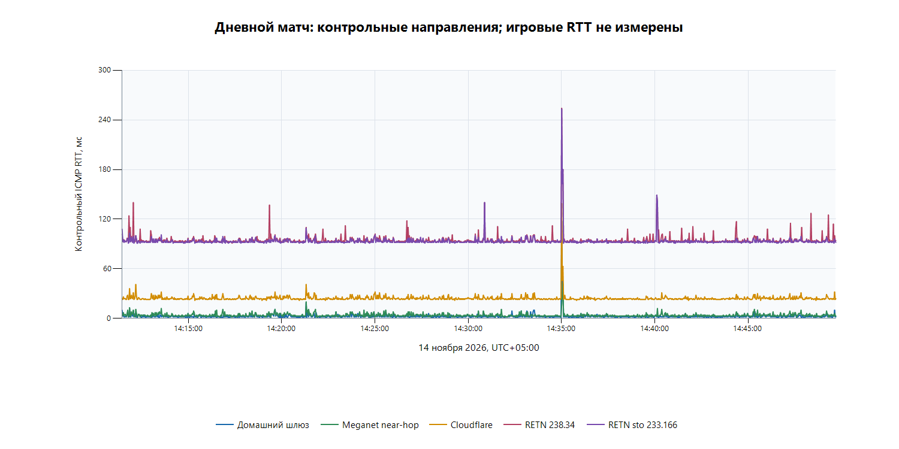
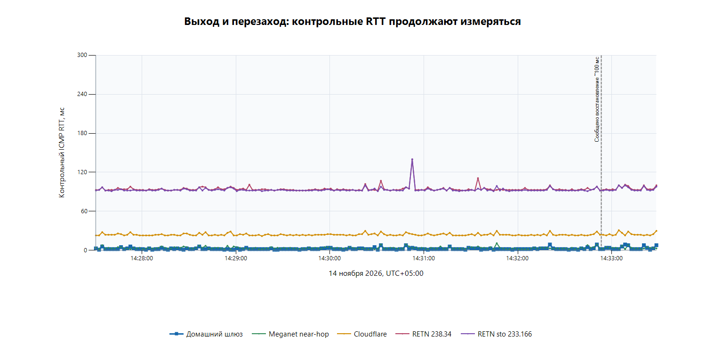
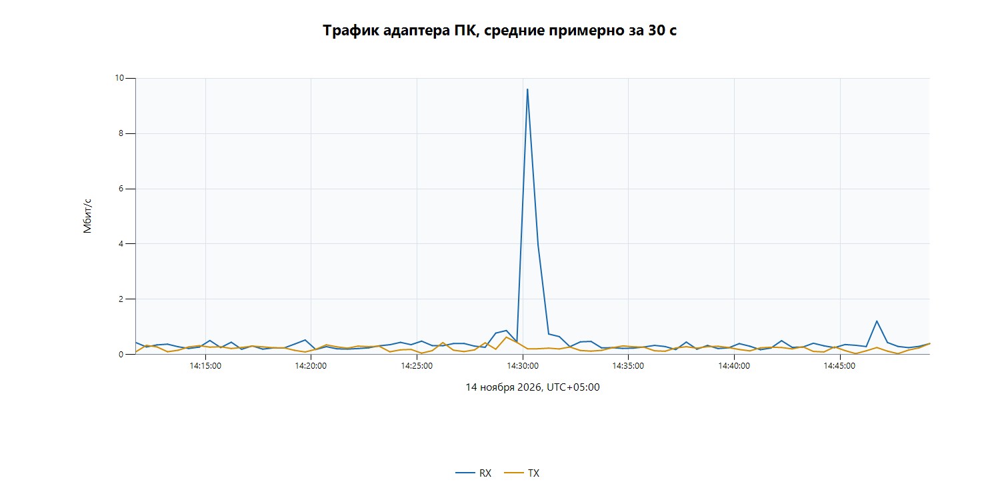
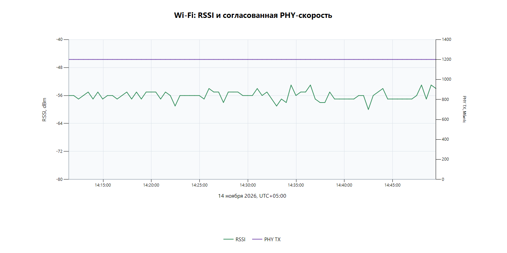

# Итог дневного наблюдения 14 ноября

Рейтинговый Stockholm выбран игроком. Дневной сбор 14:11:26.498–14:49:44.196 (+05:00), 1149 циклов и 5745 успешных контрольных ICMP-проб. Причина игрового RTT и источник игровых потерь не установлены.

## Контрольные направления всего матча

|Цель|n|min|median|avg|p95|max, мс|ICMP неответы|
|---|---|---|---|---|---|---|---|
|192.168.123.1|1149|1.0|2.0|2.747|6.0|118.0|0|
|89.38.164.205|1149|2.0|3.0|3.976|8.0|43.0|0|
|1.1.1.1|1149|22.0|24.0|24.425|28.0|139.0|0|
|87.245.238.34|1149|91.0|93.0|94.822|100.0|254.0|0|
|87.245.233.166|1149|91.0|92.0|93.386|97.0|253.0|0|

Пороговые классы: 1122 цикла ниже всех порогов, 22 с превышением только RETN, 1 публичный без локального порога, 4 локальных. Пороги 15/16/38/109/106 мс, порядок целей как в таблице. Эти классы не измеряют длительность игровой деградации и потери.

## Главный эпизод 300–400 мс

Исходный игровой диапазон 89–95 мс сообщён игроком. Затем повторные колебания, ретроспективный порядок 95→120→180→120. В плотном окне F8/F9 14:19:15.263–14:22:15.150 по 90 проб на цель; медианы 2/4/24/94/93 мс, максимумы 19/20/41/137/109. Максимумы могли возникнуть в разные циклы.

Новая серия F8 начинается 14:27:50.587. В 14:29:10.353 внесено сообщение о продолжающихся 300–400 мс; позднее длительность оценена примерно в пять минут. Начало и конец этой фазы точно не измерены. Численные игровые потери в дневном матче не сообщены.

Полезное короткое окно контроля: **14:29:10.353–14:29:58.079 (+05:00)**, после сообщения и до последнего снимка прежнего игрового процесса:

|Цель|n|min|median|avg|p95|max, мс|ICMP неответы|
|---|---|---|---|---|---|---|---|
|192.168.123.1|24|1.0|2.0|2.042|3.0|3.0|0|
|89.38.164.205|24|2.0|3.0|3.292|5.0|5.0|0|
|1.1.1.1|24|22.0|24.0|23.583|25.0|25.0|0|
|87.245.238.34|24|92.0|93.0|93.083|94.0|95.0|0|
|87.245.233.166|24|91.0|92.0|92.25|93.0|93.0|0|

Это существенное расхождение между сообщённым игровым RTT и контрольными направлениями в близком окне. Оно не поддерживает объяснение всей фазы длительным одинаковым ростом задержки на всех измеренных направлениях. Контроли не адресованы игровому peer: специфический игровой маршрут, обратное направление, UDP-очереди, а также клиент/сервер остаются возможными объяснениями. Виновная сторона не установлена.

## Перезаход и восстановление

Игрок самостоятельно вышел и вернулся. Старый процесс присутствовал в снимке 14:29:58, отсутствовал 14:30:28/58; новый обнаружен 14:31:28. Это дискретные снимки раз в ~30 секунд. Монитор продолжал работу.

До выхода штатные игровые записи содержат 185.40.64.1:7004; после — 162.249.72.1:7004, включая GameNetDriver/RemoteAddr. В 14:32:53.416 внесено сообщение ~100 мс, в 14:42:38.073 — стабильные 100–110 мс. После матча игрок связал поздние F8 с 120–130 мс. [Безопасное сравнение адресов](../06_destinations/reconnect-comparison.json).

Совпадение смены адреса и восстановления — зацепка для проверки. Перезапуск одновременно меняет состояние клиента, поэтому это не причинный A/B и не доказательство смены физического сервера, транзита или неисправности Meganet.

## Краткие локальные всплески и нагрузка

В **14:35:00.503** контрольные RTT составили **118/16/139/254/253 мс**; следующие два цикла 25/26/46/163/163 и 41/43/63/180/180. Уже шлюз ответил медленнее, но этот краткий эпизод после восстановления не объясняет прежние пять минут 300–400. Рядом нет F8 и численного игрового RTT.

77 системных снимков: Wi-Fi connected, 5 ГГц, канал 36, RSSI −60…−53 dBm; один наблюдаемый AP и один вариант выбранных контрольных маршрутов. Максимальные средние RX/TX за ~30 с — 9.599/0.634 Мбит/с. Отсутствие длительного насыщения самим ПК не исключает микровсплесков, других устройств, retries или очередей.

[Хронология](../05_timeline/CHRONOLOGY.md), [сырые пробы CSV](../02_measurements/D01-day-continuous/probes.csv), [метрики окон](../04_summary/incident-window-metrics.csv). Числа в отчёте пересчитаны по экспортированным пробам; все показатели совпали с сохранённым анализом.
