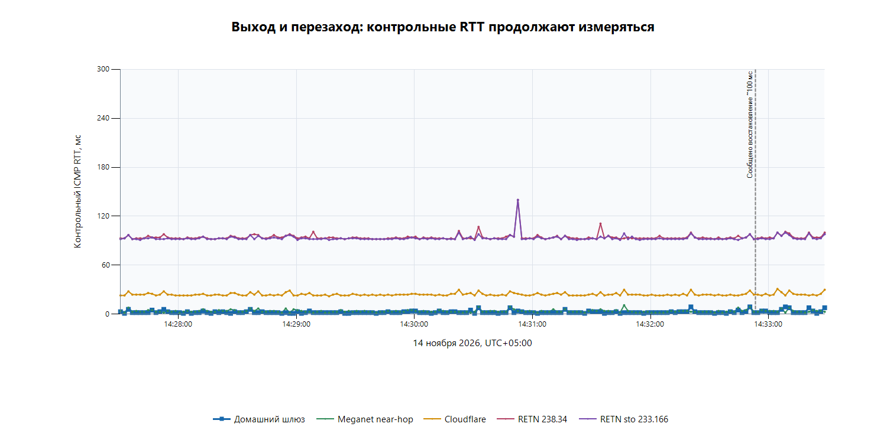

# Итоговый технический отчёт: Valorant, 13–14 ноября 2026

**Измерения показывают несколько разных паттернов; причина игрового RTT и виновная сторона не установлены.** Главная зацепка — сообщённые длительные игровые 300–400 мс 14 ноября при спокойных контрольных направлениях в близком окне. Есть также отдельные краткие локальные/общие всплески, которые нельзя скрывать или автоматически переносить на весь игровой инцидент.

## Что можно проверить

Около 14:29:10–14:29:58 (+05:00) по 24 ICMP-пробы к каждой цели дали:

|Цель|n|min|median|avg|p95|max, мс|ICMP неответы|
|---|---|---|---|---|---|---|---|
|192.168.123.1|24|1.0|2.0|2.042|3.0|3.0|0|
|89.38.164.205|24|2.0|3.0|3.292|5.0|5.0|0|
|1.1.1.1|24|22.0|24.0|23.583|25.0|25.0|0|
|87.245.238.34|24|92.0|93.0|93.083|94.0|95.0|0|
|87.245.233.166|24|91.0|92.0|92.25|93.0|93.0|0|

Игровые 300–400 мс — ручное сообщение, внесённое 14:29:10.353, длительность примерно пять минут со слов игрока. Это не синхронный автоматический ряд игры. Контроли относятся к другим адресам; они не измеряют UDP и обратный путь конкретного матча. Разница полезна для поиска специфического игрового маршрута/очереди/обратного пути, но совместима и с клиентским/серверным состоянием.

После самостоятельного перезахода сообщены ~100, затем 100–110 мс. В штатных логах до/после — 185.40.64.1:7004 → 162.249.72.1:7004. Связь с игровыми записями подтверждена, причинность и физическая локация адресов — нет.

## Остальные значимые результаты

Ночные короткие серии и непрерывный запуск содержат 7125 пригодных ICMP Success, дневной — 5745. Всего **12870 пригодных основных проб без ICMP неответов**, дополнительно **335 попыток H01 контроля качества**. Нули ICMP не отменяют сообщённые игровые потери. На раннем baseline игра показывала общие потери 1% и входящие 3%; в дневном матче количественный loss не сообщён.

Первый скриншотный RTT avg/max 185/189 мс попал в пробел мониторинга около 00:03–00:06. Его нельзя объяснить данными более поздней серии. Ночью шлюз достигал 140 мс одновременно с внешними RTT; днём отдельный эпизод 14:35 дал шлюз 118 мс. Они подтверждают краткий локальный/общий вклад, но механизм Wi-Fi/AP/ПК не разделён.

Снимки выбранных контрольных маршрутов не обнаружили смены пути на ПК; редкость снимков не исключает кратких изменений и ничего не доказывает о внешнем/обратном маршруте. Низкие средние скорости адаптера не исключают очередей, других устройств и микровсплесков. Bufferbloat и влияние Wi-Fi не установлены и не исключены; Ethernet A/B не выполнялся.

## Что передать на проверку

Просим проверить оба игровых адреса, прямое и обратное направления, возможные очереди/дропы и различия хорошей/плохой фаз. Подробнее — [запрос инженерам](ENGINEER-REQUEST.md). По ICMP к отдельным интерфейсам нельзя назначать виновными Meganet, RETN или Riot. Пароли, токены и абонентские идентификаторы для чтения этого пакета не нужны.

## Порядок чтения

- [Дневной итог и эпизод 300–400](DAY-2026-11-14.md).
- [Вечерний и ночной итог](NIGHT-2026-11-13_14.md).
- [Первоначальный baseline](BASELINE-2026-11-13.md), отдельно от новых измерений.
- [Хронология](../05_timeline/CHRONOLOGY.md), [адреса](../06_destinations/DESTINATIONS.md), [трассировки](../03_routes/ROUTES.md).
- [Методика и ограничения](METHODOLOGY.md), [сводные метрики](../04_summary/session-metrics.csv).
