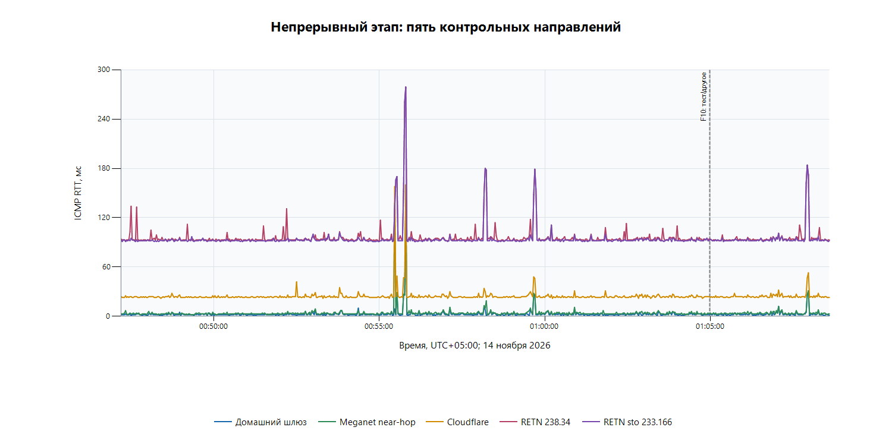
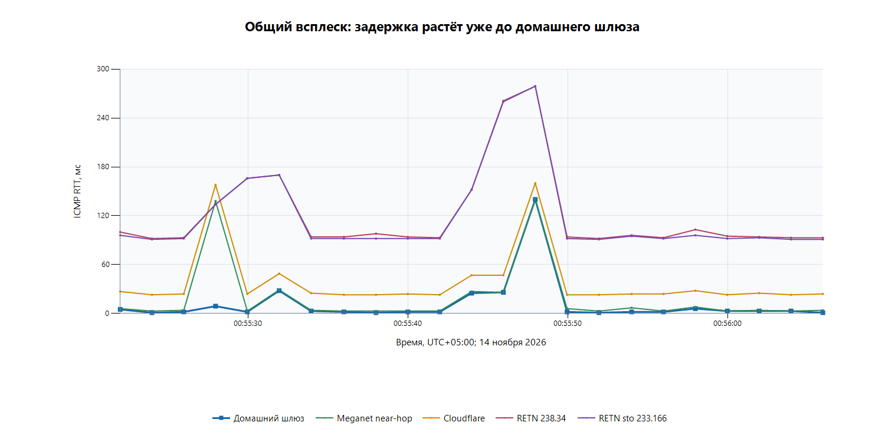
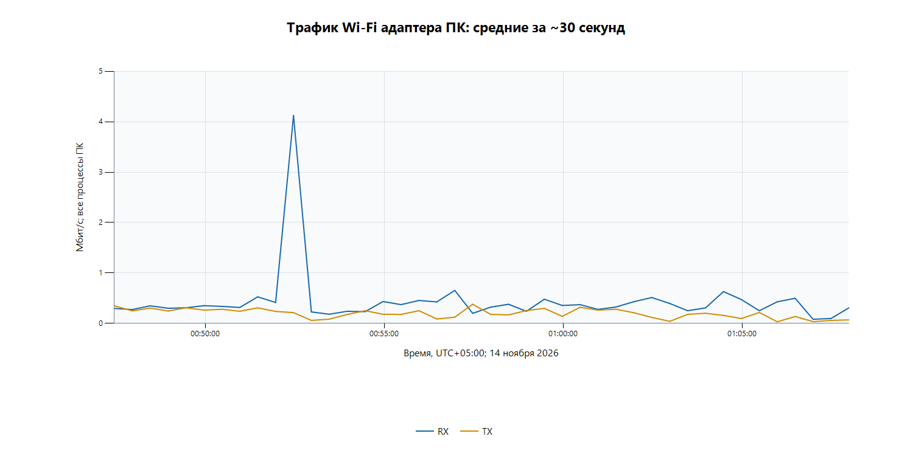
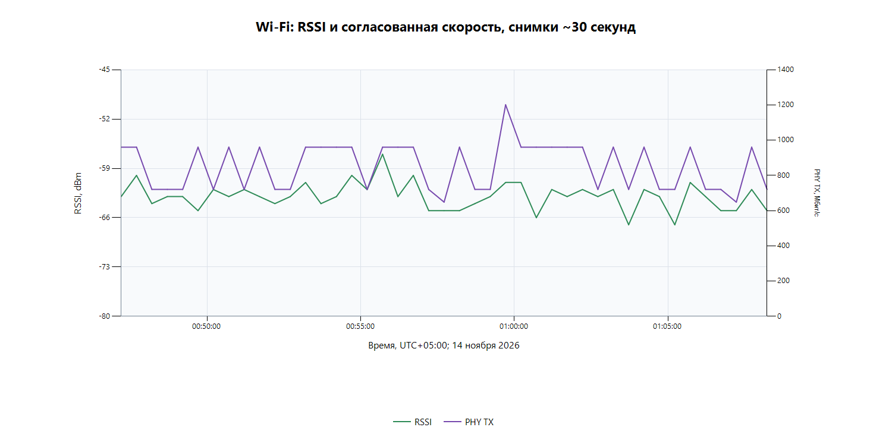

# Итог вечернего и ночного этапа 13–14 ноября

## Окна измерений

|Серия|Окно отправки +05:00|Циклов|Пригодна для неответов|Контекст|
|---|---|---|---|---|
|H01-early-quality-only|2026-11-13T23:42:36.0222035+05:00 — 2026-11-13T23:44:48.1259419+05:00|67|нет, контроль качества|Range|
|H02-range|2026-11-13T23:46:10.2352884+05:00 — 2026-11-13T23:50:48.2290034+05:00|140|да|Range|
|H03-transition|2026-11-13T23:50:55.9545789+05:00 — 2026-11-13T23:53:15.9988663+05:00|71|да|Unknown|
|H04-stockholm-unrated|2026-11-13T23:53:24.6167092+05:00 — 2026-11-14T00:03:20.7418197+05:00|299|да|Stockholm-unrated|
|H05-stockholm-incident|2026-11-14T00:06:13.6965930+05:00 — 2026-11-14T00:10:17.7858644+05:00|123|да|Stockholm-unrated|
|H06-stockholm-recovery|2026-11-14T00:10:25.3300008+05:00 — 2026-11-14T00:15:21.3577941+05:00|149|да|Stockholm-unrated|

H01 не используется для оценки потерь из-за ранних TimedOut. Ночные пригодные короткие серии плюс N01 содержат 7125 успешных ICMP-проб без зарегистрированных неответов; это не исключает игровых UDP-потерь.

## Игровые свидетельства

13 ноября игрок сообщил Range 100–110 мс, начало обычного Stockholm 90–100 с одним 110. Позже в сохранённом отчёте описан скриншот игрового RTT avg/max 185/189 мс, текущие потери 0%, накопленный счётчик 48. Первый пик попал в пробел 00:03:21–00:06:13; причина этого пика по контролям не локализуется. После возобновления сообщались колебания 100–180, затем восстановление 91–96 мс. Числа не являются автоматическим непрерывным игровым рядом. Скриншоты с потенциальными именами игроков в пакет не включены.

## Непрерывный ночной запуск N01

00:47:11.922–01:08:36.533 (+05:00): 643 цикла, 3215 Success; исходный журнал 3299 записей без разрыва. Контекст игры Unknown. Единственная F10 01:04:58.948 позднее уточнена как тест кнопки/другое событие и не считается скачком или восстановлением.

|Цель|n|min|median|avg|p95|max, мс|ICMP неответы|
|---|---|---|---|---|---|---|---|
|192.168.123.1|643|1.0|2.0|2.942|6.0|140.0|0|
|89.38.164.205|643|2.0|3.0|4.308|7.0|140.0|0|
|1.1.1.1|643|22.0|24.0|24.656|27.0|160.0|0|
|87.245.238.34|643|91.0|93.0|96.275|105.0|279.0|0|
|87.245.233.166|643|91.0|92.0|94.58|96.0|279.0|0|

Пороги как в дневном отчёте. 8 циклов с локальным превышением, 19 только RETN, 2 near-hop без шлюза, 1 публичный без локального порога, 613 ниже всех. В **00:55:47.927** шлюз/near/CF/RETN-1/RETN-2 = **140/140/160/279/279 мс**. Краткий локальный/общий вклад подтверждается, но Wi-Fi, AP/роутер, планирование ПК и стек не разделены.

В 00:47:29.923 один RETN отвечал 134 мс при втором 95, шлюзе 1, near 3, CF 24. В 00:58:11.956 — 8/10/30/180/180. Превышения отдельных интерфейсных ICMP не доказывают дроп пересылаемых пакетов или вину транзита. Контрольные маршруты и их обратные пути могут отличаться от игрового.

43 системных снимка: 5 ГГц/канал 36, RSSI −67…−57 dBm, RX PHY 1201 Мбит/с; TX 648.5/720.5/960.5/1201. Средний максимум RX/TX за ~30 с — 4.125/0.381 Мбит/с; в интервале главного локального пика — 0.456/0.254. Изменение PHY нормально возможно при адаптации, но механизм не установлен. Зарегистрированных WLAN-разрывов в проверенном окне не найдено; короткие помехи/retries этим не исключаются. NIC errors/discards не выросли, но они не равны игровым потерям.

В трёх снимках контрольный путь выбирал Wi-Fi через домашний шлюз. Конкурирующий VPN default не был выбран для этих целей в эти моменты; интервалы между снимками не проверены. Около 00:59:37 шла публикация проекта рядом с локальными всплесками; влияние этого фонового трафика не измерено.

## Игровые адреса и предел вывода

В ограниченном лог-извлечении встречались переходы 185.40.64.1:7039 → :7329 → :7415 → :7382 → :7354. Нельзя считать весь вечер одним неизменным потоком. Сохранённый TTL-проход к 185.40.64.1 показал отвечающие интерфейсы шлюза, 10.0.0.229, 89.38.164.205, 89.38.167.209, 87.245.238.34 и 87.245.233.166; конечный адрес не ответил до TTL 16. Это не 100% игрового loss и не локализация причины. Полный оригинал и исправленная интерпретация адресов timeout находятся в [разделе маршрутов](../03_routes/ROUTES.md).

Причина игрового RTT/loss не установлена; нужны одновременные игровые показания и проверка конкретного пути в плохой и хорошей фазах. Для локальных всплесков полезен отдельно согласованный Ethernet/Wi-Fi A/B.
